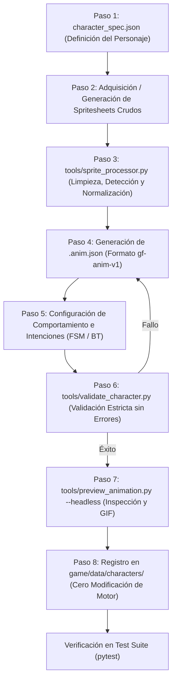

# AGENT_ANIMATION_WORKFLOW.md — GAMEFORGE 2D
## Flujo de Trabajo Automatizado para Agentes de IA: Creación, Validación e Integración de Personajes y Animaciones

**Estado:** PROTOCOLO NORMATIVO PARA AGENTES  
**Misión:** MISIÓN 002 — Sprites, Animaciones y Lógica de Personajes  
**Fecha:** 2026-11-07  
**Público Objetivo:** Agentes Autónomos de IA (Claude, Gemini, GPT) y Desarrolladores  

---

## 1. Resumen Ejecutivo

Uno de los pilares estratégicos de **GameForge 2D** es que los agentes autónomos puedan expandir el universo del juego creando nuevos personajes, enemigos y animaciones completas **sin tener que modificar ni una sola línea del motor central (`game/`)**.

Este documento define el **Pipeline Automatizado de 8 Pasos** que cualquier agente debe seguir para:
1. Redactar la especificación declarativa del personaje.
2. Ingerir y limpiar imágenes o spritesheets crudos.
3. Generar atlas empacados y normalizados respecto al suelo.
4. Redactar el manifiesto formal `gf-anim-v1`.
5. Configurar la máquina de estados y el árbol de comportamiento.
6. Validar matemáticamente que no existan fotogramas faltantes o cajas corruptas.
7. Generar una previsualización autónoma (GIF animado headless).
8. Registrar el personaje dinámicamente en el catálogo de juego.

---

## 2. Diagrama del Flujo de Trabajo del Agente



---

## 3. Guía Paso a Paso del Pipeline

### Paso 1: Definición Declarativa de la Ficha del Personaje
El agente redacta un archivo `character_spec.json` que define el arquetipo, rol y lista de animaciones obligatorias:

```json
{
  "character_id": "swamp_troll",
  "name": "Trol de las Ciénagas",
  "role": "elite_enemy",
  "base_stats": {
    "max_hp": 85.0,
    "speed": 80.0,
    "damage": 22.0,
    "poise": 40.0
  },
  "required_clips": ["idle", "walk", "attack_slam", "hurt", "die"],
  "visual_theme": "bruto pesado con mazo de piedra, piel verdosa y lodo"
}
```

### Paso 2: Adquisición o Generación del Spritesheet Crudo
El agente descarga, genera o ubica el archivo de imagen en la carpeta temporal de trabajo:
`assets/sprites/raw/swamp_troll_raw.png`.

### Paso 3: Limpieza y Normalización con `tools/sprite_processor.py`
El agente ejecuta la herramienta de desarrollo que implementa los algoritmos investigados en `rsheet`:
```bash
python tools/sprite_processor.py \
    --input assets/sprites/raw/swamp_troll_raw.png \
    --output-dir assets/sprites/enemies/swamp_troll/ \
    --remove-bg \
    --tolerance 8 \
    --anchor bottom-center \
    --pack-atlas
```
- **Acciones realizadas automáticamente:**
  1. *Remoción de fondo:* K-Means en bordes y flood-fill alfa para eliminar fondos sólidos.
  2. *Detección de fotogramas:* Detección geométrica de islas de píxeles sin requerir rejilla fija.
  3. *Ground Normalization:* Cálculo de desfases $(\Delta x, \Delta y)$ respecto al contacto con el suelo para anular el temblor (*jittering*).
  4. *Empacado:* Generación de `swamp_troll_atlas.png` con márgenes de extrusión de 1px.

### Paso 4: Redacción del Manifiesto `swamp_troll.anim.json`
El agente genera el archivo de animación conforme a la especificación `ANIMATION_FORMAT_SPEC.md`:
- Asigna identificadores a cada fotograma (`idle_0`, `walk_0`, etc.).
- Define duraciones en milisegundos.
- Coloca sockets clave: `hand_right` para el mazo, `head` para efectos de aturdimiento, `shadow` para la proyección en el suelo.
- Delimita las cajas `hurtboxes` del cuerpo del trol y las `hitboxes` activas del mazo en el frame de impacto de `attack_slam`.
- Añade eventos de sincronización:
  ```json
  "events": [
    { "name": "play_sfx", "payload": { "sfx_id": "heavy_hammer_impact" } },
    { "name": "screen_shake", "payload": { "trauma": 0.35 } },
    { "name": "spawn_particle", "payload": { "type": "mud_sparks", "count": 16 } }
  ]
  ```

### Paso 5: Configuración de la Lógica (FSM y Behavior Tree)
El agente crea `swamp_troll.behavior.json` definiendo la toma de decisiones sin escribir código Python:

```json
{
  "entity_id": "swamp_troll",
  "behavior_tree": {
    "type": "Selector",
    "children": [
      {
        "type": "Sequence",
        "description": "Atacar si el jugador está a corta distancia",
        "children": [
          { "type": "Condition", "name": "IsTargetInDistance", "args": { "max_dist": 48.0 } },
          { "type": "Cooldown", "duration_s": 2.5, "child": {
            "type": "Action", "name": "ExecuteClip", "args": { "clip": "attack_slam" }
          }}
        ]
      },
      {
        "type": "Sequence",
        "description": "Perseguir al jugador si hay línea de visión",
        "children": [
          { "type": "Condition", "name": "HasLineOfSightToTarget" },
          { "type": "Action", "name": "MoveTowardsTarget", "args": { "speed": 80.0, "clip": "walk" } }
        ]
      },
      {
        "type": "Action",
        "description": "Vagabundear en reposo",
        "name": "Wander",
        "args": { "speed": 30.0, "clip": "walk", "idle_clip": "idle" }
      }
    ]
  }
}
```

### Paso 6: Validación Estricta con `tools/validate_character.py`
Antes de considerar terminada la tarea, el agente debe ejecutar el validador automático:
```bash
python tools/validate_character.py --character assets/sprites/enemies/swamp_troll/swamp_troll.anim.json
```

**Batería de Comprobaciones Automatizadas:**
- [x] La imagen del atlas existe y se puede decodificar correctamente con `pygame.image.load()`.
- [x] Todos los rectángulos de fotogramas están completamente contenidos en el atlas.
- [x] Ningún fotograma tiene dimensiones cero o negativas.
- [x] Todos los clips requeridos (`idle`, `walk`, `hurt`, `die`) están definidos.
- [x] Ningún clip referencia fotogramas inexistentes (*dangling references*).
- [x] Las hitboxes poseen parámetros de daño y retroceso válidos.
- [x] Las duraciones de los frames son $\ge 20 \text{ ms}$ y $\le 2000 \text{ ms}$.

Si el validador reporta errores, el agente recibe el informe detallado, corrige el JSON y repite la validación hasta obtener `[OK]`.

### Paso 7: Previsualización Autónoma Headless
Un agente de IA no tiene ojos humanos para mirar una ventana interactiva abierta en el escritorio. Para validar visualmente el resultado:
```bash
python tools/preview_animation.py \
    --manifest assets/sprites/enemies/swamp_troll/swamp_troll.anim.json \
    --clip attack_slam \
    --export-gif artifacts/previews/swamp_troll_attack.gif \
    --draw-boxes \
    --fps 20
```
- La herramienta genera un GIF animado en el directorio de artefactos con:
  - Los sprites animados correctamente centrados en su pivote de suelo.
  - La sombra proyectada debajo de los pies.
  - La silueta de la `Hurtbox` en verde translúcido.
  - La silueta de la `Hitbox` en rojo translúcido durante los frames de impacto.
- El agente (o el usuario humano) puede inspeccionar el archivo generado para confirmar que la animación es impecable.

### Paso 8: Integración en el Juego sin Tocar el Motor Central
El catálogo de entidades (`game.entities.enemy_catalog`) escanea automáticamente la carpeta de datos `game/data/characters/` o `assets/sprites/enemies/`:
- Todo subdirectorio que contenga un par `*.anim.json` y `*.behavior.json` válido se registra dinámicamente como un tipo de enemigo o NPC disponible en el generador de mazmorras (`DungeonGenerator`) o en el cargador de mapas de Tiled (`TiledLoader`).
- El agente **no necesita editar `player.py`, `enemies.py`, ni `combat.py`**.

---

## 4. Matriz de Autochequeo para el Agente (Checklist del DoD)

Antes de reportar la finalización de una tarea de creación de personaje, el agente debe verificar cada uno de los siguientes puntos:

| Criterio de Aceptación | Método de Comprobación | Estado Requerido |
|---|---|---|
| **Formato JSON Válido** | `python -m json.tool <archivo>.anim.json` | Cero errores de sintaxis |
| **Validación de Esquema** | `tools/validate_character.py` | Salida: `ALL CHECKS PASSED` |
| **Clips Mandatorios** | Comprobación de `idle`, `walk`, `hurt`, `die` | 100% presentes |
| **Ausencia de Jittering** | Comprobación de pivote `[x, y]` al suelo | Coordenadas congruentes |
| **Cero Impacto en Contratos** | Ejecución de `tools/verify.py` | 228+ tests pasando, 0 regresiones |
| **Artefacto de Previsualización** | Generación de GIF en carpeta artifacts | Archivo generado con éxito |

---

## 5. Conclusión

Este flujo de trabajo desacoplado garantiza la autonomía total de los agentes de IA dentro de GameForge 2D. Proporciona herramientas de procesamiento deterministas, validación a prueba de fallos y un canal de extensión puramente orientado a datos (*data-driven*), cumpliendo rigurosamente las directivas de arquitectura y calidad del proyecto.
