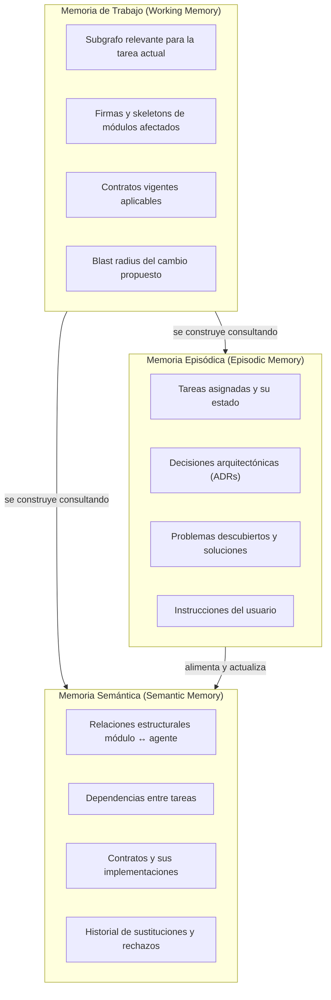
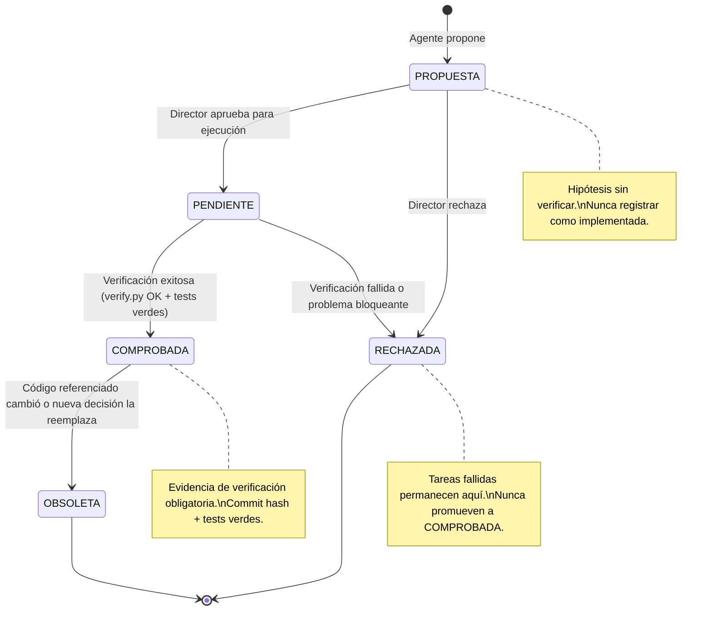
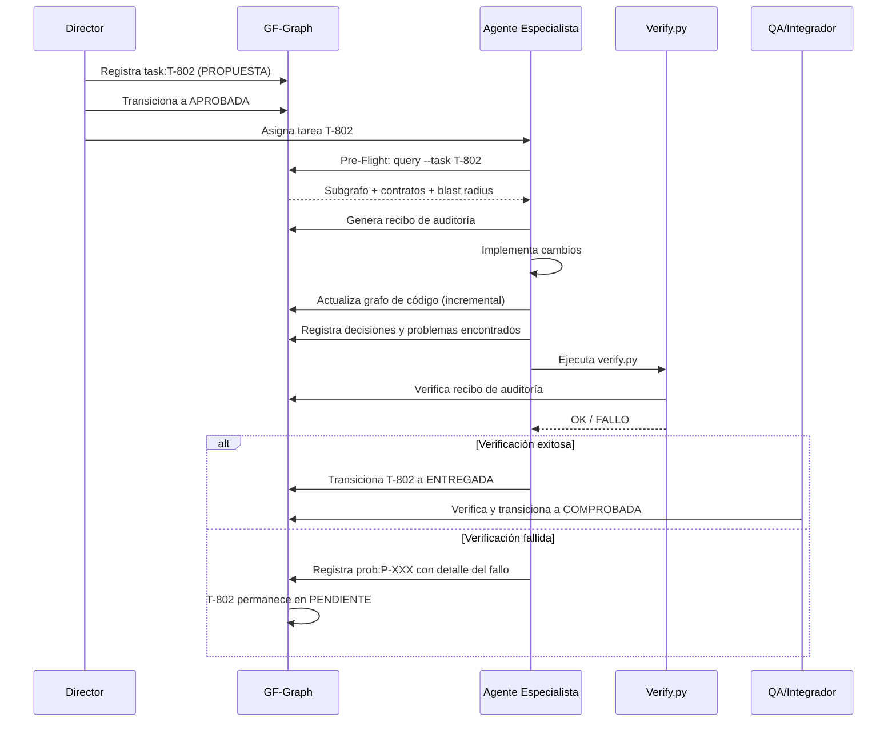

# AGENT_MEMORY_SYSTEM.md — GAMEFORGE 2D
## Sistema de Memoria Persistente para Agentes

**Estado:** ESPECIFICACIÓN TÉCNICA NORMATIVA  
**Misión:** MISIÓN 004 — Sistema de Grafos, Memoria y Contexto Operativo  
**Fecha:** 2026-11-07  
**Autor:** Director / Arquitecto de Sistemas  
**Proyecto:** GameForge 2D (RPG Modular en Python / Pygame CE)  

---

## 1. Modelo de Memoria del Agente

El sistema de memoria de GF-Graph organiza el conocimiento en tres niveles jerárquicos, inspirados en la memoria humana y adaptados de los conceptos de Graphiti (temporalidad bi-temporal) y Cognee (niveles de memoria):



### 1.1. Memoria de Trabajo

Es efímera por sesión. Se construye al inicio de cada tarea mediante el flujo Pre-Flight de 7 pasos. Contiene únicamente el subgrafo de código y conocimiento relevante para la tarea asignada, limitado por presupuesto de tokens.

No se persiste como tal; se reconstruye desde las capas persistentes en cada consulta.

### 1.2. Memoria Episódica

Es persistente y cronológica. Registra **eventos** que ocurrieron durante el desarrollo: qué tarea se asignó, quién la ejecutó, qué decidió, qué falló, qué se verificó. Cada registro incluye timestamps, procedencia y estado epistémico.

Se almacena en la tabla `knowledge_nodes` con categorías como `task`, `instruction`, `problem`, `solution`.

### 1.3. Memoria Semántica

Es persistente y relacional. Modela las **relaciones estables** entre conceptos del proyecto: qué agente es responsable de qué módulo, qué tarea depende de qué otra, qué contrato gobierna qué función.

Se almacena en las tablas `knowledge_edges` y `knowledge_code_links`.

---

## 2. Categorías de Nodos de Conocimiento

Cada nodo de conocimiento se almacena en `knowledge_nodes` con un `node_id` que sigue la convención `<categoría>:<identificador>`:

| Categoría | Prefijo de ID | Descripción | Ejemplo |
|:---|:---|:---|:---|
| `task` | `task:T-XXX` | Tarea del tablero de trabajo | `task:T-802` |
| `adr` | `adr:ADR-XXX` | Decisión arquitectónica registrada | `adr:ADR-008` |
| `instruction` | `instr:I-XXX` | Instrucción directa del usuario o director | `instr:I-015` |
| `problem` | `prob:P-XXX` | Problema descubierto durante desarrollo o testing | `prob:P-003` |
| `solution` | `sol:S-XXX` | Solución verificada para un problema | `sol:S-003` |
| `agent` | `agent:<ROL>` | Registro del agente y su ámbito de responsabilidad | `agent:GAMEPLAY` |
| `contract_change` | `cchg:CC-XXX` | Propuesta o ejecución de cambio en un contrato | `cchg:CC-001` |

---

## 3. Tipos de Aristas de Conocimiento

Las aristas en `knowledge_edges` modelan las relaciones semánticas entre nodos de conocimiento:

| Tipo de Arista | Semántica | Ejemplo |
|:---|:---|:---|
| `ASSIGNED_TO` | La tarea fue asignada al agente | `task:T-802 → agent:GAMEPLAY` |
| `DEPENDS_ON` | La tarea depende de la finalización de otra | `task:T-803 → task:T-802` |
| `SUPERSEDES` | La decisión nueva reemplaza a la anterior | `adr:ADR-009 → adr:ADR-005` |
| `RESOLVES` | La solución resuelve un problema documentado | `sol:S-003 → prob:P-003` |
| `TOUCHES_MODULE` | La tarea modifica archivos de un módulo | `task:T-802 → module:game.sim` |
| `VALIDATES` | El agente QA verificó la tarea | `agent:QA → task:T-802` |
| `BLOCKS` | Un problema bloquea la ejecución de una tarea | `prob:P-004 → task:T-803` |
| `APPROVED_BY` | La propuesta fue aprobada por el director | `cchg:CC-001 → agent:DIRECTOR` |

Las aristas cruzadas entre conocimiento y código (`knowledge_code_links`) usan tipos:

| Tipo | Semántica | Ejemplo |
|:---|:---|:---|
| `GOVERNS` | El contrato o ADR gobierna la implementación del módulo | `adr:ADR-002 → file:game/world/collision.py` |
| `AFFECTS` | La tarea modifica la función | `task:T-802 → func:game.sim.combat:resolve_attack` |
| `VALIDATES_CONTRACT` | El test valida el contrato | `test:test_combat → contract:Player.take_damage` |

---

## 4. Taxonomía Epistémica

Cada nodo de conocimiento posee un campo `epistemic_status` que clasifica su nivel de certeza. El sistema aplica una máquina de estados estricta para las transiciones:



### 4.1. Definiciones precisas

| Estado | Significado | Evidencia requerida | Transiciones permitidas |
|:---|:---|:---|:---|
| **PROPUESTA** | Idea, plan o intención declarada por un agente. No se ha ejecutado ni verificado. | Descripción de la propuesta y agente responsable | → PENDIENTE, → RECHAZADA |
| **PENDIENTE** | Aprobada para ejecución, en curso o esperando verificación. | Aprobación del director + ID de tarea | → COMPROBADA, → RECHAZADA |
| **COMPROBADA** | Implementada, probada y verificada con evidencia real. | Commit hash, resultado de verify.py, recibo de auditoría | → OBSOLETA |
| **OBSOLETA** | Fue verdadera en su momento, pero ya no refleja el estado actual. | Referencia al cambio que la invalidó + `valid_to` seteado | *(terminal)* |
| **RECHAZADA** | Se evaluó y se descartó explícitamente con justificación. | Justificación de rechazo + agente que rechazó | *(terminal)* |

### 4.2. Reglas inviolables

1. **Nunca** transicionar de RECHAZADA a COMPROBADA sin crear un nodo nuevo (no se reutilizan rechazos).
2. **Nunca** transicionar de PROPUESTA directamente a COMPROBADA (siempre pasa por PENDIENTE con verificación).
3. **Nunca** registrar una hipótesis o plan como COMPROBADA sin evidencia de ejecución exitosa.
4. Las transiciones inversas (COMPROBADA→PENDIENTE, OBSOLETA→COMPROBADA) están **prohibidas**. Si se necesita reactivar algo obsoleto, se crea un nodo nuevo que referencia al anterior con arista `SUPERSEDES`.

---

## 5. Procedencia y Trazabilidad

Cada nodo de conocimiento incluye campos obligatorios de procedencia:

| Campo | Tipo | Descripción | Ejemplo |
|:---|:---|:---|:---|
| `responsible_agent` | TEXT | Rol del agente que creó el registro | `GAMEPLAY` |
| `provenance_ref` | TEXT | Referencia a la fuente de verdad | `commit:762a88b`, `file:tasks/BOARD.md#L14` |
| `created_at` | DATETIME | Momento de creación del nodo | `2026-11-07T01:30:00Z` |
| `valid_from` | DATETIME | Inicio de vigencia del conocimiento | `2026-11-07T01:30:00Z` |
| `valid_to` | DATETIME | Fin de vigencia (NULL = vigente) | `NULL` o `2026-11-08T14:00:00Z` |

### 5.1. Temporalidad bi-temporal

Inspirada en Graphiti, la temporalidad bi-temporal distingue entre:

- **Tiempo de transacción** (`created_at`): Cuándo se registró en la base de datos.
- **Tiempo de validez** (`valid_from`, `valid_to`): Cuándo era/dejó de ser verdadero en el mundo real.

Esto permite consultar "¿qué sabíamos en la fecha X?" y "¿qué era verdad en la fecha Y?", esencial para auditorías post-mortem y depuración de decisiones.

---

## 6. Registro de Decisiones Sin Código

No todas las decisiones implican cambios de código. El sistema permite registrar:

### 6.1. Instrucciones del usuario

Cuando el usuario da una instrucción verbal o textual (ej: "No usar Pymunk en este proyecto"), se registra como:

```
node_id: instr:I-002
category: instruction
title: "No usar Pymunk en el vertical slice"
description: "El usuario decidió que la física tile-based es suficiente..."
epistemic_status: COMPROBADA
responsible_agent: DIRECTOR
provenance_ref: "user:session-2026-11-06"
```

### 6.2. ADRs sin commit

Decisiones como "No instalar LangGraph" que no producen archivos de código igualmente se registran como nodos `adr:` con sus justificaciones.

### 6.3. Rechazos explícitos

Cuando se rechaza una propuesta (ej: "No usar Neo4j"), se crea un nodo en estado RECHAZADA con la justificación, para que ningún agente futuro proponga lo mismo sin consultar el historial.

---

## 7. Sincronización Entre Agentes

### 7.1. Protocolo de lectura

Antes de iniciar cualquier tarea, cada agente:

1. Abre conexión de lectura a `.gameforge/graph.db` (SQLite WAL permite lecturas concurrentes).
2. Ejecuta `gf-graph query --task T-XXX` para obtener su memoria de trabajo.
3. Verifica que no existan nodos `PENDIENTE` o `EN CURSO` de otros agentes que afecten los mismos archivos.
4. Si detecta conflicto potencial → **pausa y reporta** al director.

### 7.2. Protocolo de escritura

Al finalizar una tarea, el agente:

1. Adquiere lock de escritura SQLite (`BEGIN IMMEDIATE`).
2. Registra nodo de tarea con resultado (éxito/fallo).
3. Actualiza aristas de conocimiento (nuevas dependencias, problemas descubiertos).
4. Transiciona el estado epistémico correspondiente.
5. `COMMIT`.

### 7.3. Resolución de conflictos

SQLite garantiza serialización de escrituras. Si dos agentes intentan escribir simultáneamente, el segundo recibe `SQLITE_BUSY` y debe reintentar tras un backoff exponencial (máximo 5 reintentos, 100ms-3200ms).

---

## 8. Consulta Contextual

### 8.1. Consulta por tarea

```
gf-graph query --task T-802
```

Retorna:
- Nodo de tarea con su descripción, agente y estado.
- Archivos permitidos (del tablero).
- Subgrafo de código de esos archivos (funciones, clases, imports).
- Contratos aplicables.
- Tests relacionados.
- Tareas recientes que tocaron los mismos módulos.
- Problemas abiertos en esos módulos.

### 8.2. Consulta por módulo

```
gf-graph query module:game.sim.combat
```

Retorna:
- Todas las funciones y clases del módulo.
- Quién importa este módulo y qué importa este módulo.
- Tests que prueban este módulo.
- Tareas históricas que lo modificaron.
- Contratos que lo gobiernan.
- Último agente que lo tocó y cuándo.

### 8.3. Consulta de historial de decisiones

```
gf-graph query --history module:game.world.collision
```

Retorna todos los nodos de conocimiento vinculados al módulo, ordenados cronológicamente, con sus estados epistémicos.

---

## 9. Prevención de Alucinaciones

### 9.1. Principio fundamental

> **Ningún agente puede declarar que comprende un módulo sin evidencia de consulta al grafo.**

La comprensión no se demuestra con afirmaciones textuales; se demuestra con un **recibo de auditoría** que contiene el hash del subgrafo consultado.

### 9.2. Mecanismos de prevención

| Riesgo | Mecanismo de Prevención |
|:---|:---|
| Agente afirma "ya conozco este módulo" sin consultar | Recibo de auditoría obligatorio con hash verificable |
| Agente asume una API que no existe | El skeleton muestra las firmas reales del módulo |
| Agente desconoce un cambio reciente de otro agente | La consulta pre-flight muestra `last_indexed` y tareas recientes |
| Agente propone duplicar funcionalidad existente | El blast radius y las aristas CALLS muestran funciones ya existentes |
| Agente ignora un contrato vigente | La consulta IMPLEMENTS_CONTRACT lista todos los contratos aplicables |

### 9.3. Verificación post-hoc

`tools/verify.py` (una vez integrado con GF-Graph) verifica:
1. Que existe un recibo de auditoría válido para la tarea en entrega.
2. Que el recibo fue emitido **antes** del primer commit de la tarea.
3. Que los archivos modificados están dentro del subgrafo consultado.

---

## 10. Flujo de Registro de una Tarea Completa



---

## 11. Comparación con Alternativas Descartadas

| Característica | GF-Graph (elegido) | Graphiti (descartado) | Cognee (descartado) |
|:---|:---|:---|:---|
| Backend | SQLite local | Neo4j / FalkorDB | LanceDB + DuckDB |
| Extracción de conocimiento | Determinista (parsers) | LLM (costoso en tokens) | LLM (costoso en tokens) |
| Dependencias externas | 0 (solo stdlib + networkx opcional) | Neo4j server + Python client | ~20 dependencias pip |
| Costo por operación | 0 | Llamada LLM por tripleta | Llamada LLM por chunk |
| Temporalidad bi-temporal | ✅ (adoptada de Graphiti) | ✅ (nativa) | ❌ |
| Estados epistémicos | ✅ (5 estados + transiciones) | ❌ (sin clasificación) | ❌ (sin clasificación) |
| Recibos de auditoría | ✅ | ❌ | ❌ |
| Compatible con Python 3.11+ puro | ✅ | ❌ (requiere Neo4j) | ❌ (requiere vector store) |
