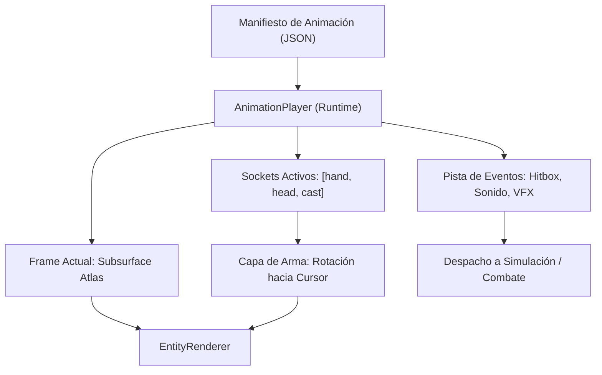

# ANIMATION_SYSTEM_PROPOSAL.md — GAMEFORGE 2D
## Propuesta Arquitectónica del Sistema de Animación (Tradicional, Esquelética e Híbrida)

**Estado:** APROBADO PARA DISEÑO ARQUITECTÓNICO  
**Misión:** MISIÓN 002 — Sprites, Animaciones y Lógica de Personajes  
**Fecha:** 2026-11-07  
**Motor Objetivo:** Python 3.11+ / pygame-ce (v2.5+)  

---

## 1. Resumen Ejecutivo

El sistema de animación de **GameForge 2D** debe satisfacer tres objetivos esenciales:
1. **Fidelidad Estética:** Mantener la estética limpia y responsiva de un Action-RPG / Roguelike 2D en pixel art de alta precisión.
2. **Rendimiento Garantizado:** Procesar la animación de más de 100 entidades simultáneas (jugador, jefes, hordas de enemigos Swarm AI, proyectiles y elementos del entorno) en menos de **2.0 ms de simulación por frame**.
3. **Generación por Agentes de IA:** Permitir que agentes autónomos definan secuencias de animación completas, eventos sincronizados y clips reutilizables mediante especificaciones declarativas legibles en JSON.

Este documento compara rigurosamente los dos grandes paradigmas de animación 2D (fotograma a fotograma tradicional vs animación esquelética por huesos), analiza las herramientas candidatas (**Skelform**, **PySpine**, **Spine Runtime**, **Aseprite**) y establece la **arquitectura definitiva híbrida** recomendada para GameForge 2D.

---

## 2. Comparativa: Animación Tradicional vs. Animación Esquelética

### 2.1 Paradigma Tradicional por Fotogramas Clave (*Frame-by-Frame Spritesheets*)
- **Mecanismo:** Cada fotograma es una imagen rasterizada independiente con su propia pose y detalle de pixel art.
- **Ventajas:**
  - Control pixel a pixel absoluto por parte del artista o agente. Sin distorsiones de perspectiva ni deformaciones borrosas en las líneas de pixel art.
  - Coste de CPU de renderizado en runtime casi nulo: una simple llamada a `blit()` con una subsuperficie ya en memoria.
  - Cero dependencias matemáticas en tiempo de ejecución (sin cálculo de jerarquías de matrices ni transformaciones afines complejas).
- **Desventajas:**
  - Mayor consumo de memoria VRAM si las animaciones son extremadamente largas o complejas.
  - Dificultad para variar equipamiento o armas si no se dibujan todas las combinaciones o se utiliza un sistema modular paperdoll estricto.

### 2.2 Paradigma Esquelético 2D (*Skeletal Cut-Out / Mesh Deformation*)
- **Mecanismo:** Los personajes se construyen como un árbol jerárquico de huesos (*rig*). A cada hueso se le asocia una pieza de sprite (*cut-out*) o vértices de una malla con pesos (*mesh deformation / Free-Form Deformation*).
- **Ventajas:**
  - Reutilización instantánea de animaciones: un rig bípedo puede compartir las mismas animaciones de caminar, atacar y morir entre decenas de personajes y enemigos con distintas apariencias (*skins*).
  - Interpolación continua entre fotogramas clave, permitiendo cámara lenta, tasas de refresco arbitrarias y transiciones fluidas.
  - Soporte de Cinemática Inversa (IK) para adaptar pies al terreno o apuntar armas dinámicamente hacia el cursor del ratón.
- **Desventajas:**
  - **Sobrecarga de CPU:** Calcular matrices locales y mundiales para 15-25 huesos por entidad para 100 enemigos = 2500 multiplicaciones matriciales por frame en Python.
  - **Deformación de Mallas en Pygame:** Pygame-ce no dispone de un pipeline de rasterización de triángulos con interpolación baricéntrica por software optimizado para cientos de sprites deformados en la CPU. Forzar deformación de mallas en software en SDL2 destruye el presupuesto de 60 FPS.
  - **Artefactos en Pixel Art:** Rotar sprites individuales de pixel art con ángulos continuos mediante `pygame.transform.rotozoom` produce aliasing y quiebre de la cuadrícula de píxeles (*pixel mixel*).

### 2.3 Matriz de Decisión Multidimensional

| Dimensión de Análisis | Spritesheet Tradicional (Aseprite / rsheet) | Esquelético Cut-Out (PySpine / SaxonRah) | Esquelético con Malla (Skelform / Spine) |
|---|---|---|---|
| **Consumo de CPU (100 entidades a 60 FPS)** | **Extremadamente Bajo** ($< 0.3 \text{ ms}$) | **Medio** ($1.8 - 3.2 \text{ ms}$) | **Crítico / Inviable en CPU pura** ($> 25 \text{ ms}$) |
| **Consumo de Memoria VRAM** | Moderado ($15 - 40 \text{ MB}$) | **Mínimo** ($2 - 5 \text{ MB}$) | **Mínimo** ($3 - 8 \text{ MB}$) |
| **Estética Pixel Art** | **Perfecta (100% nativa)** | Requiere snapping o downsampling | Ruptura de píxeles / estética vectorial |
| **Cinemática Inversa (IK)** | No nativa (requiere frames) | **Soportada** (2-Bone IK) | **Soportada** (2-Bone IK + Constraints) |
| **Generación y Edición por Agentes** | **Excelente** (matrices y rectángulos JSON) | Buena (árbol de huesos en JSON) | Compleja (mallas, pesos, UVs) |
| **Licencias y Legalidad** | **100% Libre** (formatos abiertos) | **100% Libre** (código abierto MIT) | Spine oficial es restrictivo; Skelform es libre |

---

## 3. Análisis de Herramientas Investigadas

### 3.1 `Retropaint/skelform`
- **Arquitectura:** Editor moderno de animación esquelética escrito en Rust (`wgpu` + `egui`), con runtimes oficiales para Python (`skelform_python`), Unity y Go.
- **Capacidades Destacadas:**
  - Soporte de Inverse Kinematics (IK) con restricciones angulares.
  - Deformación de mallas mediante pesos de vértices y teselación Delaunay.
  - Importación directa de archivos PSD multicapa para generar piezas y slots de rig automáticamente.
  - **Función Clave para GameForge:** Capacidad de **exportar/hornear (baking)** animaciones esqueléticas directamente a hojas de spritesheets rasterizadas a la tasa de fotogramas deseada.
- **Dictamen:** Excepcional para el pipeline offline de creación. Los agentes pueden utilizar rigs de Skelform o sus scripts de exportación para generar spritesheets tradicionales sin incurrir en costes de deformación de malla en runtime.

### 3.2 `SaxonRah/PySpine`
- **Arquitectura:** Suite de 4 editores independientes escritos en Python utilizando Pygame como motor de renderizado:
  1. `PySpine_SpriteSheetEditor.py`: Recorte y selección de fragmentos de sprites con pivotes.
  2. `PySpine_BoneEditor.py`: Jerarquía de huesos (padre-hijo) con capas de profundidad (*Behind, Middle, Front*).
  3. `PySpine_SpriteAttachmentEditor.py`: Vinculación de sprites cortados a huesos con offsets locales y rotación.
  4. `PySpine_AnimationEditor.py`: Línea de tiempo interactiva con fotogramas clave de posición, rotación y escala.
- **Ventajas:**
  - Formato de intercambio totalmente legible en JSON (`sprite_project.json`, `bone_project.json`, `sprite_attachment_config.json`, `bone_animation.json`).
  - Totalmente compatible con la API de Pygame sin dependencias externas en C.
- **Dictamen:** Excelente referencia didáctica y base arquitectónica para el subsistema de rigging modular (*cut-out*) ligero de GameForge 2D.

### 3.3 Esoteric Software Spine Runtime (Referencia de la Industria)
- **Riesgo Crítico de Licencia:** El runtime oficial de Spine requiere que todo aquel que distribuya un juego posea una licencia de pago de Spine (Essential o Professional). **No es permisible bajo las políticas de software libre y auditabilidad de GameForge 2D**.
- Las alternativas abiertas como **Skelform** y formatos abiertos JSON eliminan cualquier riesgo de propiedad intelectual.

---

## 4. Arquitectura Definitiva Recomendada: El Modelo Híbrido

Para combinar la pureza estética del pixel art y el mínimo consumo de CPU con la flexibilidad modular del equipamiento y el apuntado dinámico, GameForge 2D adopta una **Arquitectura Híbrida de Dos Niveles**:

```
[Nivel 1: Animación Base por Spritesheet (Frame-by-Frame)]
 - Cuerpo base, piernas, cabeza y torso animados por fotogramas clave.
 - Cero cálculo matricial por frame para el movimiento general.
 - Garantiza fidelidad pixel art 100%.

[Nivel 2: Sockets Cinemáticos y Apuntado Modular (Cut-out)]
 - El fotograma expone sockets ('hand_mount', 'head_mount', 'cast_point').
 - Los objetos acoplados (armas, báculos, arcos, escudos) se orientan dinámicamente:
   - Rotación libre hacia el vector de apuntado (aim_vector).
   - Sin deformación de malla: rotación de sprite individual con pivote en la empuñadura.
```



---

## 5. El Motor de Animación en Tiempo de Ejecución

### 5.1 Estructura de Datos de Animación (`AnimationState` y `AnimationClip`)
El motor no debe acoplar las animaciones a una clase `pygame.sprite.Sprite` tradicional (que mezcla rectángulos de pantalla, colisiones y dibujo en un solo objeto monolítico). Se divide limpiamente en datos inmutables y estado mutable:

```python
@dataclass(frozen=True, slots=True)
class FrameEvent:
    name: str                 # "hitbox_enable", "spawn_particle", "play_sfx", "step"
    payload: dict[str, object]

@dataclass(frozen=True, slots=True)
class FrameData:
    atlas_rect: tuple[int, int, int, int]  # (x, y, w, h) dentro del atlas
    pivot: tuple[int, int]                  # Punto invariante (normalmente base/suelo)
    duration: float                         # Segundos de duración del frame
    sockets: dict[str, tuple[int, int]]     # Puntos de anclaje de accesorios
    events: tuple[FrameEvent, ...]          # Disparadores de eventos
    hitboxes: tuple[tuple[int, int, int, int], ...]
    hurtboxes: tuple[tuple[int, int, int, int], ...]

@dataclass(frozen=True, slots=True)
class AnimationClip:
    name: str
    frames: tuple[FrameData, ...]
    loop: bool = True
    speed_multiplier: float = 1.0

class AnimationPlayer:
    """Controlador de reproducción con coste O(1) por tick."""
    __slots__ = ("clips", "current_clip", "frame_index", "elapsed_time", "is_finished", "pending_events")
    
    def __init__(self, clips: dict[str, AnimationClip]) -> None:
        self.clips = clips
        self.current_clip: AnimationClip | None = None
        self.frame_index: int = 0
        self.elapsed_time: float = 0.0
        self.is_finished: bool = False
        self.pending_events: list[FrameEvent] = []

    def play(self, clip_name: str, force_restart: bool = False) -> None:
        if not force_restart and self.current_clip and self.current_clip.name == clip_name:
            return
        clip = self.clips.get(clip_name)
        if not clip:
            return
        self.current_clip = clip
        self.frame_index = 0
        self.elapsed_time = 0.0
        self.is_finished = False
        self._enqueue_current_events()

    def update(self, dt: float) -> list[FrameEvent]:
        self.pending_events.clear()
        if not self.current_clip or self.is_finished:
            return self.pending_events
        
        self.elapsed_time += dt * self.current_clip.speed_multiplier
        current_frame = self.current_clip.frames[self.frame_index]
        
        if self.elapsed_time >= current_frame.duration:
            self.elapsed_time -= current_frame.duration
            self.frame_index += 1
            if self.frame_index >= len(self.current_clip.frames):
                if self.current_clip.loop:
                    self.frame_index = 0
                else:
                    self.frame_index = len(self.current_clip.frames) - 1
                    self.is_finished = True
            self._enqueue_current_events()
            
        return self.pending_events

    def _enqueue_current_events(self) -> None:
        if self.current_clip and self.frame_index < len(self.current_clip.frames):
            frame = self.current_clip.frames[self.frame_index]
            self.pending_events.extend(frame.events)
```

---

## 6. Sincronización de Animación y Eventos de Gameplay

### 6.1 Las Tres Fases de una Animación de Acción
Para garantizar combate responsivo y balanceado (estilo *Souls-like / Dead Cells*), toda animación de ataque se divide en 3 ventanas temporales estructuradas:

1. **Anticipación (*Startup / Windup*):**
   - Fotogramas preparatorios (levantar la espada o cargar el hechizo).
   - No hay daño activo. El personaje es vulnerable y su movimiento está ralentizado.
   - Si recibe daño pesado, la animación se interrumpe (*interruptible*).
2. **Impacto Activo (*Active Frames*):**
   - El arma barre el espacio. Las cajas de ataque (`Hitbox`) se activan durante estos fotogramas específicos.
   - Se disparan eventos de sonido (`play_sfx: sword_slash`) y partículas (`vfx: slash_arc`).
   - El código de combate evalúa intersección contra las `Hurtbox` de los enemigos.
3. **Recuperación (*Recovery / Cooldown*):**
   - El personaje recupera el equilibrio. Las hitboxes se desactivan automáticamente.
   - Permite mecánicas de *Cancelación*: por ejemplo, cancelar la recuperación mediante un *Dash / Roll* en un instante preciso si el jugador pulsa esquiva.

```
[Frame 0: Startup] -> [Frame 1: Startup] -> [Frame 2: ACTIVE (Hitbox On)] -> [Frame 3: Recovery] -> [Frame 4: Recovery]
```

### 6.2 Eventos de Sincronización Estándar
Los eventos soportados por el despachador de animación son:
- `hitbox_enable` / `hitbox_disable`: Control estricto de ventanas de daño.
- `spawn_particle`: Emisión de polvo de pasos, destellos de fuego o sangre.
- `play_sfx`: Disparo de efectos de audio con canal dedicado.
- `spawn_projectile`: Momento exacto de soltar una flecha o bola de fuego.
- `apply_impulse`: Movimiento forzado hacia adelante en estocadas (*root motion* simplificado).

---

## 7. Catálogo Estándar de Clips Requeridos por Entidad

Para que cualquier personaje (Jugador o Enemigo) sea completamente funcional en GameForge 2D, el agente debe suministrar los siguientes clips básicos:

| Clip ID | Tipo | Duración Típica | Comportamiento |
|---|---|---|---|
| `idle` | En bucle | 600 - 1000 ms (4-6 frames) | Respiración / descanso en reposo. |
| `walk` | En bucle | 600 - 800 ms (6-8 frames) | Marcha estándar; sincroniza pasos en frames 2 y 6. |
| `run` | En bucle | 400 - 600 ms (6-8 frames) | Desplazamiento rápido; inclina el torso. |
| `jump_start` | Una vez | 100 - 150 ms (2 frames) | Compresión de piernas previa al despegue. |
| `jump_air` | En bucle | 300 ms (2 frames) | Pose en el punto más alto del salto. |
| `jump_fall` | En bucle | 300 ms (2 frames) | Pose de caída acelerada hacia el suelo. |
| `jump_land` | Una vez | 100 ms (2 frames) | Amortiguación al contactar el suelo. |
| `attack_1` | Una vez | 300 - 450 ms (4-5 frames) | Golpe básico horizontal; ventana activa en frame 2. |
| `attack_2` | Una vez | 350 - 500 ms (5-6 frames) | Segundo golpe de combo; ventana activa en frame 3. |
| `dash` | Una vez | 200 - 300 ms (3-4 frames) | Desplazamiento invulnerable con estela de partículas. |
| `hurt` | Una vez | 200 - 300 ms (3 frames) | Parpadeo, retroceso y retroalimentación de impacto. |
| `die` | Una vez | 600 - 900 ms (6-8 frames) | Caída al suelo; queda congelado en el último fotograma. |

---

## 8. Transiciones y Políticas de Interrupción

### 8.1 Por qué evitar el Cross-Fading en Pixel Art
En motores 3D o 2D vectorial, cambiar de una animación a otra se realiza mediante *cross-fading* (interpolación lineal del canal alfa de un sprite mientras desaparece el otro).
- **Problema en Pixel Art:** El fundido cruzado genera dos imágenes translúcidas solapadas ("efecto fantasma") que rompe la nitidez de los píxeles.
- **Solución Óptima:** **Transición por Estados con Prioridad**:
  - Prioridad 1 (Crítica / Ininterrumpible): `die`.
  - Prioridad 2 (Forzada / Reactiva): `hurt` (interrumpe ataques y movimiento).
  - Prioridad 3 (Acción Comprometida): `attack`, `dash` (solo interrumpibles por daño o en su fase de recovery).
  - Prioridad 4 (Locomoción y Reposo): `walk`, `run`, `idle` (transicionan instantáneamente en función de la velocidad del vector de movimiento).

---

## 9. Conclusión y Síntesis Arquitectónica

GameForge 2D adopta:
1. **Pipeline de Reproducción `AnimationPlayer` Desacoplado:** Totalmente puro en memoria, sin referencias a coordenadas de pantalla ni APIs de sonido directas. Devuelve listas de eventos que el orquestador de simulación despacha.
2. **Renderizado de Máximo Rendimiento:** Uso de `subsurface` preconvertidas de atlas compartidos.
3. **Cero Dependencias Pesadas en Runtime:** Todo cálculo de rigs complejos o extracción de hojas se hace offline; el runtime es 100% Python estándar con `pygame-ce`.
