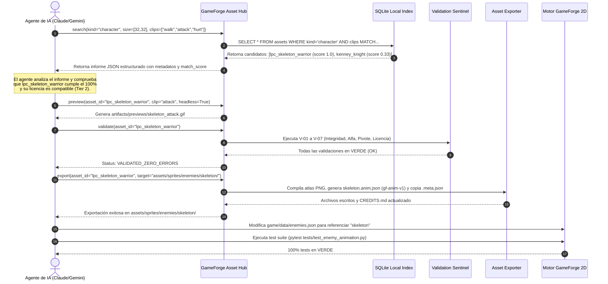

# ASSET_HUB_ARCHITECTURE.md — GAMEFORGE 2D
## Arquitectura del Sistema GameForge Asset Hub: Motor Local de Catálogo, Búsqueda Semántica, Verificación e Ingestión para Agentes de IA

**Estado:** ESPECIFICACIÓN ARQUITECTÓNICA Y DE DISEÑO DE SISTEMAS  
**Misión:** MISIÓN 003 — Asset Ecosystem & GameForge Asset Hub  
**Fecha:** 2026-11-07  
**Autor:** Director / Arquitecto de Sistemas & Especialista en Pipeline de Arte  
**Ubicación Propuesta:** `tools/asset_hub/` (Completamente desacoplado del motor central `game/`)  

---

## 1. Misión, Requisitos No Funcionales e Invariantes del Sistema

### 1.1. Misión
El **GameForge Asset Hub** es un subsistema local, autónomo y sin dependencias de servicios externos en la nube, diseñado para que tanto los agentes de inteligencia artificial (Claude, Gemini, GPT) como los desarrolladores humanos puedan **localizar, inspeccionar, previsualizar, validar rigurosamente y exportar recursos gráficos** para el motor de juego sin tener que abrir ni examinar manualmente cada imagen en el explorador de archivos.

### 1.2. Invariantes Arquitectónicos
1. **Desacoplamiento Estricto del Motor:** El código del Asset Hub reside en `tools/asset_hub/` y opera exclusivamente como herramienta de soporte al desarrollo (*developer/agent tooling*). El bucle de juego en tiempo de ejecución (`game/`) no importa ni depende de esta herramienta.
2. **Cero Alucinaciones de Compatibilidad:** Si un agente solicita un personaje con animaciones de `walk`, `attack` y `hurt`, el sistema únicamente devolverá compatibilidad total (`match_score: 1.0`) si los tres clips existen físicamente y han sido validados. Si solo existe `walk`, reportará compatibilidad parcial (`match_score: 0.33`) y enumerará explícitamente los clips faltantes, impidiendo que el agente genere código roto.
3. **Operación Local y Sin Coste:** No requiere claves de API, servidores de pago ni descargas masivas de repositorios externos. Gestiona los activos ya presentes en el almacenamiento local y permite indexar carpetas montadas o repositorios clonados.
4. **Respeto Absoluto a los Originales:** Los archivos crudos de fuentes externas se tratan como inmutables (*read-only*). Las adaptaciones, recortes y estabilizaciones se generan en directorios de exportación o artefactos.
5. **Rendimiento Ultrarrápido:** El tiempo de consulta de búsqueda debe ser inferior a 5 milisegundos mediante una base de datos local SQLite (`assets/.hub/asset_hub.db`).

---

## 2. Diagrama de Arquitectura de Subsistemas

```mermaid
flowchart TD
    subgraph Fuentes Locales de Arte
        RawKenney["Repositorio Kenney (CC0)"]
        RawLPC["Repositorio LPC (CC-BY-SA)"]
        RawOGA["Colecciones OGA / Tiddybub"]
    end

    subgraph GameForge Asset Hub [tools/asset_hub/]
        Scanner["Scanner & Ingestion Service"]
        Hasher["Hasher (SHA-256 & dHash)"]
        DB[(Local Index SQLite / JSON)]
        SearchEngine["Semantic Query Engine"]
        Validator["Validation Sentinel"]
        Previewer["Headless / GUI Previewer"]
        Exporter["Asset Compiler & Packager"]
    end

    subgraph Agente de IA / Desarrollador
        AgentPrompt["Solicitud Semántica del Agente:
'Personaje humanoide 32x32 con walk, attack, hurt'"]
        CLI["CLI Interface (python -m tools.asset_hub)"]
    end

    subgraph Motor de Videojuego [game/ & assets/]
        EngineAssets["assets/sprites/ | assets/tilesets/ | assets/ui/"]
        AnimSpec["gf-anim-v1.json"]
        EngineRuntime["game.render.animation & TileMap"]
    end

    Fuentes Locales --> Scanner
    Scanner --> Hasher
    Hasher --> Validator
    Validator --> DB

    AgentPrompt --> CLI
    CLI --> SearchEngine
    SearchEngine --> DB
    SearchEngine --> CLI

    CLI --> Previewer
    CLI --> Exporter
    Exporter --> EngineAssets
    Exporter --> AnimSpec
    AnimSpec --> EngineRuntime
```

---

## 3. Desglose de Componentes y Módulos

### 3.1. `tools/asset_hub/scanner.py` (Servicio de Escaneo e Indexación)
- **Función:** Recorre recursivamente las rutas de activos especificadas.
- **Detección de Tipos:** Identifica automáticamente si una imagen es un spritesheet de personaje, un tileset de terreno, un componente de UI 9-slice o un icono aislado mediante heurísticas dimensionales y análisis de bordes.
- **Extracción de Metadatos:** Lee ficheros `.meta.json`, descriptores XML de Kenney o archivos TSX de Tiled si están presentes. Si no existen, sintetiza un manifiesto borrador preliminar.
- **Cálculo Criptográfico y Perceptual:**
  - `sha256`: Detección de duplicados idénticos a nivel de bit.
  - `dhash` (Difference Hash de 64 bits): Detección de imágenes duplicadas que hayan sufrido ligeras variaciones de compresión o metadatos.

```python
def compute_dhash(image_surface: pygame.Surface, hash_size: int = 8) -> str:
    """Calcula el difference hash de 64 bits para detección de duplicados visuales."""
    # Escala la imagen a (hash_size + 1, hash_size) en escala de grises
    scaled = pygame.transform.smoothscale(image_surface, (hash_size + 1, hash_size))
    pixels = pygame.surfarray.pixels3d(scaled)
    # Grayscale = 0.299*R + 0.587*G + 0.114*B
    gray = (pixels[:, :, 0] * 0.299 + pixels[:, :, 1] * 0.587 + pixels[:, :, 2] * 0.114)
    del pixels
    
    # Compara píxeles adyacentes horizontalmente
    difference = gray[1:, :] > gray[:-1, :]
    # Empaca el array booleano de 8x8 en una cadena hexadecimal de 16 caracteres
    decimal_value = 0
    hex_string = []
    for index, val in enumerate(difference.flatten()):
        if val:
            decimal_value += 2 ** (index % 8)
        if (index % 8) == 7:
            hex_string.append(f"{decimal_value:02x}")
            decimal_value = 0
    return "".join(hex_string)
```

---

### 3.2. `tools/asset_hub/db.py` (Base de Datos Local y Caché)
- **Motor:** SQLite integrado en la biblioteca estándar de Python (`sqlite3`), almacenado en `assets/.hub/asset_hub.db`.
- **Rendimiento:** Índices B-Tree en `(kind, visual_style, frame_w, frame_h)` que garantizan consultas en menos de 2 milisegundos para catálogos de hasta 100,000 sprites.
- **Sincronización:** Genera también un archivo exportable en JSON plano (`assets/hub_index.json`) para inspección directa en el editor sin necesidad de un visor de base de datos.

---

### 3.3. `tools/asset_hub/query.py` (Motor de Búsqueda Semántica para Agentes)
Este es el componente central que atiende la consulta del agente. Expone una API en Python y comandos CLI:

#### La Solicitud Canónica del Agente
Cuando el agente ejecuta:
```bash
python -m tools.asset_hub search \
    --kind character \
    --style pixel_art_32x32 \
    --size 32x32 \
    --clips walk,attack,hurt \
    --json
```

El motor ejecuta la siguiente lógica de compatibilidad estricta:
1. Filtra los activos por `kind == 'character'` y dimensiones de fotograma dentro del rango solicitado (o con escalado entero compatible).
2. Para cada activo, compara la lista de clips requeridos contra los clips verificados en la tabla `character_clips`.
3. Calcula el `match_score`:
   $$\text{match\_score} = \frac{|\text{clips\_solicitados} \cap \text{clips\_disponibles}|}{|\text{clips\_solicitados}|}$$
4. Devuelve una respuesta JSON estructurada y no ambigua:

```json
{
  "query": {
    "kind": "character",
    "target_frame_size": [32, 32],
    "required_clips": ["walk", "attack", "hurt"]
  },
  "total_matches": 2,
  "results": [
    {
      "asset_id": "lpc_skeleton_warrior",
      "name": "Guerrero Esqueleto LPC",
      "match_score": 1.0,
      "exact_clip_match": true,
      "found_clips": ["walk", "attack", "hurt"],
      "missing_clips": [],
      "native_frame_size": [64, 64],
      "downscale_compatible": true,
      "license": {
        "spdx": "CC-BY-SA-3.0",
        "tier": "tier_2_copyleft_warning",
        "attribution": "Stephen Challener, Johannes Sjölund"
      },
      "engine_export_command": "python -m tools.asset_hub export lpc_skeleton_warrior --target assets/sprites/enemies/skeleton_warrior"
    },
    {
      "asset_id": "kenney_roguelike_knight",
      "name": "Caballero Roguelike Kenney",
      "match_score": 0.333,
      "exact_clip_match": false,
      "found_clips": ["walk"],
      "missing_clips": ["attack", "hurt"],
      "native_frame_size": [16, 16],
      "upscale_compatible": true,
      "license": {
        "spdx": "CC0-1.0",
        "tier": "tier_0_public_domain",
        "attribution": "Kenney (kenney.nl)"
      },
      "warning": "No apto para combate directo sin generar o simular clips de ataque y daño."
    }
  ]
}
```

---

### 3.4. `tools/asset_hub/validator.py` (Sentinela de Validación Automática)

El sentinela ejecuta 7 pruebas matemáticas y de formato sobre cualquier activo antes de permitir su indexación o exportación:

| Código de Regla | Nombre de la Validación | Criterio de Aprobación | Acción en caso de Fallo |
| :--- | :--- | :--- | :--- |
| **`V-01`** | Integridad de Imagen | El archivo se decodifica limpiamente mediante Pygame CE / PIL sin truncamiento. | Rechazo inmediato; archivo corrupto marcado en log. |
| **`V-02`** | Retícula y Dimensiones | El ancho y alto total de la imagen son múltiplos exactos del tamaño de celda declarado. | Error dimensional: informa el residuo en píxeles. |
| **`V-03`** | Canal Alfa y Transparencia | La imagen contiene canal alfa de 8 bits y no es una superficie 100% opaca ni 100% vacía. | Falla si el fondo es sólido opaco (falta de transparencia). |
| **`V-04`** | Estabilidad de Pivotes | Las coordenadas del anclaje (*pivot*) se ubican dentro de los límites del fotograma y alineadas con la base. | Corrección automática sugerida o rechazo. |
| **`V-05`** | Completitud de Licencia | El archivo `.meta.json` adjunto contiene autor, SPDX válido y URL de origen. | Bloqueo por regla legal (Nivel 3 o Huérfano). |
| **`V-06`** | Detección de Duplicados | La distancia Hamming entre el `dhash` del activo y cualquier otro en la base de datos es $> 4$. | Advertencia de duplicado: identifica el activo existente. |
| **`V-07`** | Verificación de Fotogramas Vacíos | Ningún fotograma declarado en un clip activo está completamente transparente. | Error de contenido: clip con fotogramas ciegos. |

---

### 3.5. `tools/asset_hub/previewer.py` (Previsualizador Headless y Gráfico)
1. **Modo Headless (Orientado a Agentes de IA):**
   - No inicializa ninguna ventana de escritorio (utiliza el driver de vídeo `dummy`).
   - Ensambla los fotogramas del clip seleccionado en un GIF animado de 320x320 píxeles a la velocidad nativa de la animación (`duration_ms`).
   - Dibuja sobreimpresas las cajas de golpe verdes (`hurtboxes`) y rojas (`hitboxes`), así como la cruz de pivote.
   - Guarda el resultado en `artifacts/previews/<asset_id>_<clip>.gif`.
2. **Modo Interactivo (Orientado a Humanos):**
   - Abre una ventana ligera de Pygame CE.
   - Controles de reproducción: Barra espaciadora (Play/Pause), Flechas (Avanzar/Retroceder fotograma individual), Rueda de ratón (Zoom $1\times$ a $8\times$), Tecla `B` (Activar/Desactivar visualización de hitboxes).

---

### 3.6. `tools/asset_hub/exporter.py` (Compilador y Empaquetador para el Motor)
Cuando el agente aprueba un activo y ordena su incorporación al juego:
1. Transforma el spritesheet crudo según las necesidades del motor:
   - Recorta las celdas necesarias y elimina fotogramas no utilizados.
   - Estabiliza los pivotes a la convención canónica `bottom_center`.
   - Empaca la textura final en `assets/sprites/<category>/<asset_id>/<asset_id>_atlas.png`.
2. Escribe el archivo manifiesto compatible con el motor:
   `assets/sprites/<category>/<asset_id>/<asset_id>.anim.json` (esquema `gf-anim-v1`).
3. Registra automáticamente la procedencia y la licencia:
   - Copia el archivo `.meta.json`.
   - Actualiza de forma atómica `assets/README.md` y `CREDITS.md`.

---

## 4. Especificación de la Interfaz de Línea de Comandos (CLI)

El Asset Hub se invoca mediante el módulo estándar de Python:

```bash
# 1. Escanear e indexar un nuevo directorio de recursos
python -m tools.asset_hub scan <ruta_directorio> [--provider kenney|lpc|oga] [--reindex]

# 2. Buscar recursos con filtros semánticos
python -m tools.asset_hub search \
    --kind character|tileset|ui_component|item_equipment \
    --style pixel_art_32x32 \
    --size 32x32 \
    --clips walk,attack,hurt \
    --tags undead,sword \
    --max-tier tier_1_permissive_attribution \
    [--json]

# 3. Inspeccionar los metadatos completos y clips de un recurso
python -m tools.asset_hub inspect <asset_id>

# 4. Validar la integridad y consistencia de un recurso o de todo el catálogo
python -m tools.asset_hub validate [<asset_id>|--all]

# 5. Generar previsualización de una animación (Headless para agentes o ventana para humanos)
python -m tools.asset_hub preview <asset_id> --clip attack_down [--headless] [--output preview.gif]

# 6. Exportar y compilar un recurso hacia el motor del juego
python -m tools.asset_hub export <asset_id> --target assets/sprites/enemies/<nombre_destino>/

# 7. Auditar licencias y reconstruir el archivo de créditos del juego
python -m tools.asset_hub credits --output CREDITS.md
```

---

## 5. Protocolo de Comunicación del Agente de IA

El siguiente diagrama de secuencia ilustra el flujo de trabajo exacto de un agente autónomo para satisfacer la solicitud planteada:



---

## 6. Plan de Entrega e Implementación Futura

Para cumplir con la directiva explícita de la Misión 003 (*"No implementar todavía. Primero presenta la investigación y la arquitectura propuesta"*), este diseño queda registrado para la siguiente fase de desarrollo (Misión 004 / Tarea de Implementación).

Una vez aprobada esta arquitectura por el director del proyecto, la implementación se dividirá en módulos independientes:
1. `tools/asset_hub/db.py`: Esquema SQLite y utilidades de base de datos.
2. `tools/asset_hub/scanner.py` & `hasher.py`: Detección de imágenes y perceptual hash.
3. `tools/asset_hub/validator.py`: Implementación de reglas V-01 a V-07.
4. `tools/asset_hub/previewer.py`: Generador headless de GIF y visor Pygame.
5. `tools/asset_hub/exporter.py`: Compilador hacia esquemas `gf-anim-v1`, `gf-tileset-v1` y `gf-ui-skin-v1`.
6. `tools/asset_hub/cli.py`: Interfaz de comandos unificada.
7. `tests/test_asset_hub.py`: Cobertura exhaustiva de pruebas unitarias y de integración.
