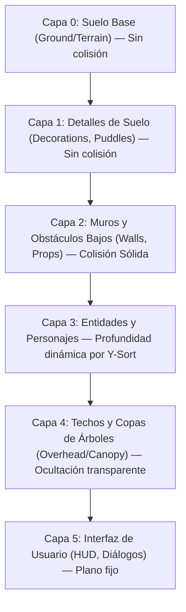

# ASSET_HUB_RESEARCH.md — GAMEFORGE 2D
## Investigación Integral del Ecosistema de Recursos Gráficos, Estándares de la Industria y Análisis de Fuentes

**Estado:** INVESTIGACIÓN TÉCNICA NORMATIVA  
**Misión:** MISIÓN 003 — Asset Ecosystem & GameForge Asset Hub  
**Fecha:** 2026-11-07  
**Autor:** Director / Arquitecto de Sistemas & Especialista en Pipeline de Arte  
**Proyecto:** GameForge 2D (RPG Modular en Python / Pygame CE)  

---

## 1. Resumen Ejecutivo y Motivación

En el desarrollo autónomo y asistido por IA de videojuegos 2D, el acceso y consumo de recursos visuales constituye tradicionalmente uno de los mayores cuellos de botella y fuentes de error. Los agentes de software suelen enfrentar problemas críticos:
1. **Búsqueda ciega y alucinación:** Asumir que una hoja de sprites contiene una animación de "ataque" o "recibir daño" cuando únicamente dispone de "caminar" o un ciclo de movimiento estático.
2. **Incompatibilidad dimensional y espacial:** Mezclar recursos de 16x16 píxeles con recursos de 32x32 o 64x64 sin corrección de densidad, o con anclajes (*pivots*) inconsistentes que producen el indeseable efecto de "personaje tembloroso" (*sprite jitter*).
3. **Riesgo legal y contaminación de licencias:** Incorporar indiscriminadamente gráficos con licencias restrictivas (como Creative Commons No Comercial `CC-NC`, No Derivadas `CC-ND` o copyleft viral `GPL/CC-BY-SA`) sin la debida compartimentación, poniendo en riesgo la integridad legal del proyecto.
4. **Falta de introspección local:** Dependencia de búsquedas web lentas, manuales y no deterministas, en lugar de consultar un catálogo local estructurado, indexado, validado matemáticamente y reproducible.

Este documento presenta una investigación exhaustiva sobre los 10 dominios visuales clave del RPG 2D, evalúa las principales fuentes de activos abiertos recomendadas (`shorepine/kenney`, `LiberatedPixelCup`, `LPC-Style-Guide`, `Tiddybub/2d-assets`, `eturner58/game-assets`, `kenney.nl`, `opengameart.org`) y formula los requisitos de ingeniería para el **GameForge Asset Hub**.

---

## 2. Análisis Comparativo de Fuentes y Repositorios Iniciales

Para fundamentar el ecosistema de GameForge 2D, se han analizado en detalle 7 fuentes de referencia primaria:

| Repositorio / Fuente | Licencia Dominante | Estilo Visual | Resoluciones Clave | Metadatos Disponibles | Fortalezas | Limitaciones para GameForge 2D |
| :--- | :--- | :--- | :--- | :--- | :--- | :--- |
| **`shorepine/kenney`** & **`kenney.nl`** | CC0 1.0 (Dominio Público) | Flat pixel art, cartoon estilizado, clean outline | 16x16 (Roguelike, Tiny Dungeon), 32x32, 64x64, Vector SVG | XML SubTextures, JSON atlas, TSX tilesets | Consistencia geométrica extrema, dominio público total, empaquetado ultra-limpio. | Rango de animaciones de combate limitado (muchos sprites son poses estáticas o ciclos de 2-4 cuadros). |
| **`OpenGameArt/LiberatedPixelCup`** | Dual CC-BY-SA 3.0 / GPLv3 | Pixel art 3/4 top-down clásico (16-bit SNES / GBA) | Base 32x32 tiles; Personajes 64x64 lienzo (cuerpo 32-48px) | Guías de estilo, capas modulares (*paperdoll*), plantillas XCF/PNG | Enorme estándar comunitario unificado; sistema modular de ropa y armas; animaciones completas (walk, slash, thrust, cast, shoot, hurt). | La licencia CC-BY-SA/GPL exige aislamiento de datos; resolución de lienzo (64x64) requiere recorte o anclaje preciso en motores de 32x32. |
| **`OpenGameArt/LPC-Style-Guide`** | CC-BY-SA 3.0 / GPLv3 | Manual de diseño, proporciones y paletas | 32x32 tiles, 64x64 frames de personajes | Documentación formal de perspectiva, ángulo oblicuo (~60°), iluminación cenital norte | Es la "biblia" para interoperabilidad estética; define cómo deben construirse tilesets y animaciones compatibles. | Requiere herramientas de validación para garantizar que nuevos sprites respeten la estricta retícula y paleta. |
| **`Tiddybub/2d-assets`** | CC0 1.0 Universal | Variado (desde retro 8-bit hasta 32-bit pixel) | Múltiples (16x16, 24x24, 32x32, 48x48) | Heterogéneo (PNGs sueltos, algunos spritesheets) | Recursos completamente libres de restricciones de autoría; variedad de criaturas y entornos. | Muy heterogéneo: carece de metadatos estandarizados de animación; requiere indexación y normalización automática. |
| **`eturner58/game-assets`** | MIT / CC-BY / Propietario libre | Pixel art indie, prototipos | 16x16, 32x32 | Ficheros JSON de proyectos específicos | Útil para referencias de diseño y lógica de integración en motores rápidos. | Cobertura parcial; variabilidad en licencias según el subproyecto. |
| **`opengameart.org` (Catálogo General)** | Mixto (CC0, CC-BY, CC-BY-SA, OGA-BY, GPL) | Altamente diverso | Desde 8x8 hasta 128x128 y HD | Tags libres, comentarios, atribuciones en texto plano | El mayor repositorio de arte libre para videojuegos existente en internet. | Calidad muy desigual; metadatos no normalizados; riesgo de contaminación de licencias si no se audita minuciosamente. |

---

## 3. Las 10 Áreas de Investigación Técnica

### 3.1. Personajes y sus Animaciones
#### Dimensiones y Proporciones
En los RPG 2D cenitales (*top-down* / perspectiva oblicua 3/4), coexisten dos escuelas principales:
1. **La Escuela Kenney / Tiny Dungeon (16x16 píxeles compactos):**
   - Altura del personaje: 12 a 16 píxeles.
   - Ocupa exactamente 1 tile del mapa.
   - Animación simple: 2 a 4 fotogramas para caminar; el combate se suele resolver mediante balanceo o desplazamiento del sprite completo (*tweening* / oscilación procedimental).
2. **La Escuela Liberated Pixel Cup (LPC - 64x64 de lienzo, 32x32 base de colisión):**
   - El lienzo de cada cuadro es de 64x64 píxeles para acomodar el rango de balanceo de armas grandes, arcos y capas.
   - El volumen físico del torso y las piernas ocupa aproximadamente 24x32 píxeles centrado en la base.
   - La base de colisión en el suelo se proyecta sobre un círculo de radio 8 a 12 píxeles en la parte inferior del cuadro.

#### Estructura de Direcciones
- **4 Direcciones canónicas:** Abajo (*South*), Izquierda (*West*), Derecha (*East*), Arriba (*North*). Es el estándar de oro en LPC y Kenney RPG.
- **Simetría horizontal:** En la gran mayoría de spritesheets, la dirección *East* es un reflejo exacto horizontal de *West*, ahorrando un 25% de memoria en textura. Sin embargo, para personajes con equipamiento asimétrico (escudo en mano izquierda, parche en el ojo), se requieren las 4 u 8 pistas independientes.
- **8 Direcciones:** Añade diagonales (SO, SE, NO, NE), necesarias para movimiento analógico suave, pero cuadruplica el coste de fotogramas. En GameForge 2D, la proyección canónica es 4 direcciones con blending direccional en el controlador.

#### Repertorio de Acciones Obligatorias para un RPG Funcional
Para que un personaje sea clasificado como "apto para combate activo" en GameForge 2D, debe verificar la existencia real de los siguientes clips:
- `idle`: Mínimo 1-4 fotogramas (respiración o balanceo sutil).
- `walk`: Mínimo 4-8 fotogramas (contacto, paso, caída, impulso).
- `attack_melee`: Mínimo 3-6 fotogramas (anticipación, golpe activo con socket de arma extendido, recuperación).
- `hurt`: Mínimo 2-4 fotogramas (impacto, retroceso con flash de color).
- `death`: Mínimo 3-6 fotogramas (colapso y persistencia del cadáver en el suelo).

---

### 3.2. Spritesheets y Atlas (Atlas de Texturas)
#### Formatos de Distribución
- **Retícula Uniforme (*Uniform Grid*):** Todos los cuadros tienen idéntico ancho y alto ($W \times H$). Típico de Kenney y LPC (ej. retículas de 64x64 dispuestas en filas por dirección).
  - *Ventaja:* Aritmética trivial ($x = \text{frame} \times W$, $y = \text{action} \times H$).
  - *Desventaja:* Desperdicio de espacio transparente en animaciones de reposo.
- **Atlas Empacado (*Packed Atlas* / MaxRects Bin Packing):** Los fotogramas individuales se recortan (*trim*) eliminando bordes transparentes y se empaquetan optimizando el área total en una textura de potencia de dos ($512\times 512$, $1024\times 1024$).
  - *Ventaja:* Ahorro de memoria de vídeo (VRAM) de hasta un 60%.
  - *Desventaja:* Requiere un archivo descriptor (`.json` o `.xml`) con coordenadas exactas `[x, y, w, h]` y offsets originales `[orig_w, orig_h, offset_x, offset_y]`.

#### Prevención de Artefactos de Borde (*Bleeding & Seams*)
Cuando Pygame CE o una GPU escala una textura con filtrado bilineal o mediante subpíxeles, los píxeles adyacentes pueden sangrar en el fotograma activo.
- **Regla obligatoria de empaquetado:** Se exige un margen mínimo (*padding*) de 2 píxeles entre fotogramas y extrusión de bordes (*edge bleed*) para texturas destinadas a interpolación.

---

### 3.3. Mapas y Tilesets
#### Retícula y Perspectiva
- **Resolución estándar en GameForge 2D:** Retícula de 32x32 píxeles por tile.
  - Los tiles de 16x16 son escalables limpiamente con factor entero $2\times$ (mediante escalado *nearest neighbor* en `VirtualCanvas`).
  - Los tiles de 32x32 permiten un nivel de detalle superior para texturas de piedra, madera, agua y follaje.
- **Perspectiva:** Oblicua 3/4 (*3/4 Top-Down Overhead*). El suelo se visualiza desde arriba, mientras que las paredes verticales muestran su cara frontal en un ángulo de aproximadamente 60°, permitiendo apreciar la altura de muros, puertas y estanterías.

#### Topología de Autotiling
1. **Blob Autotiling (47 tiles / Retícula 3x3 extendida):** Permite transiciones orgánicas completas entre dos terrenos (ej. hierba y tierra, agua y costa), considerando bordes cardinales y esquinas diagonales.
2. **Wang Tilesets (16 tiles):** Basado en coincidencia de bordes o esquinas, idóneo para mazmorras ortogonales con paredes de piedra y pasillos rectos.
3. **Paredes con Profundidad 2.5D:** Muros compuestos por 2 tiles de altura (tile superior / cornisa y tile inferior / cara vertical frontal). La colisión se ubica únicamente en el tile inferior, permitiendo al personaje caminar visualmente "detrás" de la cornisa superior para generar profundidad.

#### Capas Canónicas de Renderizado


---

### 3.4. NPC y Criaturas
#### Clasificación Morfológica
- **Criaturas Menores (16x16 a 24x24):** Slimes, ratas, murciélagos, fuegos fatuos (*wisps*). Movimiento simple, sin necesidad de rotación en 4 direcciones completas (muchos usan simetría izquierda-derecha o movimiento omnidireccional).
- **Humanoides Estándar (32x32 a 48x48):** Aldeanos, caballeros, arqueros, zombis. Requieren el estándar completo de 4 direcciones para interactuar coherentemente con el jugador.
- **Jefes y Bestias Grandes (64x64, 96x96, 128x128):** Troles, golems, dragones. Cajas de colisión compuestas (múltiples círculos de colisión o elipses en la base).

#### Variación de Paleta (*Color Palette Swapping*)
Para evitar la duplicación innecesaria de archivos de imagen para variantes de enemigos (ej. Slime Verde, Slime de Ácido Azul, Slime de Fuego Rojo):
- Los activos de base deben crearse utilizando una rampa de color neutral o escala de grises controlada.
- El sistema de catálogo debe soportar metadatos de mapeo de paleta (*LUT - Look-Up Table*) aplicables en tiempo de carga mediante sustitución de índices de color en la superficie de Pygame CE.

---

### 3.5. Armas, Objetos y Equipamiento
#### Separación entre Iconografía y Representación en Mano
1. **Icono de Inventario (UI Item Icon):**
   - Resolución fija de 16x16 o 32x32 píxeles.
   - Vista en ángulo de 45° o frontal isométrica, enmarcada con iluminación propia y contraste alto respecto al fondo de la casilla de inventario.
2. **Sprite de Arma en Combate (*In-Hand Combat Sprite*):**
   - Representación alargada del arma orientada a lo largo del plano de ataque.
   - Sockets de sujeción: punto de pivote en la empuñadura sincronizado con el hueso/socket `hand_r` del personaje.
3. **Sistema Modular de Ropa/Armadura (*Paperdoll System*):**
   - Cada pieza de armadura (pechera, yelmo, botas, grebas, capa) debe exportarse como una capa transparente de exactamente las mismas dimensiones y número de cuadros que el cuerpo base del personaje.
   - La composición en tiempo de renderizado dibuja las capas en orden estricto de profundidad de adelante hacia atrás.

---

### 3.6. Iconos y Componentes de Interfaz
#### Modularidad y Estados de Componentes
Los componentes de la interfaz de usuario requieren un conjunto regular de variantes visuales según la interacción del usuario:
- **Botones y Ranuras:**
  - `normal`: Estado pasivo.
  - `hover`: Resaltado de borde o incremento de brillo al pasar el cursor o seleccionar con gamepad.
  - `pressed` / `active`: Desplazamiento de 1 píxel hacia abajo y sombra atenuada.
  - `disabled`: Atenuación de saturación (escala de grises) y menor contraste.
  - `focused`: Borde pulsante o cursor indicador.
- **Iconografía Funcional:**
  - Marcadores de estado (veneno, aturdimiento, bendición, velocidad).
  - Indicadores de interactividad en el mundo (bocadillos de diálogo `!`, `?`, tecla de acción `[E]`).

---

### 3.7. HUD, Inventario, Menús y Ventanas (Técnica 9-Slice)
#### Principio del Escalado 9-Slice (9-Patch)
Para que las ventanas de diálogo, paneles de inventario y barras de vida puedan escalar a cualquier tamaño arbitrario sin deformar ni pixelar los bordes artísticos:
- La textura se subdivide en 9 regiones mediante 4 líneas de corte ($x_1, x_2, y_1, y_2$):
  - **4 Esquinas:** Se dibujan a escala $1:1$ fija, sin estiramiento ni deformación.
  - **4 Bordes (Superior, Inferior, Izquierdo, Derecho):** Se estiran o se repiten (*tilean*) en un solo eje.
  - **1 Centro:** Se estira o se repite en ambos ejes para rellenar el interior.

```
+-----------+-----------------------+-----------+
| Esquina NO|     Borde Superior    | Esquina NE|
+-----------+-----------------------+-----------+
|   Borde   |                       |   Borde   |
| Izquierdo |        Centro         |  Derecho  |
+-----------+-----------------------+-----------+
| Esquina SO|     Borde Inferior    | Esquina SE|
+-----------+-----------------------+-----------+
```

---

### 3.8. Efectos Visuales (VFX)
#### Tipologías de Efectos en 2D
- **Trazados de Ataque (*Slashing Arcs*):** Hojas de sprites de 3 a 5 cuadros en forma de arco de media luna con borde difuminado.
- **Impactos y Chispas (*Sparks & Dust*):** Secuencias radiales de 4 a 6 fotogramas para proyectiles impactando contra muros o golpes exitosos.
- **Partículas Procedimentales vs. Fotogramas:**
  - Las partículas cinéticas continuas (humo de antorchas, chispas de hoguera) son gestionadas por el `ParticlePool` nativo de GameForge 2D (bloques de 2x2 a 4x4 píxeles con velocidad y decaimiento).
  - Los efectos dramáticos discretos (explosiones mágicas, sellos rúnicos, invocaciones) deben cargarse como secuencias de sprites transparentes.
- **Modos de Fusión:** Compatibilidad con `BLEND_ADD` (aditivo para magia y fuego) y `BLEND_ALPHA_SDL2` en Pygame CE.

---

### 3.9. Formatos y Metadatos (Formatos de Archivo)
#### Formatos de Imagen
- **PNG (Portable Network Graphics - RGBA de 32 bits):** Estándar obligatorio indiscutible. Conserva compresión sin pérdida, canal alfa completo de 8 bits (256 niveles de transparencia) y soporte nativo universal en Pygame CE (`pygame.image.load().convert_alpha()`).
- **Indexado PNG (8 bits con paleta):** Muy eficiente para técnicas de *palette swapping*, pero exige desindexación al cargarse en superficies aceleradas.

#### Metadatos y Descriptores
- **JSON (JavaScript Object Notation):** Formato canónico para GameForge 2D (`gf-anim-v1`, `tileset.json`, `ui_skin.json`). Legible por humanos, generado nativamente por LLMs, parseable a máxima velocidad con `json.loads()` de la biblioteca estándar de Python sin requerir dependencias C externas.
- **XML / TSX / TMX (Estándar Kenney y Tiled):** Formato ampliamente extendido en herramientas externas. El Asset Hub debe incorporar un transpilador automático de XML de Kenney y TSX de Tiled a esquemas nativos JSON de GameForge.

---

### 3.10. Licencias y Procedencia
#### Matriz de Riesgo y Compatibilidad Legal
La inclusión de gráficos en un repositorio de código requiere una separación nítida entre la licencia del software y la licencia del material artístico:

1. **Dominio Público (`CC0 1.0 Universal`, `Unlicense`):**
   - *Riesgo:* Cero.
   - *Obligaciones:* Ninguna legalmente vinculante, aunque la buena práctica exige registrar el autor original.
   - *Ejemplos:* Obras de Kenney, assets de Tiddybub.
2. **Atribución Permisiva (`CC-BY 3.0 / 4.0`, `OGA-BY 3.0`, `MIT Art`):**
   - *Riesgo:* Bajo.
   - *Obligaciones:* Mantener el crédito formal, enlace a la fuente y aviso de cambios en un archivo visible (`CREDITS.md` y `assets/README.md`).
3. **Copyleft Creativo / ShareAlike (`CC-BY-SA 3.0 / 4.0`):**
   - *Riesgo:* Moderado / Requiere Aislamiento Estricto.
   - *Obligaciones:* Cualquier obra derivada (modificación del sprite, recorte, recoloración) debe licenciarse bajo la misma licencia idéntica.
   - *Precaución crítica:* No debe incrustarse arte CC-BY-SA en código ejecutable de manera que se interprete legalmente como una obra derivada del código base; debe almacenarse estrictamente como activos de datos externos desacoplados (`game/data/` y `assets/`).
4. **Copyleft de Software (`GPLv2 / GPLv3`):**
   - *Riesgo:* Crítico si se combina con código de licencia diferente.
   - *Obligaciones:* Si se adoptan scripts o herramientas bajo GPL, el código de la herramienta debe permanecer GPL. Para arte con doble licencia (LPC es dual CC-BY-SA y GPL), GameForge adopta siempre la vertiente de licencia de datos artísticos (CC-BY-SA) con almacenamiento desacoplado.

---

## 4. Análisis de Brechas (*Gap Analysis*) en GameForge 2D

Actualmente, GameForge 2D cuenta con:
- Un motor 2D funcional con pipeline `gf-anim-v1` integrado (Misión 002).
- Procedimientos de renderizado por primitivas geométricas o sprites sintéticos (`tools/generate_enemy_sprites.py`).
- Cero catálogo local indexado de assets externos.
- Falta de un mecanismo programático para que un agente pregunte: *"¿Tenemos algún enemigo tipo 'undead' de 32x32 con animación de ataque?"* sin escanear carpetas a ciegas.

Para superar esta brecha, se formula la arquitectura del **GameForge Asset Hub**, cuyo diseño y especificaciones formales se detallan en los documentos normativos complementarios.
