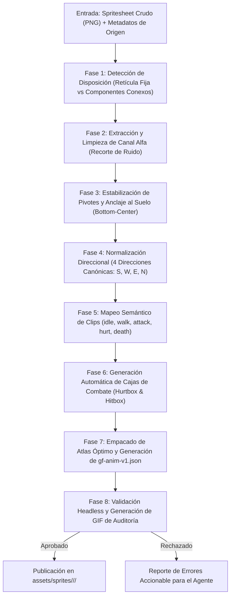

# CHARACTER_ASSET_PIPELINE.md — GAMEFORGE 2D
## Pipeline Automatizado de Ingestión, Estabilización de Pivotes, Paperdoll y Compilación de Personajes

**Estado:** ESPECIFICACIÓN TÉCNICA NORMATIVA  
**Misión:** MISIÓN 003 — Asset Ecosystem & GameForge Asset Hub  
**Fecha:** 2026-11-07  
**Autor:** Director / Arquitecto de Sistemas & Especialista en Pipeline de Arte  
**Formato de Salida:** `gf-anim-v1`  

---

## 1. Resumen y Objetivos del Pipeline

El objetivo central del **Character Asset Pipeline** es eliminar por completo la intervención manual al importar personajes y criaturas. Un agente de software o desarrollador debe poder tomar un spritesheet crudo (proveniente de LPC, Kenney o colecciones de OpenGameArt) y transformarlo deterministamente en un paquete ejecutable por el motor GameForge 2D con:
- Puntos de pivote anclados al suelo sin oscilaciones (*wobble-free ground anchoring*).
- Cajas de combate (*hitboxes* y *hurtboxes*) matemáticamente calculadas según la masa de píxeles opacos.
- Asignación de sockets de equipamiento en las manos para armas intercambiables.
- Exportación al estándar normativo `gf-anim-v1.json`.
- Validación visual autónoma *headless* (generación de GIF de inspección sin abrir ventanas GUI).

---

## 2. Diagrama de Flujo del Pipeline de Personajes



---

## 3. Fases del Pipeline en Detalle

### Fase 1: Detección de Disposición e Ingestión
El módulo receptor evalúa la geometría del archivo crudo:
1. **Plantilla Canónica LPC (64x64 por celda, hoja estándar de 832x1344 o subconjuntos):**
   - El sistema reconoce automáticamente la firma de dimensiones de LPC: múltiplos de 64 píxeles en ancho y alto.
   - Aplica el mapa de filas estándar de LPC:
     - Fila 0-3: Lanzamiento de hechizos (*Spellcast* - 7 frames por dirección).
     - Fila 4-7: Estocada de lanza (*Thrust* - 8 frames por dirección).
     - Fila 8-11: Ciclo de caminar (*Walk* - 9 frames por dirección).
     - Fila 12-15: Ataque con espada (*Slash* - 6 frames por dirección).
     - Fila 16-19: Disparo con arco (*Shoot* - 13 frames por dirección).
     - Fila 20: Derribo y muerte (*Hurt / Collapse* - 6 frames).
2. **Retícula Uniforme Arbitraria ($W \times H$):**
   - El agente puede especificar `--cell-size 32x32` o `--cell-size 16x16` para paquetes de Kenney o Tiddybub.
3. **Detección Automática por Componentes Conexos:**
   - Si no existe una retícula fija, un algoritmo de *Connected Component Labeling* (basado en flooding de píxeles opacos continuos) aísla cada silueta individual y calcula su cuadro delimitador (*bounding box*).

---

### Fase 2 y 3: Estabilización de Pivotes y Prevención del "Sprite Wobble"

#### El Problema del Temblor de Sprites (*Sprite Jitter / Wobble*)
Cuando los fotogramas de una animación tienen siluetas con alturas o anchuras cambiantes (por ejemplo, el héroe agachándose en un paso de carrera o levantando un arma), si el pivote se calcula como el centro de la caja delimitadora recortada, la posición del personaje en el suelo temblará violentamente de un frame a otro.

#### Solución Algorítmica: Anclaje al Suelo (*Ground-Contact Projection*)
1. Se establece el plano horizontal del suelo (*baseline*) como la línea inferior de la celda de animación.
2. Para cada fotograma $f$:
   - Se localiza la masa de píxeles del cuerpo principal (excluyendo efectos de sombra o chispas voladoras).
   - Se computa el centroide horizontal $X_{\text{center}}$ de las columnas con contacto en el suelo (los pies del personaje).
   - Se fija el pivote exactamente en $[X_{\text{center}}, Y_{\text{ground}}]$ (típicamente $[\lfloor W/2 \rfloor, H - 2]$ en una celda normalizada).
3. **Invariante:** El punto de contacto con el suelo permanece estrictamente estacionario en la simulación física; solo las partes móviles del cuerpo se desplazan en relación con este anclaje.

```python
def compute_ground_pivot(frame_surface, cell_w: int, cell_h: int) -> tuple[int, int]:
    """Calcula el pivote estabilizado con respecto a los pies del personaje."""
    # Obtenemos la caja delimitadora de píxeles no transparentes
    bbox = frame_surface.get_bounding_rect()
    if bbox.width == 0 or bbox.height == 0:
        return (cell_w // 2, cell_h)
    
    # El centro horizontal se alinea con el centroide del cuerpo
    pivot_x = bbox.centerx
    # El anclaje vertical se fija en la base de la celda o en el píxel más bajo
    pivot_y = bbox.bottom
    return (pivot_x, pivot_y)
```

---

### Fase 4: Normalización Direccional y Convención de Ejes

GameForge 2D utiliza el estándar de 4 direcciones mapeado en orden cardinal horario:

| Índice | Dirección | Nombre Canónico | Vector Unitario `(dx, dy)` | Convención en Spritesheet |
| :---: | :---: | :---: | :---: | :---: |
| 0 | Abajo / Sur | `down` | `(0, 1)` | Cara frontal hacia la cámara |
| 1 | Izquierda / Oeste | `left` | `(-1, 0)` | Perfil izquierdo |
| 2 | Derecha / Este | `right` | `(1, 0)` | Perfil derecho (o espejo de Left) |
| 3 | Arriba / Norte | `up` | `(0, -1)` | Espalda hacia la cámara |

#### Regla de Generación por Espejo (*Horizontal Mirroring*)
Si el spritesheet original solo provee la dirección `left` (o `right`):
- El pipeline duplica la secuencia aplicando una reflexión horizontal: `pygame.transform.flip(surface, True, False)`.
- Si el personaje tiene cajas de golpe asimétricas (ej. espada en mano derecha), los sockets y las cajas se recalculan invirtiendo la coordenada $X$:
  $$X_{\text{flipped}} = W_{\text{frame}} - (X_{\text{original}} + W_{\text{box}})$$

---

### Fase 5: Mapeo Semántico de Acciones a Clips de Animación

Para cada arquetipo de personaje, el pipeline compila un catálogo de clips reconocidos formalmente por `game.render.animation`:

```json
{
  "clips": {
    "idle_down": { "frames": ["idle_down_0", "idle_down_1"], "duration_ms": 150, "loop": true, "priority": 10 },
    "walk_down": { "frames": ["walk_down_0", "walk_down_1", "walk_down_2", "walk_down_3"], "duration_ms": 100, "loop": true, "priority": 20 },
    "attack_down": { "frames": ["atk_down_0", "atk_down_1", "atk_down_2"], "duration_ms": 75, "loop": false, "priority": 50 },
    "hurt_down": { "frames": ["hurt_down_0", "hurt_down_1"], "duration_ms": 100, "loop": false, "priority": 80 },
    "die_down": { "frames": ["die_down_0", "die_down_1", "die_down_2", "die_down_3"], "duration_ms": 120, "loop": false, "priority": 100 }
  }
}
```

---

### Fase 6: Cálculo Automático de Cajas de Combate (Hitboxes & Hurtboxes)

Para garantizar que el combate en tiempo real sea justo, preciso y no requiera edición manual de colisiones por parte del agente:

1. **Hurtbox (Caja de Vulnerabilidad):**
   - Se analiza el fotograma para encontrar la "masa central" del torso y la cabeza (área de mayor densidad de píxeles opacos, excluyendo extremidades delgadas o armas extendidas).
   - Se proyecta un rectángulo centrado en el eje del cuerpo: típicamente un 60% del ancho del sprite y un 70% de su altura.
2. **Hitbox (Caja de Daño Ofensivo):**
   - En los fotogramas del clip etiquetados como "golpe activo" (*active frames*):
   - Se compara la silueta del fotograma de ataque contra la silueta del fotograma de reposo (*idle*).
   - Los píxeles sobresalientes que corresponden al arma o proyectil se engloban en una caja delimitadora etiquetada como `hitbox` con daño y multiplicador de retroceso (*knockback*).
3. **Sockets de Equipamiento:**
   - Se localiza automáticamente el centro del grupo de píxeles correspondientes a las manos para registrar los puntos `socket_hand_r` y `socket_hand_l`, permitiendo emparentar espadas, bastones o antorchas dinámicamente.

---

### Fase 7: Sistema Modular de Capas (*Paperdoll Compositing*)

Para personajes personalizables (jugador, NPCs y mercenarios), el pipeline implementa el sistema de ensamblado por capas (*Paperdoll*), plenamente compatible con el estándar LPC:

#### Orden Estricto de Capas (*Render Order Stack*)
```
1. Sombra en el Suelo (Shadow Circle)
2. Capa Trasera (Cape Back)
3. Cuerpo Base (Base Body - piel desnuda)
4. Ojos y Expresión Facial
5. Ropa Interior / Túnica Base
6. Pantalones / Grebas Inferiores
7. Botas / Calzado
8. Pechera / Armadura de Torso
9. Brazaletes / Guantes
10. Barba y Bigote
11. Pelo
12. Yelmo / Sombrero
13. Arma en Mano Principal (Main Hand Weapon)
14. Escudo / Antorcha en Mano Secundaria (Off Hand)
15. Capa Delantera (Cape Front)
16. Efectos Visuales de Hechizo / Auras (VFX Overlay)
```

#### Fusión en Tiempo de Compilación vs. Tiempo de Ejecución
- **Fusión en Tiempo de Compilación (Recomendado para NPCs y Enemigos):** El pipeline toma la especificación de equipamiento y funde las capas transparentes en un único atlas `atlas_fused.png`. Cero sobrecoste de CPU en el bucle principal.
- **Composición Dinámica (Para el Jugador con Inventario Activo):** Se mantienen las texturas individuales de cada ranura de equipamiento cargadas en memoria y se dibujan secuencialmente en el buffer de la entidad antes de aplicar la transformación de cámara.

---

### Fase 8: Validación Headless y Generación de GIF de Auditoría

Un principio inviolable de GameForge 2D (Directiva `01_GLOBAL.md`) es que **los sistemas deben poder probarse sin abrir una ventana**.

Para que un agente de IA pueda auditar visualmente el resultado de su pipeline:
1. El script ejecuta una simulación en memoria utilizando un contexto headless (dummy video driver de SDL / Pygame).
2. Genera un GIF animado optimizado de 320x320 píxeles con:
   - El ciclo completo de la animación solicitada a su frame rate exacto.
   - La retícula de coordenadas del suelo dibujada en color cian.
   - El punto de pivote marcado con una cruz roja de 5x5 píxeles.
   - Las `hurtboxes` dibujadas con un rectángulo verde semitransparente.
   - Las `hitboxes` dibujadas con un rectángulo rojo en los fotogramas de ataque.
3. El archivo de auditoría se guarda en:
   `artifacts/previews/<character_id>_<clip>_preview.gif`
4. El agente o el revisor humano puede inspeccionar directamente este archivo para verificar que el personaje no "tiembla" y que los golpes ocurren en la coordenada espacial correcta.

---

## 4. Algoritmo de Conversión a `gf-anim-v1`

El pipeline compila el resultado final en la especificación formal del proyecto:

```json
{
  "version": "gf-anim-v1",
  "metadata": {
    "id": "skeleton_warrior",
    "display_name": "Guerrero Esqueleto",
    "author": "LPC Team / GameForge Importer",
    "rig_type": "frame_by_frame",
    "tags": ["undead", "enemy", "melee"]
  },
  "texture": {
    "image_path": "skeleton_warrior_atlas.png",
    "width": 512,
    "height": 512,
    "format": "RGBA"
  },
  "frames": [
    {
      "id": "walk_down_0",
      "rect": [0, 0, 64, 64],
      "pivot": [32, 58],
      "duration_ms": 100,
      "hurtboxes": [
        { "name": "body", "rect": [22, 18, 20, 40] }
      ],
      "hitboxes": [],
      "sockets": {
        "hand_r": [18, 38],
        "hand_l": [46, 38]
      }
    }
  ],
  "clips": {
    "walk_down": {
      "loop": true,
      "priority": 20,
      "frames": ["walk_down_0", "walk_down_1", "walk_down_2", "walk_down_3"]
    }
  }
}
```
