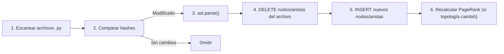

# CODE_GRAPH_INTEGRATION.md — GAMEFORGE 2D
## Integración del Grafo de Código en el Pipeline de Desarrollo

**Estado:** ESPECIFICACIÓN TÉCNICA NORMATIVA  
**Misión:** MISIÓN 004 — Sistema de Grafos, Memoria y Contexto Operativo  
**Fecha:** 2026-11-07  
**Autor:** Director / Arquitecto de Sistemas  
**Proyecto:** GameForge 2D (RPG Modular en Python / Pygame CE)  

---

## 1. Alcance del Grafo de Código

El Grafo de Código de GF-Graph modela la topología sintáctica completa del repositorio GameForge 2D utilizando el módulo `ast` de la biblioteca estándar de Python. No depende de binarios externos (Tree-sitter, Rust, Node.js) ni de servicios en la nube.

### 1.1. Qué extrae el parser AST

El extractor recorre cada archivo `.py` del repositorio mediante `ast.parse()` y produce nodos y aristas para los siguientes elementos:

| Elemento AST | Tipo de Nodo | Información Extraída |
|:---|:---|:---|
| Archivo `.py` | `file` | Ruta relativa, hash SHA-256, mtime, conteo de líneas |
| Módulo (paquete `__init__.py`) | `module` | Nombre cualificado (ej: `game.sim`), exports públicos |
| Clase (`ast.ClassDef`) | `class` | Nombre, bases, decoradores, docstring, línea inicio/fin |
| Función (`ast.FunctionDef` / `ast.AsyncFunctionDef`) | `function` | Nombre, firma completa con tipos, decoradores, docstring, línea inicio/fin |
| Import (`ast.Import` / `ast.ImportFrom`) | *(arista)* | Módulo origen, símbolos importados, alias |
| Llamada (`ast.Call`) | *(arista)* | Función invocada, módulo destino inferido |
| Constante de tipo / Atributo | *(metadata)* | Anotaciones de tipo en firmas y variables de clase |

### 1.2. Qué NO modela

- Ejecución dinámica (`exec`, `eval`, `importlib.import_module` dinámico).
- Generación de código en tiempo de ejecución.
- Dependencias de C extensions más allá de su nombre de import.

---

## 2. Tipos de Nodos

Cada nodo en el grafo de código se almacena en la tabla `code_nodes` con un `node_id` único construido según la convención:

```
<tipo>:<ruta_modulo>:<nombre_simbolo>
```

| Tipo de Nodo | Convención de ID | Ejemplo | Descripción |
|:---|:---|:---|:---|
| `file` | `file:<ruta_relativa>` | `file:game/sim/combat.py` | Archivo fuente Python |
| `module` | `module:<nombre_paquete>` | `module:game.sim` | Paquete con `__init__.py` |
| `class` | `class:<modulo>:<nombre>` | `class:game.entities.player:Player` | Definición de clase |
| `function` | `func:<modulo>:<nombre>` | `func:game.sim.combat:resolve_attack` | Función o método |
| `contract` | `contract:<nombre>` | `contract:Player.take_damage` | Firma documentada en CONTRACTS.md |
| `test` | `test:<archivo>:<nombre>` | `test:tests/test_combat.py:test_damage_applies` | Función de test |
| `asset` | `asset:<ruta>` | `asset:game/data/enemies.json` | Archivo de datos JSON/config |

---

## 3. Tipos de Aristas

Las aristas se almacenan en `code_edges` con la restricción de unicidad `(source_id, target_id, relation_type)`:

| Tipo de Arista | Semántica | Dirección | Ejemplo |
|:---|:---|:---|:---|
| `IMPORTS` | El archivo origen importa un símbolo del destino | `file:A → file:B` | `game/sim/combat.py` importa `Vec2` de `game/core/math2d.py` |
| `CALLS` | La función origen invoca a la función destino | `func:A → func:B` | `resolve_attack` llama a `take_damage` |
| `DEFINES` | El archivo define la clase/función | `file:A → class:X` | `game/entities/player.py` define `Player` |
| `IMPLEMENTS_CONTRACT` | La función implementa un contrato documentado | `func:A → contract:C` | `Player.take_damage` implementa `contract:Player.take_damage` |
| `TESTED_BY` | La función/clase es probada por un test | `func:A → test:T` | `resolve_attack` es probado por `test_damage_applies` |
| `READS_ASSET` | El módulo lee o carga un archivo de datos | `file:A → asset:D` | `game/entities/enemy_catalog.py` lee `game/data/enemies.json` |

---

## 4. Pipeline de Indexación Incremental

La indexación sigue un flujo de 5 fases, diseñado para minimizar el trabajo redundante:



### 4.1. Detección de cambios

Para cada archivo `.py` del repositorio:

1. Calcular `SHA-256(contenido)` y `mtime_ns` (nanosegundos).
2. Comparar contra la entrada existente en `file_hashes`.
3. Si ambos coinciden → **omitir** (0 trabajo adicional).
4. Si difieren → marcar para reparseo.

### 4.2. Parsing selectivo

Solo los archivos marcados se procesan con `ast.parse(source, filename)`. Para cada uno:

1. Visitar el AST con un `ast.NodeVisitor` personalizado.
2. Extraer todas las definiciones (`ClassDef`, `FunctionDef`) con sus firmas y docstrings.
3. Extraer todos los imports (`Import`, `ImportFrom`) y resolver módulos destino.
4. Extraer todas las llamadas (`Call`) y resolver funciones destino cuando sea posible estáticamente.

### 4.3. Actualización atómica

Dentro de una transacción SQLite `BEGIN IMMEDIATE`:

1. `DELETE FROM code_edges WHERE source_id IN (nodos del archivo)`.
2. `DELETE FROM code_nodes WHERE filepath = <archivo>`.
3. `INSERT` nuevos nodos y aristas.
4. `UPDATE file_hashes SET sha256=..., mtime_ns=..., last_indexed=...`.
5. `COMMIT`.

### 4.4. Recálculo condicional de PageRank

El PageRank solo se recalcula si la **topología del grafo cambió** (se añadieron o eliminaron aristas). Se detecta comparando un hash de la lista ordenada de aristas antes y después de la actualización.

---

## 5. Algoritmo de PageRank Personalizado

Inspirado directamente en el mecanismo de Aider RepoMap, el sistema construye un grafo dirigido ponderado y calcula un ranking contextual de relevancia.

### 5.1. Construcción del MultiDiGraph

```
Nodos: Archivos .py del repositorio (uno por archivo)
Aristas: file_A → file_B  si  file_A contiene una referencia a un símbolo definido en file_B
Peso: Número de referencias distintas entre el par de archivos
```

Se utiliza `networkx.MultiDiGraph` para permitir múltiples aristas entre el mismo par de archivos (una por tipo de referencia).

### 5.2. Vector de personalización

El PageRank estándar distribuye la probabilidad de "teletransporte" uniformemente. El **Personalized PageRank (PPR)** inyecta un sesgo hacia los archivos relevantes para la tarea actual:

- **Archivos de la tarea**: Los archivos listados en `tasks/BOARD.md` como "archivos permitidos" reciben peso alto (0.5 del total).
- **Archivos mencionados**: Si la descripción de la tarea menciona módulos o funciones específicas, los archivos correspondientes reciben peso medio (0.3).
- **Baseline uniforme**: El 0.2 restante se distribuye uniformemente.

La llamada a NetworkX:

```
nx.pagerank(G, alpha=0.85, personalization=bias_vector, weight='weight')
```

### 5.3. Truncamiento por presupuesto de tokens

Los archivos se ordenan por score PPR descendente. Se genera el skeleton de cada uno secuencialmente y se acumula el conteo de tokens. Se detiene cuando se alcanza el presupuesto configurado (default: 2000 tokens, configurable).

Se utiliza búsqueda binaria sobre el ranking para encontrar el punto de corte óptimo.

---

## 6. Generación de Esqueletos (Skeletons)

Los esqueletos son representaciones compactas de los archivos que incluyen únicamente las firmas públicas, sin cuerpos de función. Están inspirados en los *structural skeletons* de `ctx`.

### 6.1. Formato de skeleton

```python
# game/sim/combat.py
class CombatResult:
    damage: float
    killed: bool
    knockback: Vec2

def resolve_attack(attacker: Entity, target: Entity, weapon: AttackSpec) -> CombatResult: ...
def calculate_knockback(source_pos: Vec2, target_pos: Vec2, force: float) -> Vec2: ...
```

### 6.2. Reglas de generación

1. Incluir docstring de módulo (primera línea).
2. Incluir todas las definiciones de clase con sus atributos tipados.
3. Incluir todas las funciones con firma completa (`def nombre(args) -> tipo`).
4. Reemplazar el cuerpo con `...` (elipsis).
5. Omitir funciones privadas (`_prefijo`) a menos que sean referenciadas por funciones públicas.
6. Preservar decoradores relevantes (`@property`, `@staticmethod`, `@dataclass`).

### 6.3. Ratio de compresión esperado

Para el código actual de GameForge 2D:
- Código fuente completo por archivo: ~100-400 líneas → ~400-1600 tokens.
- Skeleton equivalente: ~15-60 líneas → ~60-240 tokens.
- **Ratio de compresión**: ~0.08-0.15 (85%-92% de ahorro en tokens).

---

## 7. Análisis de Radio de Explosión (Blast Radius)

El análisis de impacto determina todos los módulos, funciones, tests y contratos que podrían verse afectados por la modificación de un nodo dado. Está inspirado en el `codegraph_analyze_impact` de CodeGraph.

### 7.1. Algoritmo BFS Inverso

```
Entrada: nodo_modificado, profundidad_máxima (default: 3)
1. Inicializar cola = [nodo_modificado], visitados = {nodo_modificado}
2. Para cada nivel k de 1 a profundidad_máxima:
   a. Para cada nodo en la cola del nivel actual:
      - Buscar todas las aristas ENTRANTES (nodos que dependen de este)
      - Para cada vecino no visitado:
        → Añadir a visitados
        → Clasificar por tipo: CÓDIGO_AFECTADO, TEST_AFECTADO, CONTRATO_AFECTADO
   b. Mover la nueva frontera a la cola
3. Retornar clasificación de impacto por nivel
```

### 7.2. Formato de salida del blast radius

```
📍 Nodo modificado: func:game.sim.combat:resolve_attack

Nivel 1 (dependencias directas):
  ├── func:game.scenes.play:_process_combat  [CÓDIGO]
  ├── test:tests/test_combat.py:test_damage  [TEST]
  └── contract:Player.take_damage            [CONTRATO]

Nivel 2 (dependencias transitivas):
  ├── file:game/scenes/play.py               [CÓDIGO]
  └── test:tests/test_sim.py:test_engagement [TEST]

Resumen: 2 módulos, 2 tests, 1 contrato potencialmente afectados.
```

---

## 8. Detección Automática de Contratos

Los contratos documentados en `architecture/CONTRACTS.md` se vinculan automáticamente a sus implementaciones en el código.

### 8.1. Proceso de vinculación

1. **Parsear CONTRACTS.md**: Extraer secciones de contrato con sus firmas (ej: `take_damage(amount, source=None) -> bool`).
2. **Crear nodos `contract:`** en el grafo por cada firma documentada.
3. **Buscar implementaciones**: Para cada firma de contrato, buscar en `code_nodes` funciones con nombre y parámetros coincidentes.
4. **Crear aristas `IMPLEMENTS_CONTRACT`**: Vincular la implementación encontrada con el nodo de contrato.
5. **Alertar contratos huérfanos**: Reportar contratos sin implementación detectada o implementaciones sin contrato documentado.

### 8.2. Heurísticas de matching

- Coincidencia exacta de nombre de función.
- Coincidencia parcial de firma (nombre + número de parámetros).
- Coincidencia por pertenencia a clase (ej: `Player.take_damage` busca en `class:Player`).

---

## 9. Detección de Tests Relacionados

### 9.1. Por convención de nombre

| Módulo fuente | Test esperado |
|:---|:---|
| `game/sim/combat.py` | `tests/test_combat.py` |
| `game/entities/player.py` | `tests/test_player.py` |
| `game/world/generation.py` | `tests/test_generation.py` |

### 9.2. Por análisis de imports

Se analiza qué módulos importa cada archivo de test. Si `test_combat.py` importa `from game.sim.combat import resolve_attack`, se crea una arista `TESTED_BY` entre `func:game.sim.combat:resolve_attack` y `test:tests/test_combat.py:*`.

### 9.3. Cobertura de contratos

Se cruzan los tests con los contratos para identificar contratos no cubiertos por ningún test, generando alertas de riesgo.

---

## 10. Interfaz CLI Propuesta

La herramienta CLI vive en `tools/gf_graph.py` y expone los siguientes comandos:

| Comando | Descripción | Ejemplo |
|:---|:---|:---|
| `gf-graph index` | Indexación incremental del repositorio | `python tools/gf_graph.py index` |
| `gf-graph index --full` | Indexación completa (cold start) | `python tools/gf_graph.py index --full` |
| `gf-graph query <nodo>` | Subgrafo de k-hop alrededor de un nodo | `python tools/gf_graph.py query func:game.sim.combat:resolve_attack --depth 2` |
| `gf-graph query --task <T-XXX>` | Subgrafo relevante para una tarea | `python tools/gf_graph.py query --task T-802` |
| `gf-graph skeleton <archivo>` | Skeleton de un archivo | `python tools/gf_graph.py skeleton game/sim/combat.py` |
| `gf-graph skeleton --top <N>` | Skeletons de los N archivos más relevantes para la tarea | `python tools/gf_graph.py skeleton --top 10 --task T-802` |
| `gf-graph blast <nodo>` | Análisis de radio de explosión | `python tools/gf_graph.py blast func:game.sim.combat:resolve_attack` |
| `gf-graph status` | Estado del índice (archivos indexados, obsoletos, huérfanos) | `python tools/gf_graph.py status` |
| `gf-graph receipt <T-XXX>` | Generar recibo de auditoría pre-flight | `python tools/gf_graph.py receipt T-802 --agent GAMEPLAY` |
| `gf-graph contracts` | Verificar vinculación de contratos | `python tools/gf_graph.py contracts` |

---

## 11. Métricas de Eficiencia Esperadas

| Métrica | Estimación para GameForge (~65 archivos) | Justificación |
|:---|:---|:---|
| Indexación completa | <2 s | `ast.parse` es ~1 ms/archivo para archivos de <500 LOC |
| Indexación incremental (1 archivo) | <100 ms | Un solo parse + transacción SQLite |
| Consulta subgrafo k=2 | <20 ms | Índices compuestos en `code_edges` |
| Generación skeleton (10 archivos) | <50 ms | Formateo de texto sobre nodos ya en memoria |
| Blast radius k=3 | <50 ms | BFS sobre grafo en memoria SQLite |
| Tamaño de BD | <500 KB | ~65 archivos, ~2000 nodos, ~5000 aristas |
| Tokens ahorrados | >85% | Skeleton vs código completo |

---

## 12. Integración con el Ecosistema Existente

### 12.1. Compatibilidad

- **Python 3.11+**: Usa solo `ast`, `hashlib`, `sqlite3`, `pathlib` de la biblioteca estándar.
- **Dependencia opcional**: `networkx` para PageRank (ya disponible vía pip, licencia BSD).
- **Sin conflicto con pygame-ce**: El grafo opera offline, nunca se ejecuta durante el game loop.

### 12.2. Ubicación en el repositorio

```
tools/gf_graph.py          # CLI principal
tools/gf_graph/             
  __init__.py
  indexer.py               # Parser AST + indexación incremental
  query.py                 # Consultas de subgrafo y blast radius
  skeleton.py              # Generador de skeletons
  contracts.py             # Vinculador de contratos
  pagerank.py              # PageRank personalizado (requiere networkx)
  receipts.py              # Generador de recibos de auditoría
.gameforge/
  graph.db                 # Base de datos SQLite WAL
```
