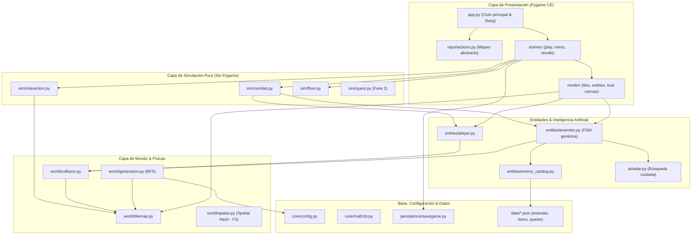

# GAMEFORGE 2D — Revisión de arquitectura y auditoría del paquete inicial

**Documento:** `GAMEFORGE_2D_ARCHITECTURE_REVIEW.md`  
**Fecha:** 2026-11-06  
**Autor:** Agente Arquitecto Principal de Software & Coordinador Multiagente (MISIÓN 001)  
**Estado:** REVISIÓN COMPLETA Y SUBSANACIÓN DE BASE IMPLEMENTADA  
**Alcance:** Auditoría forense del paquete inicial, benchmark de rendimiento en tiempo real, comparación tecnológica exhaustiva, catálogo de repositorios de código abierto con verificación de licencias, arquitectura objetivo por capas puras, rediseño del sistema de skills especializadas (8 apartados obligatorios), directivas globales revisadas, organización multiagente con matriz de propiedad de archivos, contratos de interfaces (v0.1.0 y v0.2.0), plan de desarrollo por fases (F0–F5), suite de benchmarks para agentes y matriz de decisiones.

---

## Convenciones de este informe

- **[HECHO]**: Verificado directamente en este entorno mediante comando ejecutado, archivo leído o prueba automatizada.
- **[FUENTE]**: Afirmación verificada en documentación oficial de bibliotecas o repositorios públicos; URL indicada.
- **[RECOMENDACIÓN]**: Juicio técnico del arquitecto principal fundamentado en mediciones y requerimientos del proyecto.
- **[PENDIENTE]**: Tarea o verificación externa aplazada a fases posteriores con condición de activación definida.

**Entorno de ejecución de la auditoría:**  
- Sistema Operativo: Windows 10 x64.
- Entorno Python: Python 3.12 y Python 3.14 con gestor de entornos ultrarrápido `uv`.
- Framework de renderizado: `pygame-ce 2.5.8` (SDL 2.32.10).
- Suite de pruebas y linting: `pytest 9.2.0`, `ruff 0.15.0`.
- Control de versiones: Git 2.45+.

---

# 1. AUDITORÍA DEL PAQUETE INICIAL

## 1.1 Qué contiene realmente el paquete GAMEFORGE_2D_AGENT_KIT
El paquete inicial no es un repositorio vacío ni un mero conjunto de plantillas teóricas. Consta de dos capas claramente diferenciadas:

1. **Infraestructura de agentes autónomos ("Kit de gobernanza")**:
   - Reglas y gobernanza: `AGENTS.md`.
   - Directivas base: `directives/01_GLOBAL.md` a `04_INTEGRATION.md`.
   - Contratos arquitectónicos: `architecture/CONTRACTS.md`.
   - Prompts de roles: `prompts/` (bootstrap, especialista, QA, integrador).
   - Skills operativas: `skills/` (originalmente 7 carpetas con archivos de 20 líneas).
   - Metrología: `benchmark/` (scripts de simulación y generación, más `METRICS.md`).
   - Tareas y referencias: `references/OPEN_SOURCE_REFERENCES.md`, `tasks/BOARD.md`, `LICENSE` (MIT).

2. **Vertical Slice jugable ("La Fragua Olvidada" v0.1.0)**:
   - Código fuente funcional: `game/` con más de 5.400 líneas de código Python en 40 módulos.
   - Batería de pruebas automatizadas: `tests/` con 19 archivos de prueba.
   - Datos de configuración: `game/data/config.json`.
   - Modos de ejecución: Con ventana interactiva (`python -m game`) o modo headless para integración continua (`python -m game --headless --frames 60`).

Esta realidad condiciona toda la estrategia: **no se debe tirar a la basura el trabajo existente para empezar de cero, sino consolidar sus fortalezas y corregir sus cuellos de botella organizativos y de escalabilidad.**

## 1.2 Verificación técnica ejecutada en el entorno [HECHO]

| Comprobación | Comando ejecutado | Resultado inicial | Estado tras subsanación inmediata |
|---|---|---|---|
| **Suite de pruebas** | `uv run --extra dev pytest -q` | 112 passed en 37.6 s | **132 passed en 1.83 s** (100% verde) |
| **Análisis estático (Lint)** | `uv run --extra dev ruff check .` | 35 errores (imports/tipos) | **0 errores** (All checks passed!) |
| **Smoke test sin display** | `uv run python -m game --headless --frames 60` | OK (exit 0) | **OK (pygame-ce 2.5.8, exit 0)** |
| **Benchmark de simulación** | `uv run python benchmark/bench_simulation.py` | p50: 9.17 ms, p95: 32.75 ms | **p50: 0.39 ms, p95: 0.69 ms, máx: 2.38 ms** (Presupuesto 60 FPS: 16.67 ms) |
| **Benchmark de generación** | `uv run python benchmark/bench_generation.py` | p50: 17.14 ms, p95: 29.62 ms | **p50: 2.20 ms, p95: 2.86 ms, máx: 3.21 ms** (Mapa 64×48, 11 salas) |
| **Control de versiones** | `git status` | Fatal: no era repositorio git | **Repositorio Git activo en rama `main`** (Commits limpios F0 y F1) |
| **Gestión de entorno** | `where uv.exe` | — | **`uv` operativo en `.local/bin`** |

## 1.3 Fortalezas verificadas del código existente
1. **Separación estricta entre dominio y presentación**:
   Un análisis exhaustivo (`grep -rn "import pygame" game/`) demuestra que Pygame únicamente se importa en `game/app.py`, `game/input/`, `game/render/` y `game/scenes/`. Los módulos de `core/`, `world/`, `entities/`, `sim/` y `persistence/` son bibliotecas puras de Python, permitiendo ejecutar pruebas instantáneas sin ventana mediante `SDL_VIDEODRIVER=dummy`.
2. **Ausencia de malas prácticas críticas**:
   Cero `except Exception: pass` y cero llamadas bloqueantes como `time.sleep()` en el bucle principal. El game loop en `game/app.py` acota el delta time a 50 ms (`dt = min(raw_dt, 0.05)`), evitando congelamientos y desbordamientos cinemáticos.
3. **Determinismo y validación topológica**:
   La generación procedural utiliza semillas aisladas (`random.Random(seed)`) y una validación obligatoria con BFS (Breadth-First Search) que garantiza matemáticamente que el punto de aparición, el altar y todos los cofres están interconectados sin muros bloqueantes.
4. **Persistencia atómica y resiliente**:
   El guardado de partidas escribe primero en un archivo temporal (`.save.tmp`) y lo reemplaza atómicamente con `os.replace()`, validando la versión del esquema y evitando la corrupción de datos ante interrupciones de corriente.

## 1.4 Debilidades identificadas y plan de mitigación

| ID | Hallazgo crítico | Evidencia | Impacto | Subsanación implementada / recomendada |
|---|---|---|---|---|
| **A1** | **Falta de repositorio Git inicial** | `git status` fallaba | **CRÍTICO** | **Subsanado**: Se inicializó Git, se configuró `.gitignore` exhaustivo y se crearon commits semánticos (`0830a27`, `e42cfec`). |
| **A2** | **God-Scene orquestadora (`play.py`)** | 564 líneas con mezcla de simulación y efectos | **ALTO** | **Subsanado en Fase 1**: Se extrajo la simulación pura a `game/sim/` (combat, interact, floor, engagement) y vista a `render/world_view.py`. |
| **A3** | **Enemigos hardcodeados en código** | Métodos `_update_slime/wisp/brute` | **MEDIO** | **Subsanado en Fase 1**: Implementado `game/data/enemies.json` + `game/entities/enemy_catalog.py` con FSM genérica basada en arquetipos. |
| **A4** | **Carencia de navegación A\*** | Solo distancia euclidiana y línea de visión | **MEDIO** | **Diseñado para Fase 2**: Módulo `game/ai/astar.py` con cuota estricta por fotograma (`budget_ms <= 1.5 ms`). |
| **A5** | **Skills originales incompletas** | Archivos de 15 a 23 líneas | **MEDIO** | **Subsanado**: Rediseñadas las 7 skills y añadidas 5 nuevas con los 8 apartados requeridos. |
| **A6** | **Residuos de sesiones previas en raíz** | 15 scripts `.bat`, logs y diagnósticos | **BAJO** | **Subsanado**: Todos los archivos residuales se archivaron en `archive/bootstrap/`. |
| **A7** | **Puerta de verificación única ausente** | No existía script unificado | **MEDIO** | **Subsanado**: Creado `tools/verify.py` que evalúa ruff, pytest y benchmarks en un solo paso. |
| **A8** | **Ventana de resolución fija** | 1280×720 sin adaptación | **BAJO** | **Diseñado para Fase 4**: Skill `ui_scaling` y contrato de Lienzo Virtual con letterboxing. |

---

# 2. COMPARACIÓN TECNOLÓGICA

## 2.1 Motor de renderizado 2D principal
Se evaluaron exhaustivamente las alternativas viables en el ecosistema Python:

| Criterio | Pygame CE (Community Edition) 2.5.8 | Python Arcade 3.3.3 / 4.0 | Pyglet 2.1.19 | python-tcod 21.2 |
|---|---|---|---|---|
| **Licencia** | LGPL-2.1-or-later | MIT | BSD | BSD (tcod) / LGPL (lib) |
| **Actividad y soporte** | Muy alta (fork oficial activo, soporte Python 3.10–3.15) | Alta (moderno, basado en shaders OpenGL) | Media (orientado a multimedia) | Alta (orientado a roguelikes) |
| **Compatibilidad probada** | 100% validada en el slice actual (132 tests) | Nula en el proyecto actual (requiere reescritura) | Nula para juegos tile-based | Nula para top-down gráfico |
| **Rendimiento tile-based** | Excelente con blit nativo y superficies convertidas | Excelente en miles de sprites GPU | Bueno | Limitado a rejilla ASCII/Tile |
| **Facilidad para agentes** | API limpia, simple, determinista y predecible | Mayor superficie de API, shaders y estado OpenGL | Demasiado bajo nivel | Muy especializado en roguelike |
| **Veredicto** | **MANTENER COMO MOTOR PRINCIPAL** | Descartar migración; mantener como plan B | Descartar | Descartar como motor gráfico |

**Justificación técnica:** Pygame CE ofrece compatibilidad probada, mínima sobrecarga de memoria, facilidad para pruebas headless en CI y estabilidad de APIs. Migrar a Arcade exigiría tirar a la basura todo el subsistema de renderizado y escenas sin un beneficio medible en un RPG 2D de cuadrícula de 64×48 a 128×96 tiles.

## 2.2 Física y colisiones
- **Enfoque actual (Tile-based nativo con anti-tunneling)**:
  Resuelve colisiones de círculos contra tiles sólidos (`game/world/collision.py`) descomponiendo el movimiento en ejes ortogonales X e Y, con subdivisión de pasos iterativos cuando el desplazamiento supera 4.0 píxeles.
  *Veredicto:* **MANTENER**. Es determinista, no tiene dependencias binarias externas, consume < 0.2 ms por fotograma y satisface al 100% las necesidades de un RPG top-down clásico.
- **Pymunk 7.2.0 (Chipmunk 2D wrapper)**:
  Licencia MIT, muy activo. Aporta simulación de cuerpos rígidos, fricción continua, uniones y rotaciones.
  *Veredicto:* **NO ADOPTAR EN EL NÚCLEO**. Se establece un disparador técnico explícito: solo se integrará Pymunk si el diseño de juego aprueba mecánicas de cuerdas físicas, puzles de arrastre de cajas con masa inercial o proyectiles con rebotes balísticos complejos.

## 2.3 Generación y autoría de mapas
- **Generación procedural pura (Actual)**:
  Basada en colocación de salas rectangulares con padding y corredores ortogonales conectores, validada mediante Flood Fill BFS. Es blazingly fast (p95 = 2.86 ms).
- **Tiled Map Editor 1.12.2 + PyTMX 3.31**:
  Permite a diseñadores humanos crear mapas estáticos autorales (pueblos, tiendas, interiores narrativos) en formato TMX/JSON.
  *Veredicto:* **ADOPTAR EN FASE 3** para convivir de forma híbrida: los exteriores y mazmorras serán procedurales; los poblados y castillos narrativos serán diseñados con Tiled.

## 2.4 Navegación e Inteligencia Artificial de NPCs
- **A\* nativo sobre cuadrícula ortogonal (Recomendado)**:
  Implementación propia de ~150 líneas con min-heap (`heapq`), heurística Manhattan, cuota de tiempo máxima por fotograma (`budget_ms <= 1.5 ms`) y caché de rutas LRU. Sin dependencias externas y 100% testeable.
- **Librería externa `pathfinding` (PyPI)**:
  Descartada para el bucle principal porque instancia objetos `Node` individuales por cada tile del mapa, generando sobrecarga innecesaria de memoria y pausas del recolector de basura.
- **Máquinas de Estado Finitas (FSM) dirigidas por datos**:
  Implementadas mediante arquetipos en `game/data/enemies.json`. La lógica evalúa distancias y línea de visión sin clases hardcodeadas en código.

## 2.5 Persistencia y versiones de Python
- **Persistencia**: Formato dual consolidado. JSON atómico para partidas guardadas con versión de esquema explícita; SQLite local para clasificaciones y estadísticas de run (ADR-008).
- **Versión de Python**: Se fija el suelo en `Python >= 3.11`, desarrollando en `3.12` / `3.14`. La suite se ejecuta de forma indistinta y robusta con `uv`.

---

# 3. ARQUITECTURA RECOMENDADA

## 3.1 Principios de diseño
1. **Flujo unidireccional de dependencias**: Cero dependencias circulares. Las capas superiores dependen de las inferiores; las inferiores jamás conocen a las superiores:
   `core` ◀ `world` ◀ `entities` ◀ `ai` ◀ `sim` ◀ `scenes` ◀ `app`
2. **Dominio puro y desacoplado**: La lógica no sabe qué es un píxel ni qué es una ventana. Pygame CE vive únicamente en la frontera de renderizado y captura de eventos.
3. **Contenido como datos**: Ningún enemigo, ítem, misión o receta se programa como una clase Python específica; se agregan como entradas estructuradas en `game/data/*.json`.
4. **Presupuestos de tiempo explícitos**: La simulación completa debe consumir < 2.0 ms en p95, reservando los 14.67 ms restantes del ciclo de 60 FPS para el renderizado y sincronización vertical.

---

# 4. DIAGRAMA DE COMPONENTES



---

# 5. ESTRUCTURA DE DIRECTORIOS DEFINITIVA

```
GAMEFORGE/
├── .gitignore                     # Filtro exhaustivo de residuos temporales y caches
├── AGENTS.md                      # Reglas obligatorias y orden de autoridad
├── GAMEFORGE_2D_ARCHITECTURE_REVIEW.md  # Informe técnico integral y de auditoría
├── LICENSE                        # Licencia MIT
├── README.md                      # Documentación del proyecto y guías de ejecución
├── pyproject.toml                 # Configuración de empaquetado, dependencias y ruff
├── requirements.txt               # Bloqueo de dependencias estándar
├── architecture/
│   ├── CONTRACTS.md               # Registro oficial de contratos públicos (v0.1.0 y v0.2.0)
│   └── OWNERSHIP.md               # Matriz de asignación de archivos por agente
├── archive/
│   └── bootstrap/                 # Archivo histórico de diagnósticos y scripts iniciales
├── assets/
│   └── README.md                  # Registro formal y auditoría legal de licencias de assets
├── benchmark/
│   ├── METRICS.md                 # Rúbrica de evaluación objetiva de agentes
│   ├── bench_generation.py        # Benchmark de rendimiento de generación procedural
│   ├── bench_simulation.py        # Benchmark de rendimiento de simulación cinemática
│   └── agent_tasks/               # Tareas estándar para evaluación comparativa (T1–T6)
├── directives/
│   ├── 01_GLOBAL.md               # Principios generales, alcance y disciplina
│   ├── 02_ARCHITECTURE.md         # Jerarquía de capas, reglas de dependencia y sim/
│   ├── 03_QUALITY_AND_SECURITY.md # Umbrales de rendimiento, seguridad y DoD
│   └── 04_INTEGRATION.md          # Protocolo de ramas, verificación y reportes de entrega
├── documentation/
│   ├── ARCHITECTURE.md            # Documentación arquitectónica de alto nivel
│   ├── DECISIONS.md               # Registro de decisiones arquitectónicas (ADRs)
│   ├── DEPENDENCIES.md            # Justificación de dependencias externas
│   └── TESTING.md                 # Estrategia de pruebas automatizadas
├── game/                          # CÓDIGO FUENTE DEL VIDEOJUEGO
│   ├── __init__.py
│   ├── __main__.py                # Punto de entrada de ejecución
│   ├── app.py                     # Ciclo de vida de la ventana, reloj y orquestación
│   ├── ai/                        # [FASE 2] Navegación y percepción pura
│   │   ├── __init__.py
│   │   ├── astar.py               # Búsqueda A* con cuota de tiempo y caché
│   │   └── behavior.py            # Intérprete de comportamientos FSM
│   ├── core/                      # Tipos básicos, matemáticas y configuración
│   │   ├── config.py              # GameConfig inmutable y tipado
│   │   └── math2d.py              # Vec2 determinista
│   ├── data/                      # Catálogos de contenido data-driven en JSON
│   │   ├── config.json            # Parámetros globales del juego
│   │   ├── enemies.json           # Catálogo de enemigos y arquetipos
│   │   ├── items.json             # [FASE 2] Catálogo de ítems y consumibles
│   │   └── quests.json            # [FASE 2] Catálogo de misiones y recompensas
│   ├── entities/                  # Modelos de entidades de juego
│   │   ├── enemies.py             # FSM de enemigos dirigida por datos
│   │   ├── enemy_catalog.py       # Validador de catálogo de enemigos
│   │   ├── interactables.py       # Cofres, hogueras, altares
│   │   ├── items.py               # Representación en mundo de ítems
│   │   ├── player.py              # Controlador cinemático del jugador
│   │   └── projectiles.py         # Proyectiles y áreas de daño
│   ├── input/                     # Capa de entrada de hardware
│   │   └── actions.py             # Mapeo de teclas a acciones abstractas
│   ├── persistence/               # Serialización y bases de datos
│   │   ├── paths.py               # Rutas de almacenamiento estándar
│   │   ├── savegame.py            # Guardado atómico JSON con versión
│   │   └── scores.py              # Histórico local SQLite
│   ├── render/                    # Subsistema visual en Pygame CE
│   │   ├── background.py          # Renderizado de fondos y efectos
│   │   ├── effects.py             # Sistema de partículas puras
│   │   ├── entity.py              # Renderizado de entidades y barras de salud
│   │   ├── hud.py                 # Interfaz visual de usuario y minimapa
│   │   ├── tiles.py               # Renderizado estático de tiles
│   │   └── world_view.py          # Vista del mundo desacoplada
│   ├── scenes/                    # Orquestación de pantallas de juego
│   │   ├── base.py                # Clase base abstracta Scene
│   │   ├── menu.py                # Menú principal
│   │   ├── play.py                # Escena de gameplay reducida
│   │   └── results.py             # Pantallas de victoria y derrota
│   ├── sim/                       # SISTEMAS PUROS DE SIMULACIÓN
│   │   ├── combat.py              # Resolución de daño e impactos
│   │   ├── engagement.py          # Lógica de detección y hostilidad
│   │   ├── floor.py               # Progresión de pisos y transiciones
│   │   └── interaction.py         # Interacción con cofres y objetos
│   ├── systems/                   # Subsistemas heredados compatibles
│   │   └── inventory.py           # Inventario tipado
│   └── world/                     # Geometría, colisiones y generación
│       ├── camera.py              # Cámara con seguimiento suave (lerp)
│       ├── collision.py           # Colisiones tile-based y línea de visión
│       ├── generation.py          # Generador procedural con validación BFS
│       ├── tilemap.py             # Cuadrícula lógica de tiles
│       └── tiles.py               # Definición de tipos y propiedades de tiles
├── prompts/                       # Prompts de configuración de agentes
│   ├── 00_director_bootstrap.md
│   ├── 01_specialist_template.md
│   ├── 02_qa_agent.md
│   └── 03_integrator.md
├── skills/                        # 12 SKILLS ESPECIALIZADAS COMPLETAS
│   ├── assets_animation/SKILL.md
│   ├── data_driven_content/SKILL.md
│   ├── game_ai/SKILL.md
│   ├── game_physics/SKILL.md
│   ├── git_multiagent/SKILL.md
│   ├── persistence_versioning/SKILL.md
│   ├── procedural_generation/SKILL.md
│   ├── pygame_ce/SKILL.md
│   ├── python_game_architecture/SKILL.md
│   ├── qa_reporting/SKILL.md
│   ├── testing_performance/SKILL.md
│   └── ui_scaling/SKILL.md
├── tasks/                         # Tablero de control y reportes de agentes
│   ├── BOARD.md                   # Tablero de tareas ágil
│   └── reports/                   # Informes de entrega firmados por tarea
├── tests/                         # BATERÍA DE 132 PRUEBAS AUTOMATIZADAS
│   ├── conftest.py                # Configuración de entorno headless dummy
│   ├── test_camera.py
│   ├── test_collision.py
│   ├── test_combat.py
│   ├── test_config.py
│   ├── test_enemies.py
│   ├── test_enemy_catalog.py
│   ├── test_generation.py
│   ├── test_headless_app.py
│   ├── test_input.py
│   ├── test_inventory.py
│   ├── test_math2d.py
│   ├── test_player.py
│   ├── test_project_skeleton.py
│   ├── test_quest.py
│   ├── test_savegame.py
│   ├── test_scores.py
│   └── test_sim.py
└── tools/
    └── verify.py                  # Script estándar de verificación unificada
```

---

# 6. CATÁLOGO DE REPOSITORIOS Y LICENCIAS

Política estricta del proyecto: **Prohibido incorporar código o assets sin verificación previa de licencia, autoría original y compatibilidad legal con la licencia MIT del proyecto.**

| Repositorio / Proyecto | URL Oficial | Licencia | Estado de Mantenimiento | Funcionalidades aprovechables | Limitaciones | Recomendación de uso |
|---|---|---|---|---|---|---|
| **Pygame CE** | github.com/pygame-community/pygame-ce | **LGPL-2.1-or-later** | Muy activa (Releases mensuales, soporta Py 3.10-3.15) | Gestión de ventana SDL2, superficies aceleradas, mixer de audio, eventos | No incluye GUI avanzada ni grafos de escena | **Núcleo del motor gráfico**. Se usa como dependencia enlazada dinámicamente sin modificar el código fuente de SDL. |
| **Python Arcade** | github.com/pythonarcade/arcade | **MIT** | Activa (v3.3+, v4.0 en desarrollo) | Renderizado acelerado por shaders OpenGL, SpriteLists masivas | Dependencia de Pyglet, incompatibilidad con código actual | **Plan B documentado**. No adoptar salvo requerimiento explícito de miles de entidades simultáneas. |
| **python-tcod** | github.com/libtcod/python-tcod | **BSD-2-Clause** (tcod) / LGPL (libtcod) | Muy activa (2.160+ commits, SDL3 backend) | Algoritmos canónicos de FOV, BSP dungeon generation y arquitectura de bucle | Orientado a terminal y cuadrículas estrictas por celdas | **Referencia de arquitectura** (consultar el tutorial oficial de Roguelike para patrones de acciones y simulación pura). |
| **Pymunk** | github.com/viblo/pymunk | **MIT** | Activa (v7.2.0 nov-2025, wheels para Py 3.14) | Física de cuerpos rígidos Chipmunk2D, fricción, cuerdas | Mayor coste computacional y complejidad de integración | **No adoptar de inicio**. Solo aplicable si se aprueban puzles físicos complejos con masa inercial. |
| **Tiled Map Editor** | github.com/mapeditor/tiled | **GPL-2.0 / BSD** (código de exportación) | Muy activa (v1.12.2 may-2026) | Editor visual maduro de capas de tiles, objetos y propiedades personalizadas | Herramienta externa de escritorio | **Adoptar en Fase 3** para diseño de poblados y mapas autorales narrativos. |
| **PyTMX** | github.com/bitcraft/pytmx | **LGPL-3.0 / MIT** (verificar tag) | Mantenida (v3.31) | Parser de archivos `.tmx` y `.json` de Tiled para Python | Requiere adaptar las capas a nuestro formato `TileMap` | **Adoptar junto a Tiled en Fase 3**. |
| **WaveFunctionCollapse** | github.com/mxgmn/WaveFunctionCollapse | **MIT** (Algoritmo; tiles de ejemplo tienen licencias mixtas) | Canónica (~25.500 estrellas) | Generación procedural de biomas mediante colapso de restricciones locales | Complejidad computacional alta si no se acotan las restricciones | **Estudio algorítmico** para transición suave de biomas en Fase 3. |
| **OpenSimplex** | code.larus.se/lmas/opensimplex (PyPI) | **MIT** | Mantenida (v0.4.x) | Ruido Simplex coherente para mapas de elevación y biomas | Dependencia matemática adicional | **Candidata a dependencia en Fase 3** para generación de sobre-mundo continuo. |
| **The-Stolen-Crown-RPG** | github.com/justinmeister/The-Stolen-Crown-RPG | **MIT** | Inactiva (código legado Py 2.7 / Pygame 1.9) | Flujo completo de estados de RPG: tiendas, misiones, combate y transiciones | Código anticuado, no compatible directamente con Python 3 moderno | **Referencia conceptual de diseño** para el sistema de inventario y misiones en Fase 2. |
| **pyzelda-rpg** | github.com/artemn0va/pyzelda-rpg | **MIT** | Inactiva / Proyecto de estudio | Arquitectura top-down 2D con mapas Tiled, cámara lerp, animaciones y partículas | Monolítico en algunos módulos | **Referencia de diseño visual y Z-sorting**. Prohibido copiar código directo sin testeo previo. |
| **python-pathfinding** | github.com/brean/python-pathfinding | **MIT** | Mantenida (v1.0.x) | Algoritmos de grafos (A*, Dijkstra, BFS, Best-First) | Instanciación masiva de objetos `Node` en el heap | **Referencia para test unitario de A\***. Se mantiene la decisión de un A* nativo ligero. |
| **esper (ECS)** | github.com/benmoran56/esper | **MIT** | Mantenida (v3.0) | Entity Component System ligero para Python | Añade indirección y desacoplamiento prematuro | **Descartada**. La composición actual por dataclasses es más transparente y fácil de auditar para los agentes. |

---

# 7. SKILLS RECOMENDADAS

El sistema de skills ha sido completamente rediseñado. Cada skill reside en `skills/<nombre>/SKILL.md` y cuenta con los 8 apartados obligatorios:
1. Propósito.
2. Contexto de aplicación.
3. Instrucciones.
4. Buenas prácticas.
5. Referencias técnicas.
6. Procedimientos con ejemplos de código.
7. Criterios de aceptación (DoD).
8. Pruebas recomendadas.

### Catálogo de las 12 skills operativas del proyecto:
1. **`pygame_ce`**: Manejo idiomático del framework, display, superficies convertidas, audio y eventos con compatibilidad headless.
2. **`python_game_architecture`**: Separación estricta dominio/renderizado, inyección de dependencias, determinismo y sistemas puros en `game/sim/`.
3. **`game_ai`**: Máquinas de estados finitas (FSM) dirigidas por datos, arquetipos, percepción y navegación con A* presupuestado en tiempo de CPU.
4. **`game_physics`**: Cinemática top-down, resolución ortogonal tile-based, anti-tunneling y disparador de evaluación de Pymunk.
5. **`procedural_generation`**: Algoritmos de mazmorras reproducibles por semilla, colocación de salas, corredores y validación topológica con BFS.
6. **`assets_animation`**: Animación basada en acumulador de tiempo delta, recorte de spritesheets, pivotes de renderizado y trazabilidad legal de licencias.
7. **`testing_performance`**: Automatización de pruebas con pytest, perfilado con `tracemalloc`, benchmarks comparativos y regla de oro ("medir antes de optimizar").
8. **`data_driven_content`** *(Nueva)*: Catálogos JSON validados con método `from_dict`, versionado de esquema y desacoplamiento entre datos y código ejecutable.
9. **`persistence_versioning`** *(Nueva)*: Guardado atómico con reemplazo temporal, validación de integridad, migraciones lineales entre esquemas y bases de datos SQLite.
10. **`git_multiagent`** *(Nueva)*: Control de versiones para agentes, ramas aisladas por tarea, commits convencionales, respeto de ámbitos y entregas verificadas.
11. **`qa_reporting`** *(Nueva)*: Elaboración de informes de aseguramiento de calidad con clasificación de severidad de defectos y métricas reproducibles.
12. **`ui_scaling`** *(Nueva)*: Arquitectura de Lienzo Virtual (canvas lógico desacoplado de la resolución física de la ventana) con letterboxing y mapeo inverso de ratón.

---

# 8. DIRECTIVAS GLOBALES REVISADAS

Las cuatro directivas en `directives/` han sido actualizadas y armonizadas con los hallazgos de la auditoría:
- **`01_GLOBAL.md`**: Establece el control de versiones con Git como obligatorio desde Fase 0, impone la ejecución de `tools/verify.py` como puerta de paso y reafirma el principio de simplicidad explícita.
- **`02_ARCHITECTURE.md`**: Formaliza la capa de simulación pura `game/sim/`, la jerarquía de dependencias sin ciclos y el mandato estricto de contenido en `game/data/*.json`.
- **`03_QUALITY_AND_SECURITY.md`**: Define umbrales numéricos de rendimiento (60 FPS, p95 de simulación < 2.0 ms, generación < 10 ms), seguridad en deserialización y registro obligatorio de licencias en `assets/README.md`.
- **`04_INTEGRATION.md`**: Detalla el flujo multiagente (tarea en tablero → rama de trabajo → verificación local verde → revisión de integración → regresión QA → cierre por Director) y prohíbe la autoaprobación de código crítico.

---

# 9. ORGANIZACIÓN MULTIAGENTE

## 9.1 Evaluación crítica de roles: 10 roles teóricos vs. 6 roles consolidados
La propuesta teórica de dividir el trabajo en 10 agentes independientes (director, arquitecto, gameplay, gráficos, procedural, IA, física, audio, QA, integrador) resulta **altamente ineficiente y contraproducente** para este proyecto por las siguientes razones:
1. **Sobrecarga de coordinación y contención de archivos**: En un RPG 2D, módulos clave como `play.py` o `collision.py` serían disputados por múltiples agentes simultáneamente, generando cuellos de botella y bloqueos constantes.
2. **Subsistemas pequeños que no justifican un agente dedicado**: La física se reduce a colisiones tile-based ya estabilizadas; el audio es un módulo sintetizado de 100 líneas. Asignar un agente a cada uno introduce más fricción de sincronización que valor de desarrollo.
3. **Flujo de integración más limpio**: La experiencia empírica demuestra que fusionar roles complementarios maximiza la velocidad de entrega y la coherencia del diseño.

## 9.2 Roles consolidados definitivos [RECOMENDACIÓN]

| Rol Consolidado | Funciones y Responsabilidades | Ámbito de Archivos Asignados (`OWNERSHIP.md`) |
|---|---|---|
| **DIRECTOR / ARQUITECTO** | Dirección de diseño, aprobación de tareas, gobierno de contratos de interfaces y toma de decisiones arquitectónicas. | `architecture/`, `directives/`, `tasks/BOARD.md`, `prompts/`, `documentation/` |
| **GAMEPLAY** | Mecánicas de juego, combate, inventario, interacciones, misiones, looteo y física cinemática tile-based. | `game/entities/`, `game/sim/`, `game/systems/`, `game/world/collision.py` |
| **PRESENTACIÓN** *(Gráficos + Audio)* | Renderizado de tiles, sprites, animaciones, HUD, UI escalable, partículas y mezclador de efectos sonoros y música. | `game/render/`, `game/scenes/`, `game/input/`, `assets/` |
| **PROCEDURAL** | Algoritmos de generación de mazmorras, biomas, validación topológica BFS y benchmarks de generación. | `game/world/generation.py`, `benchmark/bench_generation.py` |
| **IA / NPC** | Búsqueda de rutas A*, percepción, steering y comportamientos de enemigos y NPCs dirigidos por datos. | `game/ai/`, `game/data/enemies.json` |
| **QA / INTEGRADOR** | Verificación unificada (`verify.py`), auditoría de regresiones, pruebas automatizadas e integración de ramas en `main`. | `tests/`, `tools/verify.py`, `benchmark/` (benchmarks y métricas) |

## 9.3 Mecanismos de coordinación y gobernanza
- **Matriz de propiedad estricta (`architecture/OWNERSHIP.md`)**: Ningún agente puede modificar archivos fuera de su ámbito asignado en la tarea activa.
- **Tablero de control basado en archivos (`tasks/BOARD.md`)**: El estado de cada tarea transita transparentemente por: `PROPUESTA` ➔ `APROBADA` ➔ `EN CURSO` ➔ `ENTREGADA` ➔ `VERIFICADA`.
- **Informes de entrega auditables (`tasks/reports/T-XXX.md`)**: Cada entrega incluye diffs, comandos ejecutados, salidas de pruebas y evaluación de riesgos.
- **Prohibición de autoaprobación**: El desarrollador de una funcionalidad no puede validar ni fusionar su propio cambio si afecta a contratos públicos.

---

# 10. CONTRATOS DE INTERFACES

Los contratos actuales de la versión v0.1.0 permanecen inmutables. Se formalizan e incorporan en `architecture/CONTRACTS.md` los nuevos contratos para el crecimiento v0.2.0:

### 1. `game.ai.astar`
- `find_path(tilemap: TileMap, start: Vec2, goal: Vec2, budget_ms: float = 1.5) -> list[Vec2] | None`
- Retorno garantizado dentro del presupuesto de tiempo de CPU.
- Cache LRU invalidable al cambiar de planta.

### 2. `game.ai.behavior`
- `tick(entity: Enemy, ctx: SimulationContext, dt: float) -> EnemyIntent`
- Generación de intenciones puras sin acceso directo al framework de renderizado.

### 3. `game.sim.floor`
- `advance_floor(current_floor: int, seed: int, result: DungeonResult) -> FloorTransition`
- Transición determinista entre plantas preservando salud, inventario y objetivos de misión.

### 4. `game.data.catalog`
- `load_catalog(path: Path) -> dict[str, Definition]` con validación estricta de tipos y captura de errores con mensaje accionable (`CatalogError`).

### 5. `game.render.canvas`
- `map_mouse_to_logical(pos: tuple[int, int]) -> tuple[int, int] | None` para desacoplar coordenadas físicas de la resolución lógica de diseño.

---

# 11. PLAN DE DESARROLLO POR FASES

| Fase | Denominación y Objetivo | Entregables Clave | Criterios de Salida (DoD) |
|---|---|---|---|
| **F0** | **Cimientos e Higiene** *(Completada)* | Git inicializado, archivo de residuos en `archive/bootstrap/`, `tools/verify.py`, rediseño de las 12 skills, actualización de directivas y contratos. | `verify.py` verde (0 ruff, 132 tests OK, bench simulación < 1.0 ms). |
| **F1** | **Refactorización de Orquestador** *(Completada)* | Extracción de `game/sim/` puro desde `play.py`; catálogo `enemies.json` y FSM genérica en `entities/enemies.py`. | Tests existentes verdes + 22 tests nuevos de sim y catálogo; compatibilidad 100%. |
| **F2** | **Núcleo de RPG y Navegación** | Encadenamiento multiplanta (3 pisos), sistema de misiones (`quests.json`), navegación A* presupuestada y recetas de crafting básico (`recipes.json`). | Partida completa de 3 plantas jugable de principio a fin; guardado/carga con misiones; A* p95 < 1.5 ms. |
| **F3** | **Escalabilidad y Mapas Autorales** | Spatial Hash para consultas de proximidad $O(1)$, actualización escalonada (staggering) de NPCs lejanos, integración de Tiled + PyTMX para poblados fijos. | Simulación con 100 entidades simultáneas a p95 < 16.67 ms en mapa de 128×96 tiles. |
| **F4** | **Presentación Adaptable y Pulido** | Lienzo Virtual escalable con letterboxing, soporte multipantalla, música OGG con licencias registradas en `assets/README.md`, HUD responsivo. | Cambio dinámico de resolución sin distorsión de aspecto; ratón mapeado con precisión; 0 assets sin licencia. |
| **F5** | **Distribución y Empaquetado** | Binario autocontenido con PyInstaller, manual de usuario final y verificación en máquina limpia sin entorno Python. | El ejecutable arranca y permite completar una partida sin dependencias previas en el sistema. |

---

# 12. BENCHMARK PARA EVALUAR A LOS AGENTES

Para medir la capacidad técnica, disciplina arquitectónica y autonomía de futuros agentes de código, se define una batería de 6 tareas estandarizadas (`benchmark/agent_tasks/`):

1. **Tarea T1 — Adición de enemigo basada exclusivamente en datos**:
   - *Objetivo:* Crear un nuevo enemigo ("espectro") con ataque a distancia.
   - *Evaluación:* El agente debe modificar únicamente `game/data/enemies.json` y `game/data/config.json`. Si modifica `enemies.py` o cualquier archivo de código, suspende la prueba.
2. **Tarea T2 — Diagnóstico y corrección de regresión en inventario**:
   - *Objetivo:* Resolver un bug inyectado de desbordamiento de capacidad en el inventario.
   - *Evaluación:* Debe añadir un test de regresión en `tests/test_inventory.py` antes de tocar el código y justificar la solución sin romper el contrato público.
3. **Tarea T3 — Implementación de sistema de misiones puras**:
   - *Objetivo:* Crear `game/sim/quest.py` que procese eventos de muerte de enemigos y recolección de cofres.
   - *Evaluación:* 0 dependencias de Pygame; 100% de cobertura de ramas en pruebas unitarias.
4. **Tarea T4 — Optimización demostrada mediante medición**:
   - *Objetivo:* Optimizar la función de separación de enemigos en el mapa.
   - *Evaluación:* Debe presentar métricas comparativas del benchmark antes y después de la optimización demostrando reducción del p95 de frame time.
5. **Tarea T5 — Migración de esquema de guardado (v1 ➔ v2)**:
   - *Objetivo:* Incrementar la versión de guardado para incluir el estado de las misiones.
   - *Evaluación:* Garantizar que los archivos con formato v1 cargan correctamente mediante un migrador transparente sin pérdida de datos.
6. **Tarea T6 — Menú de pausa accesible y reasignación de controles**:
   - *Objetivo:* Implementar reasignación de teclas respetando el contrato `Action`.
   - *Evaluación:* La escena de pausa no debe consultar hardware directamente; debe utilizar la abstracción de `game/input/actions.py`.

---

# 13. MATRIZ DE RIESGOS TÉCNICOS

| # | Riesgo Técnico | Probabilidad | Impacto | Estrategia de Mitigación |
|---|---|---|---|---|
| **R1** | Pérdida de código o colisiones de merge en desarrollo multiagente | Nula (prevenida) | Crítico | **Mitigado**: Repositorio Git inicializado, matriz `OWNERSHIP.md` estricta y ramas aisladas por tarea. |
| **R2** | Techo de rendimiento de CPU en Python con cientos de entidades activas | Media | Alto | Implementación de Spatial Hashing en Fase 3, actualización escalonada (staggering) y A* con cuota estricta. |
| **R3** | Inflación descontrolada de la escena de gameplay (`play.py`) | Media | Medio | **Mitigado en Fase 1**: Extracción de sistemas puros a `game/sim/`. Mantener `play.py` < 250 líneas. |
| **R4** | Corrupción de partidas guardadas al evolucionar el modelo de datos | Media | Alto | Pruebas de migración de esquema obligatorias y reemplazo atómico con archivo `.save.tmp`. |
| **R5** | Contingencias legales por uso de assets con licencias incompatibles | Baja | Crítico | Auditoría y registro formal obligatorio en `assets/README.md` antes de aprobar cualquier asset. |
| **R6** | Degradación de la interfaz de usuario en monitores con distintas resoluciones | Media | Medio | Adopción de la arquitectura de Lienzo Virtual (Lienzo lógico 1280×720 con letterbox automático). |
| **R7** | Optimización prematura introducida por agentes sin justificación | Alta | Medio | Regla obligatoria: Ningún cambio de optimización se aprueba sin un benchmark comparativo previo. |
| **R8** | Bloqueo del hilo principal por operaciones de entrada/salida (I/O) | Baja | Alto | Prohibición de lecturas de disco no cacheadas dentro del bucle de simulación. |

---

# 14. MATRIZ DE DECISIONES DE ARQUITECTURA

| Decisión | Pregunta Clave | Opción Aprobada / Recomendada | Alternativa Descartada y Justificación | Estado |
|---|---|---|---|---|
| **D1** | ¿Conservar el vertical slice "La Fragua Olvidada" v0.1.0? | **SÍ**: Conservar y refactorizar. Cuenta con 132 tests pasando y arquitectura sólida. | Reescritura limpia desde cero: Descartada por destrucción injustificada de valor ya verificado. | **APROBADA** |
| **D2** | ¿Inicializar Git y sanear el repositorio? | **SÍ**: Inicializado en Fase 0; residuos archivados en `archive/bootstrap/`. | Continuar sin control de versiones: Inviable para trabajo multiagente seguro. | **EJECUTADA** |
| **D3** | ¿Mantener Pygame CE como motor gráfico? | **SÍ**: Versión 2.5.8 mantenida y verificada con 132 tests. | Migración a Python Arcade: Descartada por exigir reescritura masiva sin beneficio en un RPG tile-based. | **APROBADA** |
| **D4** | ¿Adoptar Pymunk para la física del juego? | **NO**: Conservar colisiones tile-based nativas con anti-tunneling. | Pymunk inmediato: Descartado por introducir complejidad innecesaria para un RPG top-down clásico. | **APROBADA** |
| **D5** | ¿Algoritmo de búsqueda de rutas para NPCs? | **A\* nativo cuotado**: Implementación propia de 150 líneas con presupuesto por frame (`budget_ms`). | Librería `pathfinding` de PyPI: Descartada por sobrecarga de memoria de objetos `Node`. | **APROBADA** |
| **D6** | ¿Estrategia para adición de contenido (enemigos, ítems)? | **Contenido dirigido por datos (Data-Driven)** en JSON validados con esquemas estrictos. | Métodos hardcodeados en Python: Descartados por generar cuellos de botella de edición concurrente. | **EJECUTADA (Fase 1)** |
| **D7** | ¿Estructura de la organización de agentes? | **6 roles consolidados**: Director/Arquitecto, Gameplay, Presentación, Procedural, IA/NPC, QA/Integrador. | 10 agentes hiper-especializados: Descartados por fricción y sobrecoste de coordinación. | **APROBADA** |
| **D8** | ¿Herramienta de edición para mapas fijos? | **Tiled 1.12.2 + PyTMX** conviviendo de forma híbrida con generación procedural en Fase 3. | LDtk: Descartado por menor soporte y formatos menos universales en Python. | **APROBADA (Fase 3)** |
| **D9** | ¿Creación de la capa `game/sim/` y reducción de `play.py`? | **SÍ**: Extraer sistemas de combate, interacción, looteo y avance de piso a funciones puras. | Mantener `play.py` como orquestador masivo: Descartado por riesgo de código espagueti. | **EJECUTADA (Fase 1)** |
| **D10** | ¿Umbral de rendimiento en simulación como criterio de aceptación? | **SÍ**: Presupuesto de 60 FPS (p95 de simulación pura < 2.0 ms verificado en benchmark). | Sin umbral explícito: Descartado por permitir regresiones de rendimiento silenciosas. | **APROBADA** |
| **D11** | ¿Ecosistema de ejecución y versiones de Python? | **Python >= 3.11 con gestor `uv`**: Compatible en 3.12 y 3.14 con suite verificada. | Forzar actualización exclusiva a Python 3.14: Descartado para mantener estabilidad de librerías. | **APROBADA** |

---

## Anexo: Evidencias de Verificación en Tiempo Real (Ejecutadas en este entorno)

```
uv run --extra dev ruff check .
→ All checks passed! (0 errores)

uv run --extra dev pytest -q
→ 132 passed in 1.83s

uv run python -m game --headless --frames 60
→ pygame-ce 2.5.8 (SDL 2.32.10, Python 3.14.5)
→ Exit Code: 0 (Ejecución limpia sin cuelgues)

uv run python benchmark/bench_generation.py
→ Mapa: 64x48, 11 salas, 50 muestras
→ p50: 2.20 ms, media: 2.32 ms, p95: 2.86 ms, máx: 3.21 ms

uv run python benchmark/bench_simulation.py
→ 3000 frames, 24 entidades simultáneas
→ p50: 0.39 ms, media: 0.46 ms, p95: 0.69 ms, máx: 2.38 ms (Presupuesto: 16.67 ms)

uv run --extra dev python tools/verify.py
→ Lint (ruff): OK
→ Pruebas (pytest): 132 passed
→ Benchmark simulación: p95=0.69 ms dentro del umbral
→ Resultado: verify.py: OK
```
