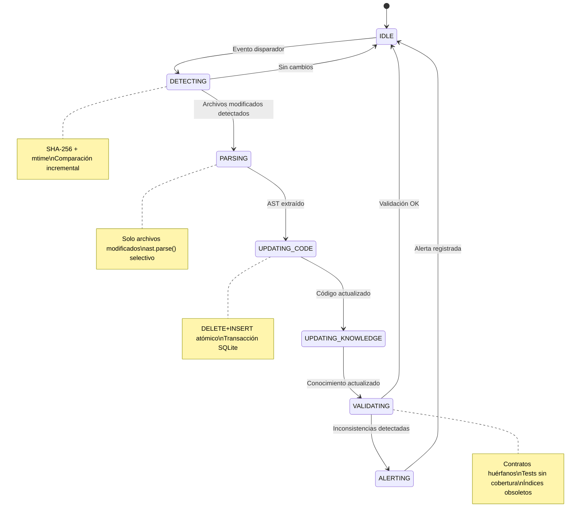
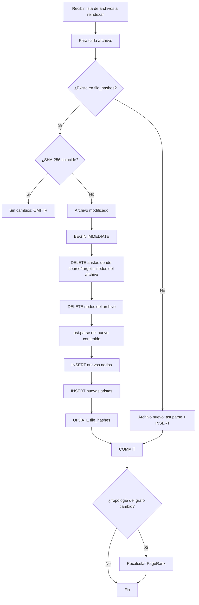

# GRAPH_UPDATE_LIFECYCLE.md — GAMEFORGE 2D
## Ciclo de Vida de Actualización del Grafo

**Estado:** ESPECIFICACIÓN TÉCNICA NORMATIVA  
**Misión:** MISIÓN 004 — Sistema de Grafos, Memoria y Contexto Operativo  
**Fecha:** 2026-11-07  
**Autor:** Director / Arquitecto de Sistemas  
**Proyecto:** GameForge 2D (RPG Modular en Python / Pygame CE)  

---

## 1. Objetivo

Definir los mecanismos de detección de cambios, hooks de integración y protocolos de actualización que mantienen el grafo GF-Graph sincronizado con el estado real del repositorio y del conocimiento del proyecto, evitando reconstrucciones completas innecesarias.

---

## 2. Diagrama de Estados del Ciclo de Actualización



---

## 3. Eventos Disparadores y Sus Acciones

| # | Evento | Origen | Acción Sobre el Grafo de Código | Acción Sobre el Grafo de Conocimiento |
|:---|:---|:---|:---|:---|
| E1 | **Commit de código** | Git post-commit hook | Reindexar archivos modificados en el commit | Registrar actividad del agente |
| E2 | **Ejecución de `verify.py`** | CLI manual o pre-merge | Verificar coherencia índice vs archivos | Verificar recibo de auditoría |
| E3 | **Cambio en `tasks/BOARD.md`** | Editor / agente | — | Parsear tablero y actualizar nodos de tareas |
| E4 | **Cambio en `CONTRACTS.md`** | Editor / agente | Revalidar aristas IMPLEMENTS_CONTRACT | Registrar `contract_change` con diff |
| E5 | **Cambio en `DECISIONS.md`** | Editor / agente | — | Crear/actualizar nodos `adr:` |
| E6 | **Tarea completada** | Agente reporta | Reindexar archivos de la tarea | Transicionar estado epistémico |
| E7 | **Instrucción del usuario** | Input directo | — | Registrar nodo `instruction` |
| E8 | **Fallo de test** | pytest / verify.py | — | Registrar nodo `problem` con evidencia |
| E9 | **Consulta pre-flight** | Agente inicia tarea | Verificar frescura del índice | Generar recibo de auditoría |

---

## 4. Mecanismos de Integración (Hooks)

### 4.1. Git Hooks

#### `pre-commit`

Ejecuta verificaciones antes de permitir el commit:

1. **Verificar recibo de auditoría**: Si los archivos en staging pertenecen a una tarea asignada, comprobar que existe un recibo pre-flight válido en `task_receipts`.
2. **Verificar archivos permitidos**: Cruzar archivos en staging contra los archivos permitidos de la tarea activa del agente (según `OWNERSHIP.md`).
3. **Resultado**: Si falla, el commit se bloquea con mensaje de error descriptivo.

Implementación: script `.git/hooks/pre-commit` que invoca `python tools/gf_graph.py verify-commit`.

#### `post-commit`

Se ejecuta después de cada commit exitoso:

1. **Obtener diff**: `git diff-tree --no-commit-id --name-only -r HEAD` para listar archivos modificados.
2. **Disparar reindexación incremental**: `python tools/gf_graph.py index --files <lista>`.
3. **Registrar actividad**: Crear entrada en el grafo de conocimiento con commit hash y autor.

Implementación: script `.git/hooks/post-commit` que invoca `python tools/gf_graph.py post-commit`.

### 4.2. Integración con `tools/verify.py`

`verify.py` ya es el punto de verificación estándar del proyecto (lint + tests + benchmark). Se propone añadir un paso adicional:

```
== verificación de grafo (gf-graph) ==
1. Verificar que el índice está actualizado (sin archivos obsoletos).
2. Verificar que existe recibo de auditoría para la tarea activa.
3. Verificar que los contratos tienen implementaciones vinculadas.
4. Reportar contratos huérfanos o tests sin cobertura de contrato.
```

Este paso es **informativo** inicialmente (no bloquea), y se puede promover a **bloqueante** cuando el sistema esté maduro.

### 4.3. Watcher de `tasks/BOARD.md`

Parser determinista que extrae el estado actual del tablero de tareas:

1. **Formato esperado**: Secciones Markdown con encabezados `## EN CURSO`, `## VERIFICADA`, etc.
2. **Extracción por tarea**: ID (T-XXX), responsable, archivos permitidos, criterios de aceptación.
3. **Comparación contra `knowledge_nodes`**: Detectar tareas nuevas, transiciones de estado y tareas completadas.
4. **Actualización**: Crear nodos `task:` nuevos o transicionar estados existentes.

### 4.4. Watcher de `architecture/CONTRACTS.md`

Parser que detecta cambios en las firmas de contrato:

1. **Extraer firmas**: Cada sección `## <nombre>` con sus firmas de función documentadas.
2. **Comparar con nodos `contract:`**: Detectar firmas nuevas, modificadas o eliminadas.
3. **Registrar cambio**: Crear nodo `contract_change:CC-XXX` con el diff semántico.
4. **Revalidar aristas**: Verificar que las aristas `IMPLEMENTS_CONTRACT` siguen siendo correctas tras el cambio.
5. **Alertar**: Si una firma de contrato cambió pero su implementación no → alerta de inconsistencia.

---

## 5. Indexación Incremental del Grafo de Código

### 5.1. Flujo detallado



### 5.2. Detección de archivos eliminados

Además de los archivos modificados, se debe detectar archivos que ya no existen:

1. Listar todos los `filepath` en `file_hashes`.
2. Verificar existencia de cada uno en el sistema de archivos.
3. Para archivos eliminados: borrar todos sus nodos, aristas y entrada en `file_hashes`.

### 5.3. Transacciones batch

Para indexaciones que afectan múltiples archivos, se agrupan todas las operaciones en una sola transacción SQLite para maximizar rendimiento:

```
BEGIN IMMEDIATE;
  -- Archivo 1: DELETE + INSERT
  -- Archivo 2: DELETE + INSERT
  -- ...
  -- Archivo N: DELETE + INSERT
  -- UPDATE file_hashes para todos
COMMIT;
```

---

## 6. Actualización del Grafo de Conocimiento

### 6.1. Registro de tareas desde BOARD.md

Cuando el parser de BOARD.md detecta una tarea nueva o un cambio de estado:

1. Si la tarea no existe como nodo `task:T-XXX` → crear con estado PROPUESTA.
2. Si la tarea cambió de columna (ej: PROPUESTA→APROBADA) → transicionar el `epistemic_status`.
3. Crear aristas `ASSIGNED_TO` hacia el agente responsable.
4. Crear aristas `TOUCHES_MODULE` hacia los módulos de los archivos permitidos.

### 6.2. Registro de ADRs desde DECISIONS.md

Cuando el parser detecta un ADR nuevo o modificado:

1. Crear nodo `adr:ADR-XXX` con título, estado y contexto.
2. Vincular con módulos afectados mediante aristas `GOVERNS`.
3. Si el ADR reemplaza uno anterior → crear arista `SUPERSEDES`.

### 6.3. Registro de problemas desde tests

Cuando `pytest` o `verify.py` reportan un fallo:

1. Crear nodo `prob:P-XXX` con descripción del error, archivo de test y mensaje.
2. Estado epistémico: COMPROBADA (el problema es un hecho verificado).
3. Vincular con el módulo que falla mediante arista `AFFECTS`.

### 6.4. Registro de soluciones verificadas

Cuando una tarea completa con `verify.py` exitoso:

1. Transicionar el nodo de tarea a COMPROBADA.
2. Si resolvía un problema → crear arista `RESOLVES` entre la solución y el problema.
3. Registrar commit hash en `provenance_ref`.

---

## 7. Detección de Índices Obsoletos

### 7.1. Criterios de obsolescencia

| Condición | Nivel de Alerta | Acción Recomendada |
|:---|:---|:---|
| Archivo modificado pero no reindexado | ⚠️ ADVERTENCIA | Ejecutar `gf-graph index` |
| Archivo eliminado pero nodos todavía en el grafo | 🔴 ERROR | Ejecutar `gf-graph index --prune` |
| Contrato modificado pero aristas IMPLEMENTS no actualizadas | ⚠️ ADVERTENCIA | Ejecutar `gf-graph contracts --revalidate` |
| Nodo de conocimiento con `valid_to` pasado y aún referenciado | ℹ️ INFO | Revisar y archivar |
| Tarea en BOARD.md marcada VERIFICADA pero nodo en PENDIENTE | 🔴 ERROR | Reconciliar estados |
| Último `last_indexed` > 24 horas | ℹ️ INFO | Ejecutar reindexación |

### 7.2. Comando de estado

```
$ python tools/gf_graph.py status

GF-Graph Status Report
═══════════════════════
Archivos indexados:     65
Archivos obsoletos:      2  ⚠️  game/sim/combat.py, game/entities/player.py
Archivos eliminados:     0
Nodos de código:      2,134
Aristas de código:    5,412
Nodos de conocimiento:   47
Contratos vinculados:  23/25 (2 huérfanos)
Último índice:        2026-11-07T01:30:00Z
```

### 7.3. Marcado automático de conocimiento obsoleto

Cuando el código al que refiere un nodo de conocimiento cambia:

1. Detectar que un archivo referenciado por `knowledge_code_links` fue reindexado.
2. Verificar si las funciones/clases referenciadas siguen existiendo con la misma firma.
3. Si la firma cambió → marcar el nodo de conocimiento como OBSOLETA con `valid_to = NOW()`.
4. Crear alerta para que el agente responsable revise.

---

## 8. Prevención de Reconstrucciones Completas

### 8.1. Estrategias de optimización

| Estrategia | Mecanismo | Ahorro Estimado |
|:---|:---|:---|
| **Hash de archivo** | Solo reparsear si SHA-256 difiere | >95% de archivos omitidos en indexación típica |
| **Hash de topología** | Solo recalcular PageRank si las aristas cambiaron | >80% de recálculos evitados |
| **Batch inserts** | Agrupar INSERTs en una transacción | 10-50x más rápido que inserts individuales |
| **Índices SQL** | Índices compuestos en `source_id`, `target_id`, `relation_type` | Consultas de vecinos en <1 ms |
| **WAL mode** | Lecturas no bloqueadas por escrituras | Cero contención en consultas simultáneas |
| **Caché de contratos** | Parsear CONTRACTS.md solo si su hash cambió | Evitar reparseo en cada consulta |

### 8.2. Cuándo SÍ reconstruir completamente

La reconstrucción completa (`gf-graph index --full`) solo se justifica cuando:

1. El archivo `.gameforge/graph.db` se corrompió o fue eliminado.
2. Se actualizó la versión del esquema DDL del grafo.
3. Se realizó un `git rebase` o `git reset --hard` que alteró muchos archivos simultáneamente.
4. El director lo solicita explícitamente.

---

## 9. Sincronización Entre Agentes

### 9.1. Modelo de concurrencia

SQLite con WAL permite **múltiples lectores simultáneos** con **un solo escritor**. Esto se adapta perfectamente al flujo de GameForge donde los agentes trabajan secuencialmente por tarea pero pueden consultar en paralelo.

### 9.2. Protocolo de escritura

```
1. Agente adquiere lock: BEGIN IMMEDIATE;
2. Ejecuta operaciones de escritura (INSERT/UPDATE/DELETE)
3. COMMIT;
4. Si SQLITE_BUSY → esperar 100ms × 2^intento (máx 5 reintentos)
5. Si todos los reintentos fallan → abortar y reportar al director
```

### 9.3. Protocolo de lectura

```
1. Abrir conexión con PRAGMA query_only = 1;
2. Ejecutar consultas SELECT libremente
3. Cerrar conexión al terminar la consulta pre-flight
```

No se mantienen conexiones de lectura abiertas indefinidamente para no bloquear el checkpointing de WAL.

---

## 10. Tabla Resumen de Ciclo de Vida

| Fase | Disparador | Entrada | Salida | Persistencia |
|:---|:---|:---|:---|:---|
| Detección | Commit, verify.py, cambio manual | Lista de archivos, BOARD.md, CONTRACTS.md | Lista de cambios detectados | — |
| Parsing | Archivos con hash diferente | Código fuente `.py` | AST con nodos y aristas | — |
| Actualización de código | AST parseado | Nodos y aristas nuevos | Grafo de código actualizado | `code_nodes`, `code_edges`, `file_hashes` |
| Actualización de conocimiento | Cambios en BOARD/DECISIONS | Estados de tareas, ADRs | Grafo de conocimiento actualizado | `knowledge_nodes`, `knowledge_edges` |
| Validación | Grafo actualizado | Estado completo del grafo | Reporte de inconsistencias | `task_receipts` (alertas) |
| PageRank | Topología de aristas cambió | Grafo de código completo | Scores de relevancia | `code_nodes.pagerank_score` |
