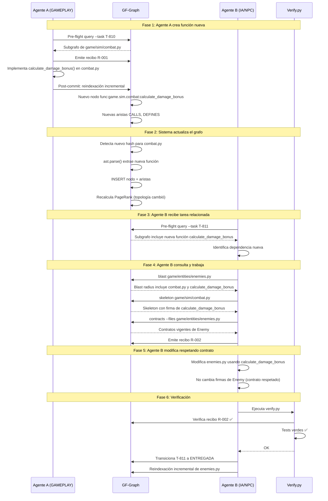

# GRAPH_VALIDATION_TESTS.md — GAMEFORGE 2D
## Especificación de Pruebas de Validación del Sistema de Grafos

**Estado:** ESPECIFICACIÓN TÉCNICA NORMATIVA  
**Misión:** MISIÓN 004 — Sistema de Grafos, Memoria y Contexto Operativo  
**Fecha:** 2026-11-07  
**Autor:** Director / Arquitecto de Sistemas  
**Proyecto:** GameForge 2D (RPG Modular en Python / Pygame CE)  

---

## 1. Objetivo

Definir la suite de pruebas que verificará el correcto funcionamiento del sistema GF-Graph, incluyendo la integridad del grafo de código, la taxonomía epistémica del grafo de conocimiento, los recibos de auditoría pre-flight y la prueba de uso real de coordinación entre agentes (Requisito 7 de la misión).

---

## 2. Suite de Tests Propuesta

Archivo: `tests/test_gf_graph.py`

### 2.1. Tests del Grafo de Código

| Test | Descripción | Criterio de Aceptación |
|:---|:---|:---|
| `test_initial_index_creates_all_code_nodes` | Indexar el repositorio desde cero crea nodos para todos los archivos `.py` en `game/` y `tools/` | Cantidad de nodos `file` ≥ 65; cada archivo `.py` tiene exactamente un nodo `file` |
| `test_incremental_index_only_modifies_changed_files` | Modificar un solo archivo y reindexar solo afecta ese archivo | Nodos/aristas de archivos no modificados permanecen idénticos (mismos IDs, mismas firmas) |
| `test_deleted_file_removes_nodes` | Eliminar un archivo y reindexar elimina sus nodos y aristas | No existen nodos con `filepath` del archivo eliminado |
| `test_import_edges_are_correct` | Las aristas `IMPORTS` reflejan los imports reales del código | Para `game/sim/combat.py`: verificar que existe arista IMPORTS hacia `game/core/math2d` y `game/entities` |
| `test_call_edges_are_correct` | Las aristas `CALLS` reflejan llamadas reales entre funciones | Si `resolve_attack` llama a `player.take_damage`, debe existir la arista CALLS correspondiente |
| `test_class_definitions_are_extracted` | Las clases se extraen con bases, decoradores y docstring | `class:game.entities.player:Player` existe con firma y líneas correctas |
| `test_function_signatures_are_complete` | Las funciones incluyen parámetros tipados y return type | `func:game.sim.combat:resolve_attack` tiene signature con todos los parámetros |
| `test_pagerank_assigns_nonzero_scores` | Tras indexación, todos los nodos de archivo tienen PageRank > 0 | `pagerank_score > 0` para todos los nodos `file` |
| `test_pagerank_ranks_central_files_higher` | Archivos muy importados (ej: `math2d.py`, `config.py`) tienen score más alto | `pagerank(math2d.py) > pagerank(leaderboard.py)` |
| `test_file_hashes_track_changes` | La tabla `file_hashes` se actualiza correctamente tras modificación | `sha256` y `mtime_ns` cambian para el archivo modificado |

### 2.2. Tests del Análisis de Impacto

| Test | Descripción | Criterio de Aceptación |
|:---|:---|:---|
| `test_blast_radius_detects_affected_tests` | Blast radius de `game/sim/combat.py` incluye `tests/test_combat.py` | El resultado contiene `test:tests/test_combat.py` en nivel 1 o 2 |
| `test_blast_radius_detects_affected_contracts` | Blast radius incluye contratos que gobiernan el módulo | Si `combat.py` implementa `contract:resolve_attack`, aparece en el resultado |
| `test_blast_radius_respects_depth_limit` | Con `depth=1` no se incluyen dependencias transitivas de nivel 2+ | El resultado de depth=1 es un subconjunto estricto de depth=3 |
| `test_skeleton_generation_reduces_tokens` | El skeleton de un archivo consume <15% de los tokens del código completo | `len(skeleton_tokens) / len(source_tokens) < 0.15` |
| `test_skeleton_preserves_signatures` | El skeleton incluye todas las firmas públicas del módulo | Todas las funciones sin prefijo `_` aparecen en el skeleton |

### 2.3. Tests de Contratos

| Test | Descripción | Criterio de Aceptación |
|:---|:---|:---|
| `test_contract_implementation_links` | Las firmas de `CONTRACTS.md` se vinculan a implementaciones | `contract:Player.take_damage` tiene arista `IMPLEMENTS_CONTRACT` desde `func:game.entities.player:Player.take_damage` |
| `test_orphan_contracts_detected` | Contratos sin implementación se reportan como huérfanos | Si se añade un contrato ficticio, el comando `contracts` lo reporta como huérfano |
| `test_uncontracted_public_functions` | Funciones públicas sin contrato se reportan como no gobernadas | El reporte incluye funciones públicas que no tienen arista `IMPLEMENTS_CONTRACT` |

### 2.4. Tests del Grafo de Conocimiento

| Test | Descripción | Criterio de Aceptación |
|:---|:---|:---|
| `test_knowledge_node_creation` | Se pueden crear nodos de todas las categorías (task, adr, problem, solution, etc.) | Cada categoría se inserta y consulta correctamente |
| `test_knowledge_edges_creation` | Se pueden crear aristas de todos los tipos entre nodos de conocimiento | Aristas ASSIGNED_TO, DEPENDS_ON, SUPERSEDES, RESOLVES funcionan |
| `test_cross_links_knowledge_to_code` | Los enlaces cruzados `knowledge_code_links` conectan conocimiento con código | `task:T-802` → `AFFECTS` → `file:game/sim/combat.py` existe |

### 2.5. Tests de Taxonomía Epistémica (Requisito 5)

| Test | Descripción | Criterio de Aceptación |
|:---|:---|:---|
| `test_valid_epistemic_transitions` | Las transiciones válidas se ejecutan correctamente | PROPUESTA→PENDIENTE→COMPROBADA funciona |
| `test_invalid_transition_propuesta_to_comprobada` | No se permite transición directa PROPUESTA→COMPROBADA | Lanza error o es rechazada |
| `test_invalid_transition_rechazada_to_comprobada` | No se permite transición RECHAZADA→COMPROBADA | Lanza error o es rechazada |
| `test_invalid_transition_obsoleta_to_comprobada` | No se permite reactivar OBSOLETA→COMPROBADA | Lanza error o es rechazada |
| `test_hypothesis_never_registered_as_implemented` | Un nodo en PROPUESTA no puede tener `provenance_ref` con commit hash | Si se intenta, se rechaza la operación |
| `test_failed_task_stays_rejected` | Una tarea que falló en verificación permanece en RECHAZADA | No se puede transicionar a COMPROBADA sin crear nuevo nodo |
| `test_temporal_invalidation_sets_valid_to` | Transicionar a OBSOLETA establece `valid_to = NOW()` | El campo `valid_to` es NOT NULL tras transicionar |
| `test_superseded_creates_chain` | Cuando un ADR reemplaza otro, se crea arista SUPERSEDES y el anterior se marca OBSOLETA | Arista existe y estado del anterior es OBSOLETA |

### 2.6. Tests de Recibos de Auditoría

| Test | Descripción | Criterio de Aceptación |
|:---|:---|:---|
| `test_preflight_receipt_creation` | Se puede crear un recibo con todos los campos obligatorios | Recibo insertado en `task_receipts` con todos los campos |
| `test_preflight_receipt_hash_verification` | El hash del subgrafo es reproducible | La misma consulta produce el mismo `queried_subgraph_hash` |
| `test_preflight_receipt_required_before_commit` | Sin recibo, el proceso de verificación emite advertencia | verify.py reporta "sin recibo para T-XXX" |
| `test_receipt_records_contracts_consulted` | El recibo incluye la lista de contratos consultados | Campo `contracts_consulted` no vacío |
| `test_receipt_records_dependencies` | El recibo incluye la lista de dependencias analizadas | Campo `dependencies_analyzed` no vacío |

### 2.7. Tests de Sincronización

| Test | Descripción | Criterio de Aceptación |
|:---|:---|:---|
| `test_cross_agent_knowledge_visibility` | Lo que registra un agente es visible para otro | Agente A inserta nodo → Agente B lo encuentra en consulta |
| `test_concurrent_reads_do_not_block` | Múltiples lectores simultáneos no se bloquean | Dos threads leen simultáneamente sin SQLITE_BUSY |
| `test_write_lock_serialization` | Dos escrituras simultáneas se serializan correctamente | Ambas escrituras se completan sin corrupción de datos |

---

## 3. Diferenciación de Información por Estado Epistémico (Requisito 5)

Tabla con ejemplos concretos de cada estado aplicado a casos reales de GameForge:

| Estado | Ejemplo Concreto | Evidencia | Observación |
|:---|:---|:---|:---|
| **COMPROBADA** | "El sistema de colisión tile-based funciona correctamente con subdivisión de desplazamiento" | 278 tests verdes, commit `762a88b`, p95=1.29ms | Implementada, probada y verificada |
| **PROPUESTA** | "Añadir sistema de buff temporal al combate" | Propuesta del agente GAMEPLAY sin código | No implementada. No registrar como existente |
| **PENDIENTE** | "Tarea T-805 (dodge roll) aprobada por el director, en espera de implementación" | Aprobación en BOARD.md, sin commit aún | En proceso. No declarar como terminada |
| **OBSOLETA** | "ADR-005 definía vertical slice de una planta; ahora hay 3 plantas con victoria en núcleo" | T-201 implementó multiplanta, ADR-005 ya no refleja el estado actual | Fue verdad, ya no lo es |
| **RECHAZADA** | "Propuesta de usar Pymunk para física rechazada por exceso de dependencias" | ADR-002, justificación del director | Evaluada y descartada. No re-proponer sin nueva evidencia |

---

## 4. Prueba de Uso Real (Requisito 7)

### 4.1. Escenario Completo



### 4.2. Evidencias a Registrar

Para cada paso del escenario, se registran las siguientes evidencias:

| Paso | Evidencia | Almacenamiento |
|:---|:---|:---|
| 1. Pre-flight de A | Recibo R-001 con hash de subgrafo | `task_receipts` |
| 2. Creación de función | Nuevo nodo `func:calculate_damage_bonus` | `code_nodes` |
| 3. Actualización de aristas | Aristas CALLS y DEFINES nuevas | `code_edges` |
| 4. Pre-flight de B | Recibo R-002 con hash de subgrafo actualizado | `task_receipts` |
| 5. Consulta de B | Hash de subgrafo incluye nueva función | Verificable en R-002 |
| 6. Blast radius de B | Resultado incluye `combat.py` | Log de consulta |
| 7. Verificación final | verify.py exit code 0, 278+ tests verdes | `task_receipts.verified_at` |

### 4.3. Criterios de Aceptación del Escenario

1. ✅ El nodo `func:game.sim.combat:calculate_damage_bonus` existe en el grafo tras el paso 2.
2. ✅ Las aristas CALLS desde la nueva función hacia sus dependencias existen.
3. ✅ El recibo R-002 de Agente B contiene el hash de un subgrafo que incluye la nueva función.
4. ✅ El blast radius de `enemies.py` muestra `combat.py` como dependencia.
5. ✅ Los contratos de `Enemy` no fueron violados.
6. ✅ Ambos recibos tienen `queried_at` anterior al primer commit de su respectiva tarea.
7. ✅ El grafo final refleja los cambios de ambos agentes consistentemente.

---

## 5. Test del Ciclo Completo (`test_full_workflow_scenario`)

Este test integra los 7 pasos del Requisito 7 en una secuencia automatizada:

### 5.1. Pseudocódigo del test

```
def test_full_workflow_scenario():
    # Setup: Crear BD temporal, indexar repositorio
    db = create_temp_graph_db()
    indexer = CodeIndexer(db)
    indexer.index_full(repo_root="game/")

    # Paso 1: Agente A crea función en un archivo temporal
    combat_path = create_temp_module_with_function(
        name="calculate_damage_bonus",
        signature="def calculate_damage_bonus(base: float, level: int) -> float",
        calls=["math.sqrt"]
    )

    # Paso 2: Reindexar incrementalmente
    indexer.index_incremental([combat_path])
    assert db.node_exists("func:temp:calculate_damage_bonus")
    assert db.edge_exists(source="func:temp:calculate_damage_bonus", type="CALLS")

    # Paso 3: Agente B consulta el grafo
    subgraph = db.query_subgraph(file=combat_path, depth=2)
    assert "calculate_damage_bonus" in subgraph.function_names

    # Paso 4: Generar recibo para Agente B
    receipt = db.create_receipt(
        task_id="task:T-TEST",
        agent="TEST-AGENT",
        subgraph_hash=subgraph.hash()
    )
    assert receipt.queried_subgraph_hash is not None

    # Paso 5: Blast radius incluye la nueva dependencia
    blast = db.blast_radius("func:temp:calculate_damage_bonus", depth=2)
    assert len(blast.affected_code) > 0

    # Paso 6: Verificar que el contrato no fue violado
    # (sin cambios de firma → contratos intactos)
    contract_status = db.verify_contracts()
    assert contract_status.orphaned == 0

    # Paso 7: Verificación final
    assert db.receipt_exists("task:T-TEST")
    assert receipt.queried_at < datetime.now()
```

### 5.2. Fixtures de pytest

```
@pytest.fixture
def temp_graph_db(tmp_path):
    """Crea una BD SQLite temporal con el esquema GF-Graph."""
    db_path = tmp_path / "test_graph.db"
    initialize_schema(db_path)
    yield GraphDB(db_path)

@pytest.fixture
def indexed_graph(temp_graph_db):
    """BD con el repositorio real indexado."""
    indexer = CodeIndexer(temp_graph_db)
    indexer.index_full("game/")
    return temp_graph_db
```

---

## 6. Integración con la Suite Existente

La suite `tests/test_gf_graph.py` se integra con el framework de testing existente:

- **Framework**: pytest ≥ 8 (ya instalado).
- **Fixtures**: Usar `tmp_path` de pytest para BDs temporales.
- **Ejecución**: Se incluye automáticamente en `tools/verify.py`.
- **Independencia de pygame**: Todos los tests de GF-Graph son headless y no requieren `import pygame`.
- **Conteo estimado**: ~25 tests nuevos, sumando a los 278 existentes.
