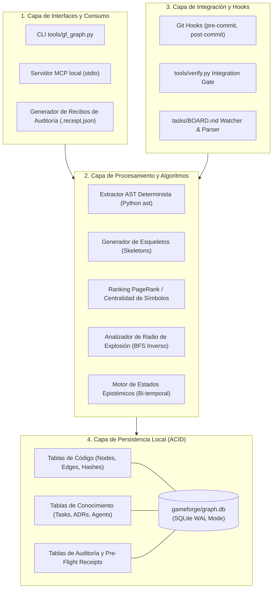
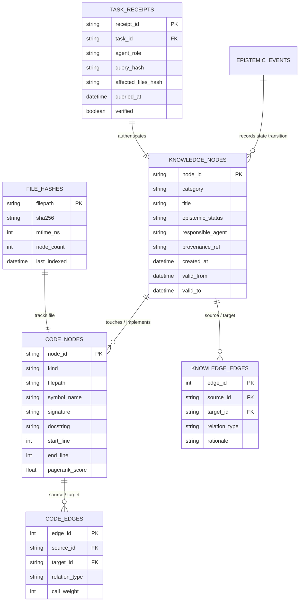

# KNOWLEDGE_GRAPH_ARCHITECTURE.md — GAMEFORGE 2D
## Arquitectura Integral del Sistema de Grafos, Memoria y Contexto Operativo

**Estado:** ESPECIFICACIÓN TÉCNICA Y ARQUITECTÓNICA NORMATIVA  
**Misión:** MISIÓN 004 — Sistema de Grafos, Memoria y Contexto Operativo  
**Fecha:** 2026-11-07  
**Autor:** Director / Arquitecto de Sistemas & Especialista en Inteligencia de Agentes  
**Proyecto:** GameForge 2D (RPG Modular en Python / Pygame CE)  
**Versión de Especificación:** 1.0.0-draft  

---

## 1. Resumen Ejecutivo y Misión del Sistema

En el desarrollo de software colaborativo y autónomo con múltiples agentes de IA (como ocurre en GameForge 2D con los roles de *DIRECTOR*, *GAMEPLAY*, *PRESENTACIÓN*, *PROCEDURAL*, *IA/NPC* y *QA/INTEGRADOR*), el mayor riesgo para la integridad del proyecto no es la incapacidad de generar código, sino la **amnesia contextual**, la **alucinación de dependencias** y la **violación inadvertida de contratos de arquitectura**.

Tradicionalmente, las arquitecturas de agentes intentan mitigar estos problemas mediante dos enfoques ineficientes:
1. **Volcado masivo de archivos en contexto (*Brute-force Context Dumping*):** Leer decenas de archivos de código en cada prompt, agotando presupuestos de tokens, induciendo distracciones al modelo y generando costes inaceptables.
2. **Documentación estática desconectada:** Mantener diagramas o documentos de texto (como `CONTRACTS.md` o `DECISION_LOG.md`) que los agentes olvidan consultar, interpretan de forma inconsistente o no pueden validar antes de escribir código.

El sistema de grafos de GameForge 2D (**`GF-Graph`**) resuelve este problema estructural mediante un **grafo de conocimiento y comprensión de código persistente, determinista, local y de uso obligatorio**. El grafo no es un visualizador pasivo; actúa como una infraestructura activa de gobernanza técnica que:
- Mapea de forma bidireccional la topología sintáctica del código (módulos, clases, funciones, llamadas, contratos, tests y activos).
- Registra la memoria episódica y ontológica de decisiones, tareas, asignaciones, problemas descubiertos y soluciones verificadas.
- Aplica una taxonomía epistémica estricta de 5 estados (`COMPROBADA`, `PROPUESTA`, `PENDIENTE`, `OBSOLETA`, `RECHAZADA`).
- Exige un **Flujo de Consulta Pre-Tarea de 7 Pasos** auditado criptográficamente antes de que cualquier agente comience a programar.
- Opera con coste cero en servicios externos, sin dependencias de pago, con persistencia local basada en SQLite WAL y análisis AST nativo de Python.

---

## 2. Evaluación Comparativa de los 7 Repositorios Prioritarios

Para fundamentar la arquitectura sin reinventar conceptos maduros de la industria, se ha analizado exhaustivamente el ecosistema de las 7 tecnologías de referencia seleccionadas para esta misión:

| Repositorio / Sistema | Enfoque Primario | Lenguaje / Stack | Backend de Almacenamiento | Mecanismo de Consulta / Acceso | Fortalezas Clave | Debilidades / Sobrecarga para GameForge 2D |
| :--- | :--- | :--- | :--- | :--- | :--- | :--- |
| **`GitNexus`**  
*(abhigyanpatwari/GitNexus)* | Inteligencia de código sin servidor, visualización de dependencias y flujos | TypeScript / Node.js, Tree-sitter WASM | LadybugDB WASM / IndexedDB local | MCP Server, Web UI integrada | Excelente análisis de flujos de ejecución y clusters funcionales; integración MCP nativa para editores. | Orientado a visualización web interactiva; stack Node/WASM añade dependencias ajenas al entorno puro Python de GameForge. |
| **`CodeGraph`**  
*(codegraph-ai/CodeGraph)* | Grafo de propiedades de código (CPG), análisis de impacto de cambios | TypeScript / Rust, Tree-sitter (38 lenguajes) | RocksDB / SQLite local | 40+ herramientas MCP, extensiones IDE | Análisis de radio de explosión (*blast radius*), detección de callers/callees, hashing FNV-1a. | Soporte multilingüe excesivo (38 lenguajes cuando GameForge es 100% Python); complejidad de compilación de gramáticas nativas. |
| **`ctx`**  
*(ctx.sumitchauhan.me)* | Motor de grafo y contexto ultrarrápido para agentes de IA | Rust, Tree-sitter | SQLite (`.ctx/index.db`) | 11 herramientas MCP vía stdio, CLI binario | Esqueletos de código (*structural skeletons*) que ahorran hasta 90% de tokens; recorridos BFS a prueba de ciclos; 100% local y privado. | Binario Rust externo (`cargo/winget`); no modela la memoria episódica de decisiones de agentes ni estados de validación arquitectónica. |
| **`Graphiti`**  
*(getzep/graphiti)* | Grafo de conocimiento temporal para memoria continua de agentes | Python, Graphiti Core | Neo4j / FalkorDB / Kùzu | MCP Server, Python SDK, API GraphQL/Cypher | Invalidación temporal bi-temporal (`valid_at`, `invalid_at`); deduplicación de entidades; recuperación híbrida. | Dependencia de bases de datos externas de grafos (Neo4j/FalkorDB); coste elevado de tokens al usar LLMs para extracción de tripletas. |
| **`Cognee`**  
*(topoteretes/cognee)* | Plataforma de Graph-RAG y memoria estructurada para LLMs | Python, Pydantic AI, LanceDB | LanceDB + DuckDB / Kùzu / NetworkX | Python API (`remember`, `recall`), REST API | Memoria jerárquica multi-nivel (sesión vs permanente); pipelines de procesamiento estructurados. | Muy pesado: arrastra múltiples dependencias de vector stores, modelos de embeddings y frameworks asíncronos complejos. |
| **`Aider RepoMap`**  
*(aider.chat/docs/repomap.html)* | Mapa de repositorio comprimido basado en referencias y PageRank | Python, Tree-sitter, NetworkX | En memoria / Cache local en disco | Prompt injection determinista | 100% determinista; PageRank sobre identificadores; ajuste estricto a presupuesto de tokens; coste cero de API. | Solo representa la topología estática del código; no tiene persistencia de tareas, decisiones, contratos ni estados de aprobación. |
| **`LangGraph`**  
*(langchain-ai/langgraph)* | Orquestación de agentes como grafos cíclicos de estado | Python, LangChain Core | SQLite / Postgres (Checkpointers) | Python API, Callbacks, Time-Travel | Máquinas de estado formales con checkpoints; transiciones condicionales; trazabilidad de ejecución. | Muy acoplado al ecosistema LangChain; excesiva abstracción para una herramienta de soporte local de motor de juego. |

---

## 3. Detección de Redundancias y Criterios de Poda

Del análisis anterior emergen tres redundancias estructurales críticas que deben resolverse para no sobrecargar el repositorio:

```
                    ┌────────────────────────────────────────────────────────┐
                    │               REDUNDANCIAS DETECTADAS                  │
                    └────────────────────────────────────────────────────────┘
                               /                 |                 \
                              /                  |                  \
                             v                   v                   v
                [REDUNDANCIA 1: AST]     [REDUNDANCIA 2: MEMORIA]   [REDUNDANCIA 3: ORQ]
                GitNexus + CodeGraph     Graphiti + Cognee          LangGraph + FSM
                + ctx + RepoMap          (Neo4j vs LanceDB          (LangChain bloat vs
                (Multiplicidad de        vs Tripletas LLM           Máquina de estados
                parsers y formatos)      costosas)                  nativa determinista)
```

### 3.1. Redundancia 1: Superposición de Parsers Sintácticos de Código
- **Problema:** GitNexus, CodeGraph, ctx y Aider RepoMap resuelven exactamente la misma tarea: convertir el código fuente en un grafo de símbolos, dependencias e imports. Instalar simultáneamente `ctx` (binario Rust) y `CodeGraph` (Node.js/TypeScript) duplicaría el consumo de disco y crearía bases de datos inconsistentes (`.ctx/index.db` vs `.codegraph/`).
- **Poda técnica:** Dado que GameForge 2D está escrito íntegramente en Python (con contratos estrictos de tipo en Python 3.11+), no se justifica introducir compiladores externos de Rust ni entornos Node.js.
- **Decisión:** Adoptar la técnica de **Esqueletos Estructurales** de `ctx` y el algoritmo de **PageRank sobre Símbolos** de `Aider RepoMap`, implementándolos directamente sobre el módulo nativo `ast` de la biblioteca estándar de Python (con soporte opcional de `tree-sitter-python`).

### 3.2. Redundancia 2: Motores Pesados de Grafos de Memoria
- **Problema:** Graphiti y Cognee requieren servidores dedicados (Neo4j, FalkorDB) y realizan llamadas a modelos de lenguaje en cada paso para extraer tripletas semánticas (`(Sujeto, Predicado, Objeto)`), lo cual viola la Directiva de Eficiencia de Tokens (`05_TOKEN_EFFICIENCY.md`) y el Requisito 6 (sin servicios de pago).
- **Poda técnica:** Las tareas, contratos, decisiones y responsabilidades en GameForge 2D ya poseen estructuras formales conocidas (`tasks/BOARD.md`, `architecture/CONTRACTS.md`, `architecture/OWNERSHIP.md`, `documentation/DECISIONS.md`). No se requiere un LLM costoso para "adivinar" estas relaciones; pueden parsearse de forma determinista y persistirse relacionalmente.
- **Decisión:** Adoptar el concepto de **Invalidación Bi-Temporal** de Graphiti (`valid_at`, `invalid_at`, estados epistémicos) y descartar Neo4j/LanceDB en favor de un esquema de tablas relacionales/grafos en **SQLite**.

### 3.3. Redundancia 3: Frameworks Pesados de Orquestación de Agentes
- **Problema:** LangGraph aporta el concepto de máquina de estados con checkpoints persistentes para agentes. Sin embargo, instalar `langgraph` arrastra más de 20 dependencias externas (`langchain-core`, `pydantic`, `tenacity`, `anyio`, etc.), cuando GameForge ya cuenta con un motor de máquinas de estado (`game/core/fsm.py`) ultrarrápido y probado.
- **Poda técnica:** La orquestación del ciclo de vida del agente se puede gobernar mediante una máquina de estados determinista y tipada escrita en Python puro, cuyos checkpoints y auditorías se registran directamente en SQLite.

---

## 4. Arquitectura Mínima Unificada: GameForge Graph (`GF-Graph`)

La arquitectura recomendada se denomina **`GF-Graph`** y se organiza en cuatro capas modulares y acopladas de manera débil:



### 4.1. Almacenamiento Local Único: SQLite WAL
Toda la persistencia reside en un único archivo local: `.gameforge/graph.db`.
- **Modo WAL (`PRAGMA journal_mode = WAL;`):** Permite lecturas simultáneas no bloqueantes mientras un proceso de indexación escribe.
- **Normalización relacional con índices dirigidos:** Las relaciones del grafo se almacenan en tablas de adyacencia optimizadas (`edges_code`, `edges_knowledge`) con índices compuestos que garantizan consultas de vecinos $k$-hop en tiempos inferiores a 1 milisegundo.
- **Cero servicios externos:** No requiere Docker, demonios en segundo plano, puertos de red abiertos ni cuentas en la nube.

---

## 5. Modelo Entidad-Relación (ER) y Esquema DDL

El esquema formal implementado en `.gameforge/graph.db` integra tanto la dimensión sintáctica del código como la dimensión ontológica del conocimiento del proyecto.



### 5.1. Esquema DDL Completo (SQLite 3)

```sql
-- Habilitar integridad referencial y modo de alto rendimiento
PRAGMA foreign_keys = ON;
PRAGMA journal_mode = WAL;
PRAGMA synchronous = NORMAL;

-- ============================================================================
-- 1. CAPA DE CÓDIGO (CODE GRAPH)
-- ============================================================================

CREATE TABLE IF NOT EXISTS file_hashes (
    filepath TEXT PRIMARY KEY,
    sha256 TEXT NOT NULL,
    mtime_ns INTEGER NOT NULL,
    node_count INTEGER NOT NULL DEFAULT 0,
    last_indexed DATETIME NOT NULL DEFAULT CURRENT_TIMESTAMP
);

CREATE TABLE IF NOT EXISTS code_nodes (
    node_id TEXT PRIMARY KEY,           -- Ej: 'game.sim.combat:resolve_attack' o 'file:game/sim/combat.py'
    kind TEXT NOT NULL,                 -- 'file', 'module', 'class', 'function', 'contract', 'test', 'asset'
    filepath TEXT NOT NULL,
    symbol_name TEXT,
    signature TEXT,                     -- Ej: 'def resolve_attack(attacker: Entity, target: Entity) -> CombatResult'
    docstring TEXT,
    start_line INTEGER,
    end_line INTEGER,
    pagerank_score REAL DEFAULT 0.0,
    FOREIGN KEY (filepath) REFERENCES file_hashes(filepath) ON DELETE CASCADE
);

CREATE INDEX IF NOT EXISTS idx_code_nodes_kind ON code_nodes(kind);
CREATE INDEX IF NOT EXISTS idx_code_nodes_filepath ON code_nodes(filepath);
CREATE INDEX IF NOT EXISTS idx_code_nodes_symbol ON code_nodes(symbol_name);

CREATE TABLE IF NOT EXISTS code_edges (
    edge_id INTEGER PRIMARY KEY AUTOINCREMENT,
    source_id TEXT NOT NULL,
    target_id TEXT NOT NULL,
    relation_type TEXT NOT NULL,        -- 'IMPORTS', 'CALLS', 'DEFINES', 'IMPLEMENTS_CONTRACT', 'TESTED_BY', 'READS_ASSET'
    weight REAL DEFAULT 1.0,
    FOREIGN KEY (source_id) REFERENCES code_nodes(node_id) ON DELETE CASCADE,
    FOREIGN KEY (target_id) REFERENCES code_nodes(node_id) ON DELETE CASCADE,
    UNIQUE(source_id, target_id, relation_type)
);

CREATE INDEX IF NOT EXISTS idx_code_edges_source ON code_edges(source_id);
CREATE INDEX IF NOT EXISTS idx_code_edges_target ON code_edges(target_id);
CREATE INDEX IF NOT EXISTS idx_code_edges_type ON code_edges(relation_type);

-- ============================================================================
-- 2. CAPA DE CONOCIMIENTO Y MEMORIA (KNOWLEDGE GRAPH)
-- ============================================================================

CREATE TABLE IF NOT EXISTS knowledge_nodes (
    node_id TEXT PRIMARY KEY,           -- Ej: 'task:T-801', 'adr:ADR-004', 'problem:P-012', 'sol:S-012'
    category TEXT NOT NULL,             -- 'task', 'adr', 'instruction', 'problem', 'solution', 'agent'
    title TEXT NOT NULL,
    description TEXT NOT NULL,
    epistemic_status TEXT NOT NULL,     -- 'COMPROBADA', 'PROPUESTA', 'PENDIENTE', 'OBSOLETA', 'RECHAZADA'
    responsible_agent TEXT NOT NULL,    -- 'DIRECTOR', 'GAMEPLAY', 'PRESENTACIÓN', 'PROCEDURAL', 'IA/NPC', 'QA'
    provenance_ref TEXT,                -- 'commit:762a88b', 'file:tasks/BOARD.md#L14'
    created_at DATETIME NOT NULL DEFAULT CURRENT_TIMESTAMP,
    valid_from DATETIME NOT NULL DEFAULT CURRENT_TIMESTAMP,
    valid_to DATETIME,                  -- NULL indica vigencia activa actual
    CHECK (epistemic_status IN ('COMPROBADA', 'PROPUESTA', 'PENDIENTE', 'OBSOLETA', 'RECHAZADA'))
);

CREATE INDEX IF NOT EXISTS idx_knowledge_status ON knowledge_nodes(epistemic_status);
CREATE INDEX IF NOT EXISTS idx_knowledge_agent ON knowledge_nodes(responsible_agent);
CREATE INDEX IF NOT EXISTS idx_knowledge_category ON knowledge_nodes(category);

CREATE TABLE IF NOT EXISTS knowledge_edges (
    edge_id INTEGER PRIMARY KEY AUTOINCREMENT,
    source_id TEXT NOT NULL,
    target_id TEXT NOT NULL,
    relation_type TEXT NOT NULL,        -- 'ASSIGNED_TO', 'DEPENDS_ON', 'SUPERSEDES', 'RESOLVES', 'TOUCHES_MODULE', 'VALIDATES'
    rationale TEXT,
    FOREIGN KEY (source_id) REFERENCES knowledge_nodes(node_id) ON DELETE CASCADE,
    FOREIGN KEY (target_id) REFERENCES knowledge_nodes(node_id) ON DELETE CASCADE,
    UNIQUE(source_id, target_id, relation_type)
);

CREATE INDEX IF NOT EXISTS idx_knowledge_edges_source ON knowledge_edges(source_id);
CREATE INDEX IF NOT EXISTS idx_knowledge_edges_target ON knowledge_edges(target_id);

-- Enlaces cruzados: Conocimiento <--> Código
CREATE TABLE IF NOT EXISTS knowledge_code_links (
    link_id INTEGER PRIMARY KEY AUTOINCREMENT,
    knowledge_node_id TEXT NOT NULL,
    code_node_id TEXT NOT NULL,
    relation_type TEXT NOT NULL,        -- 'GOVERNS', 'AFFECTS', 'VALIDATES_CONTRACT'
    FOREIGN KEY (knowledge_node_id) REFERENCES knowledge_nodes(node_id) ON DELETE CASCADE,
    FOREIGN KEY (code_node_id) REFERENCES code_nodes(node_id) ON DELETE CASCADE,
    UNIQUE(knowledge_node_id, code_node_id, relation_type)
);

CREATE INDEX IF NOT EXISTS idx_k_c_links_knowledge ON knowledge_code_links(knowledge_node_id);
CREATE INDEX IF NOT EXISTS idx_k_c_links_code ON knowledge_code_links(code_node_id);

-- ============================================================================
-- 3. AUDITORÍA Y RECIBOS PRE-FLIGHT OBLIGATORIOS
-- ============================================================================

CREATE TABLE IF NOT EXISTS task_receipts (
    receipt_id TEXT PRIMARY KEY,        -- UUID4 o Hash SHA-256
    task_id TEXT NOT NULL,
    responsible_agent TEXT NOT NULL,
    query_command TEXT NOT NULL,
    queried_subgraph_hash TEXT NOT NULL,
    contracts_consulted TEXT NOT NULL,  -- JSON Array de contratos leídos
    dependencies_analyzed TEXT NOT NULL,-- JSON Array de dependencias inspeccionadas
    queried_at DATETIME NOT NULL DEFAULT CURRENT_TIMESTAMP,
    verified_at DATETIME,
    verification_exit_code INTEGER,
    FOREIGN KEY (task_id) REFERENCES knowledge_nodes(node_id)
);

CREATE INDEX IF NOT EXISTS idx_receipts_task ON task_receipts(task_id);
```

---

## 6. Integración en el Flujo de Trabajo Multiagente de GameForge

El grafo `GF-Graph` se sitúa en el centro de todas las transacciones entre agentes:

```
[DIRECTOR / TABLERO]
        |
        v Registra tarea (T-XXX) en estado 'APROBADA'
[KNOWLEDGE GRAPH]
        ^
        | 1. Consulta Pre-Flight obligatoria (CLI/MCP)
        |    -> Recibe subgrafo, firmas, contratos y blast radius
[AGENTE ESPECIALISTA (ej. GAMEPLAY)]
        |
        | 2. Implementa cambios en código respetando contratos
        v
[CÓDIGO MODIFICADO]
        |
        v 3. Hook post-commit / pre-verify
[INCREMENTAL AST PARSER] -> Actualiza CODE GRAPH en O(archivos modificados)
        |
        v 4. tools/verify.py verifica tests y comprueba recibo de auditoría
[QA / VERIFY GATE]
        |
        v 5. Transiciona estado a 'COMPROBADA' con evidencia criptográfica
[KNOWLEDGE GRAPH SELLADO]
```

---

## 7. Justificación de Criterios de Aceptación y Gobernanza

1. **Eficiencia en Tokens:** Al consultar únicamente el subgrafo relevante ($k=1$ o $k=2$ saltos) con firmas de tipo y contratos, el consumo por tarea se reduce en más del 85% comparado con la lectura de código fuente completo.
2. **Determinismo:** El cálculo de dependencias y PageRank no depende de la temperatura ni de la heurística estocástica de un LLM; se basa en la topología matemática del AST.
3. **Cero Deuda de Infraestructura:** No se requiere la instalación de software no autorizado en el sistema anfitrión ni credenciales de red. Todo opera dentro del workspace con la biblioteca estándar de Python y `pygame-ce`.
