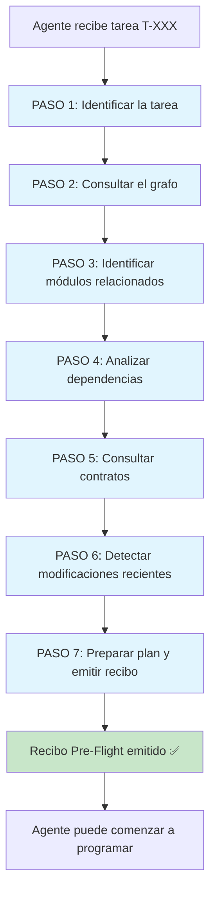

# MANDATORY_GRAPH_USAGE.md — GAMEFORGE 2D
## Protocolo de Uso Obligatorio del Grafo por Agentes

**Estado:** ESPECIFICACIÓN TÉCNICA NORMATIVA  
**Misión:** MISIÓN 004 — Sistema de Grafos, Memoria y Contexto Operativo  
**Fecha:** 2026-11-07  
**Autor:** Director / Arquitecto de Sistemas  
**Proyecto:** GameForge 2D (RPG Modular en Python / Pygame CE)  

---

## 1. Principio Fundamental

> **Ningún agente puede declarar que comprende el sistema sin consultar el conocimiento disponible. La comprensión se demuestra con un recibo de consulta verificable, no con afirmaciones textuales.**

Este documento define el Flujo de Consulta Pre-Tarea de 7 Pasos que todo agente de GameForge debe ejecutar antes de realizar cualquier modificación de código, propuesta arquitectónica o informe técnico.

---

## 2. Flujo de Consulta Pre-Tarea (7 Pasos)



### PASO 1 — Identificar la Tarea

**Acción**: Leer la asignación en `tasks/BOARD.md` y obtener:
- ID de tarea (ej: `T-802`).
- Objetivo concreto.
- Agente responsable asignado.
- Archivos permitidos para modificación.
- Criterios de aceptación verificables.

**Comando CLI**:
```
python tools/gf_graph.py query --task T-802 --step identify
```

**Salida esperada**:
```
Tarea: T-802
Objetivo: Añadir sistema de buff temporal al combate
Responsable: GAMEPLAY
Archivos permitidos: game/sim/combat.py, game/entities/player.py
Criterios: 3 criterios de aceptación definidos
Estado: APROBADA
```

### PASO 2 — Consultar el Grafo

**Acción**: Ejecutar una consulta al grafo de código para obtener el subgrafo de los módulos involucrados en la tarea.

**Comando CLI**:
```
python tools/gf_graph.py query --task T-802 --depth 2
```

**Salida esperada**: Subgrafo con todos los nodos (archivos, clases, funciones) y aristas (imports, calls, defines) dentro de 2 saltos de los archivos de la tarea. Incluye scores de PageRank para priorización.

### PASO 3 — Identificar Módulos Relacionados

**Acción**: Del subgrafo obtenido, listar:
- Módulos que importan los archivos de la tarea (dependientes).
- Módulos que los archivos de la tarea importan (dependencias).
- Tests asociados.

**Comando CLI**:
```
python tools/gf_graph.py skeleton --task T-802
```

**Salida esperada**: Skeletons compactos de los módulos relevantes mostrando solo firmas públicas, sin cuerpos de función.

### PASO 4 — Analizar Dependencias

**Acción**: Examinar las aristas `IMPORTS` y `CALLS` para comprender:
- Qué funciones externas utilizan los módulos de la tarea.
- Qué funciones de los módulos de la tarea son utilizadas por otros.
- Qué se rompería si cambio una firma.

**Comando CLI**:
```
python tools/gf_graph.py blast game/sim/combat.py --depth 3
```

**Salida esperada**: Radio de explosión clasificado por nivel, incluyendo código afectado, tests afectados y contratos afectados.

### PASO 5 — Consultar Contratos

**Acción**: Leer los contratos vigentes que gobiernan los módulos involucrados.

**Comando CLI**:
```
python tools/gf_graph.py contracts --files game/sim/combat.py game/entities/player.py
```

**Salida esperada**: Lista de contratos aplicables con sus firmas, garantías y restricciones. Cualquier violación potencial se resalta.

### PASO 6 — Detectar Modificaciones Recientes

**Acción**: Consultar si otros agentes han modificado recientemente los módulos involucrados o sus dependencias.

**Comando CLI**:
```
python tools/gf_graph.py history --files game/sim/combat.py --since 7d
```

**Salida esperada**: Lista de tareas recientes que tocaron estos archivos, con agente, fecha y cambios realizados.

### PASO 7 — Preparar Plan y Emitir Recibo

**Acción**: Generar un resumen estructurado del estado actual y producir un recibo de auditoría firmado.

**Comando CLI**:
```
python tools/gf_graph.py receipt T-802 --agent GAMEPLAY
```

**Salida esperada**: Recibo JSON guardado en `task_receipts` con hash verificable del subgrafo consultado.

---

## 3. Formato del Recibo de Auditoría (Pre-Flight Receipt)

Cada recibo se almacena en la tabla `task_receipts` y opcionalmente se exporta como `.receipt.json`:

```json
{
  "receipt_id": "a7b3c9d1-4e5f-6789-abcd-ef0123456789",
  "task_id": "task:T-802",
  "responsible_agent": "GAMEPLAY",
  "query_command": "gf-graph query --task T-802 --depth 2",
  "queried_subgraph_hash": "sha256:3f4a8b2c1d...",
  "contracts_consulted": [
    "contract:Player.take_damage",
    "contract:resolve_attack"
  ],
  "dependencies_analyzed": [
    "file:game/core/math2d.py",
    "file:game/entities/enemies.py",
    "file:game/sim/engagement.py"
  ],
  "blast_radius_summary": {
    "code_affected": 4,
    "tests_affected": 3,
    "contracts_affected": 2
  },
  "recent_changes_by_others": [],
  "queried_at": "2026-11-07T01:30:00Z",
  "verified_at": null,
  "verification_exit_code": null
}
```

### 3.1. Campos obligatorios

| Campo | Tipo | Descripción |
|:---|:---|:---|
| `receipt_id` | UUID4 | Identificador único del recibo |
| `task_id` | TEXT | Referencia a la tarea en `knowledge_nodes` |
| `responsible_agent` | TEXT | Rol del agente que emitió el recibo |
| `query_command` | TEXT | Comando CLI ejecutado para la consulta |
| `queried_subgraph_hash` | TEXT | SHA-256 del subgrafo retornado (para verificación posterior) |
| `contracts_consulted` | JSON Array | IDs de contratos revisados |
| `dependencies_analyzed` | JSON Array | IDs de dependencias inspeccionadas |
| `queried_at` | DATETIME | Timestamp de emisión del recibo |

### 3.2. Campos de verificación posterior

| Campo | Tipo | Descripción |
|:---|:---|:---|
| `verified_at` | DATETIME | Timestamp de verificación por verify.py (NULL hasta verificar) |
| `verification_exit_code` | INTEGER | Código de salida de verify.py (0 = OK) |

---

## 4. Integración con `tools/verify.py`

### 4.1. Verificación de recibo

Cuando `verify.py` se ejecuta, añade un paso de verificación de grafo:

1. **Detectar tarea activa**: Buscar en `knowledge_nodes` tareas en estado PENDIENTE asignadas al agente actual.
2. **Buscar recibo**: Consultar `task_receipts` para la tarea activa.
3. **Validar recibo**:
   - ¿Existe? → Si no, emitir advertencia.
   - ¿Fue emitido antes del primer cambio? → Si no, emitir advertencia.
   - ¿Los archivos modificados están dentro del subgrafo consultado? → Si no, emitir error.

### 4.2. Modos de enforcement

| Modo | Comportamiento | Cuándo usar |
|:---|:---|:---|
| `advisory` | Emite advertencias pero no bloquea | Fase inicial de adopción del sistema |
| `strict` | Bloquea si no hay recibo válido | Fase madura de producción |

Configuración en `.gameforge/config.json`:
```json
{
  "graph_enforcement_mode": "advisory"
}
```

---

## 5. Integración con Git Hooks

### 5.1. pre-commit

El hook `pre-commit` verifica antes de cada commit:

1. Obtener archivos en staging (`git diff --cached --name-only`).
2. Determinar si pertenecen a una tarea asignada.
3. Si sí → verificar existencia de recibo pre-flight en `task_receipts`.
4. Si no existe recibo → bloquear commit con mensaje:

```
ERROR: No se encontró recibo de auditoría pre-flight para la tarea T-802.
Ejecute: python tools/gf_graph.py receipt T-802 --agent <ROL>
```

### 5.2. post-commit

Tras cada commit exitoso, el hook:

1. Lista archivos modificados.
2. Ejecuta reindexación incremental.
3. Actualiza timestamps en el grafo de conocimiento.

---

## 6. Ejemplos de Uso Completo

### Ejemplo A: Agente GAMEPLAY modifica `game/entities/player.py`

```
Tarea: T-805 — Añadir mecánica de esquiva (dodge roll)
Agente: GAMEPLAY
Archivos permitidos: game/entities/player.py, game/input/actions.py

PASO 1: Lee T-805 en BOARD.md → Objetivo claro, 4 criterios de aceptación.

PASO 2: $ python tools/gf_graph.py query --task T-805 --depth 2
         → 23 nodos, 47 aristas en el subgrafo.
         → player.py tiene 12 funciones, 1 clase, 8 imports.

PASO 3: Módulos relacionados identificados:
         - game/world/collision.py (importado por player.py)
         - game/sim/combat.py (llama a Player.take_damage)
         - game/input/actions.py (define Action enum)
         - tests/test_player.py (prueba Player)
         - tests/test_jumping_25d.py (prueba salto)

PASO 4: Análisis de dependencias:
         - Player.take_damage es llamado desde 3 módulos externos.
         - Player.update es llamado desde game/scenes/play.py.
         - Cambiar la firma de update afectaría PlayScene directamente.

PASO 5: Contratos aplicables:
         - contract:Player.update → firma exacta con parámetros definidos.
         - contract:Player.take_damage → debe devolver bool.
         → CONCLUSIÓN: No cambiar firmas existentes. Añadir dodge como
           estado interno sin alterar la interfaz pública.

PASO 6: Modificaciones recientes:
         - T-702 (hace 2 días): Se añadió anim_player al Player.
         - Sin conflictos con la mecánica de esquiva.

PASO 7: Recibo emitido → receipt_id: "b8c4d2e1..."
         Plan: Añadir estado dodge al FSM del player, nueva acción DODGE
         en el enum Action, i-frames durante dodge. Sin cambios de firma.
```

### Ejemplo B: Agente IA/NPC añade comportamiento en `game/ai/behavior_tree.py`

```
Tarea: T-806 — Añadir nodo de comportamiento "patrol" al BehaviorTree
Agente: IA/NPC
Archivos permitidos: game/ai/behavior_tree.py, game/data/enemies.json

PASO 1: Lee T-806 → Objetivo: nodo Patrol que mueve enemigos entre waypoints.

PASO 2: $ python tools/gf_graph.py query --task T-806 --depth 2
         → behavior_tree.py tiene 6 clases (BTNode, Sequence, Selector,
           Condition, ActionNode, LiteBehaviorTree).
         → enemies.json es leído por enemy_catalog.py.

PASO 3: Módulos relacionados:
         - game/entities/enemies.py (consume BehaviorTree)
         - game/ai/astar.py (necesario para pathfinding de patrol)
         - tests/test_behavior_tree.py

PASO 4: Blast radius de behavior_tree.py:
         - Nivel 1: enemies.py (instancia árboles)
         - Nivel 2: play.py (actualiza enemigos)
         - Tests: test_behavior_tree.py, test_enemies.py

PASO 5: Contratos:
         - contract:behavior.tick → debe devolver EnemyIntent puro.
         - contract:astar.find_path → budget_ms = 1.5 ms máximo.
         → CONCLUSIÓN: El nodo Patrol debe respetar el presupuesto de A*.

PASO 6: Sin cambios recientes en behavior_tree.py.

PASO 7: Recibo emitido → Plan: Añadir clase PatrolNode(BTNode) que
         genera EnemyIntent de movimiento. Usar A* con budget.
```

---

## 7. Consecuencias de Omitir el Protocolo

| Omisión | Consecuencia | Severidad |
|:---|:---|:---|
| No ejecutar el flujo completo | Advertencia en verify.py (modo advisory) / Bloqueo (modo strict) | ⚠️ / 🔴 |
| Modificar archivos fuera del subgrafo consultado | Error en verify.py | 🔴 |
| Romper contrato sin propuesta previa | Fallo de tests + alerta de contrato huérfano | 🔴 |
| No emitir recibo | Commit bloqueado por pre-commit hook | 🔴 |
| Declarar comprensión sin consulta | Director solicita evidencia de recibo | ⚠️ |
| Ignorar blast radius y romper módulo externo | Fallo de tests detectado por QA | 🔴 |
| Modificar archivos de otro agente sin autorización | Violación de OWNERSHIP.md + alerta del director | 🔴 |

---

## 8. Reglas de Gobernanza

### 8.1. Reglas positivas (DEBE)

1. Todo agente **DEBE** ejecutar los 7 pasos antes de programar.
2. Todo agente **DEBE** emitir un recibo de auditoría verificable.
3. Todo agente **DEBE** consultar los contratos de los módulos que va a modificar.
4. Todo agente **DEBE** revisar el blast radius antes de cambiar una firma pública.
5. Todo agente **DEBE** verificar modificaciones recientes de otros agentes.

### 8.2. Reglas negativas (NO DEBE)

1. Ningún agente **NO DEBE** declarar comprensión sin recibo.
2. Ningún agente **NO DEBE** modificar archivos fuera de su asignación.
3. Ningún agente **NO DEBE** cambiar contratos sin propuesta formal.
4. Ningún agente **NO DEBE** ignorar alertas de inconsistencia del grafo.
5. Ningún agente **NO DEBE** comenzar a programar con un índice obsoleto.

### 8.3. Responsabilidad del Director

El Director es responsable de:
- Verificar que los recibos existen antes de aceptar entregas.
- Resolver conflictos cuando dos agentes necesitan modificar el mismo módulo.
- Aprobar excepciones al protocolo con justificación documentada.
- Promover el modo de enforcement de `advisory` a `strict` cuando el sistema esté estabilizado.
