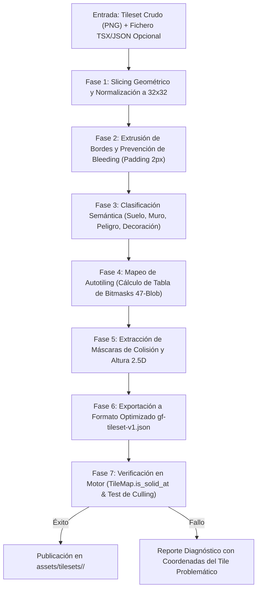

# MAP_AND_TILESET_PIPELINE.md — GAMEFORGE 2D
## Pipeline Automatizado de Tilesets, Autotiling, Capas de Colisión y Exportación de Mapas

**Estado:** ESPECIFICACIÓN TÉCNICA NORMATIVA  
**Misión:** MISIÓN 003 — Asset Ecosystem & GameForge Asset Hub  
**Fecha:** 2026-11-07  
**Autor:** Director / Arquitecto de Sistemas & Especialista en Pipeline de Arte  
**Compatibilidad:** `game.world.tilemap.TileMap` & Tiled / LDtk  

---

## 1. Resumen y Propósito del Pipeline

El **Map and Tileset Pipeline** es el subsistema encargado de transformar hojas de terreno crudas (*tilesheets*) en entornos interactivos, navegables y reproducibles por los generadores procedurales de GameForge 2D.

El pipeline garantiza:
1. **Slicing Geométrico Exacto y Prevención de Fisuras (*Seam Protection*):** Extracción limpia de tiles de 16x16 o 32x32 píxeles con corrección de sangrado de texturas.
2. **Clasificación Semántica Automatizada:** Separación de superficies transitables, muros sólidos, cornisas elevadas, trampas dañinas y accesorios decorativos.
3. **Autotiling Universal (Blob 47 y Wang 16):** Algoritmos deterministas para transiciones suaves de terreno (ej. hierba hacia tierra, caverna hacia lava).
4. **Capas con Profundidad 2.5D y Oclusión:** Mapeo de techos, copas de árboles y paredes frontales con ordenamiento por coordenada $Y$ (*Y-Sorting*).
5. **Cero Dependencias Pesadas en Runtime:** Conversión a matrices puras de enteros consumibles por `game.world.tilemap.TileMap` en tiempo $O(1)$.

---

## 2. Diagrama de Flujo del Pipeline de Mapas y Tilesets



---

## 3. Fases del Pipeline en Detalle

### Fase 1 y 2: Slicing, Normalización y Prevención de Fisuras (*Seam Bleeding*)

#### El Problema de las Fisuras en Tilesets
Al mover la cámara virtual de Pygame CE con coordenadas subpíxel (`float`) o al proyectar la resolución lógica de 1280x720 sobre monitores con escalado arbitrario, es frecuente que aparezcan "líneas parpadeantes" o fisuras de 1 píxel entre tiles adyacentes. Esto ocurre porque el rasterizador muestrea píxeles vecinos del tileset.

#### Solución: Extrusión de Bordes (*Atlas Tile Extrusion / Padding*)
El pipeline toma el tileset crudo y genera un atlas optimizado donde:
1. Cada tile de $32\times 32$ se aísla en una celda de $36\times 36$ (margen de 2 píxeles por lado).
2. Los píxeles de los 4 bordes del tile se copian (*bleed*) hacia el margen exterior.
3. Al renderizar, la textura nunca muestra artefactos del tile adyacente.

---

### Fase 3: Clasificación Semántica de Terrenos y Objetos

Cada tile del conjunto recibe una etiqueta funcional que el generador de mazmorras (`game.world.generation` y `game.world.cavern_generation`) utiliza directamente:

| Categoría | Propiedad Física | Ejemplo de Tiles | Comportamiento en `TileMap` |
| :--- | :--- | :--- | :--- |
| `GROUND_WALKABLE` | Transitable | Tierra lisa, empedrado, losas de mazmorra, arena | Multiplicador de velocidad = 1.0, daño = 0.0, sólido = False |
| `GROUND_SLOW` | Transitable lento | Barro espeso, hierba alta, agua poco profunda | Multiplicador de velocidad = 0.6, daño = 0.0, sólido = False |
| `HAZARD_DAMAGE` | Dañino continuo | Púas metálicas, suelo de lava, charco de ácido | Multiplicador de velocidad = 0.8, daño = 15.0/s, sólido = False |
| `WALL_SOLID` | Bloqueante | Muro frontal de piedra, pilar macizo, reja cerrada | Sólido = True, bloquea proyectiles y línea de visión |
| `WALL_TOP_LEDGE` | Cornisa superior | Techo o alféizar del muro vertical | Visualmente alto, permite caminar detrás con Y-Sort |
| `PIT_HOLE` | Vacío / Abismo | Precipicio, foso de agua profunda | Bloquea entidades terrestres; permite salto 2.5D |
| `PROP_INTERACTIVE` | Interactivo | Cofre del tesoro, hoguera de descanso, altar, palanca | Entidad asociada o trigger de evento de escena |
| `DECORATION_OVERLAY` | Puro adorno | Musgo en esquinas, grietas, manchas de sangre | Renderizado estético en Capa 1 sin colisión |

---

### Fase 4: Autotiling Universal (Blob 47 y Wang 16)

Para que los mapas generados proceduralmente o editados a mano luzcan orgánicos sin que el diseñador deba colocar manualmente cada esquina o borde:

#### Algoritmo 3x3 Blob Bitmasking (47 Tiles)
Se examinan los 8 vecinos inmediatos de cada celda $(x, y)$:
- Cardinales: Norte (N), Este (E), Sur (S), Oeste (W).
- Diagonales: Noroeste (NO), Noreste (NE), Suroeste (SO), Sureste (SE).

#### Regla de Dependencia de Esquinas
Una esquina diagonal solo se considera activa si ambos vecinos cardinales adyacentes son del mismo terreno (por ejemplo, NO solo cuenta si N y W son verdaderos). Esto reduce el espacio de combinaciones posibles de $2^8 = 256$ a exactamente 47 disposiciones canónicas.

```python
def compute_autotile_bitmask(grid: list[list[int]], x: int, y: int, terrain_id: int) -> int:
    """Calcula el bitmask canónico de 8 vecinos para autotiling de 47 tiles."""
    w, h = len(grid[0]), len(grid)
    
    def is_same(col: int, row: int) -> bool:
        if 0 <= col < w and 0 <= row < h:
            return grid[row][col] == terrain_id
        return True # El borde exterior se asume del mismo terreno
        
    n = is_same(x, y - 1)
    w_side = is_same(x - 1, y)
    e_side = is_same(x + 1, y)
    s = is_same(x, y + 1)
    
    nw = is_same(x - 1, y - 1) if (n and w_side) else False
    ne = is_same(x + 1, y - 1) if (n and e_side) else False
    sw = is_same(x - 1, y + 1) if (s and w_side) else False
    se = is_same(x + 1, y + 1) if (s and e_side) else False
    
    mask = 0
    if n:  mask |= 1
    if ne: mask |= 2
    if e_side: mask |= 4
    if se: mask |= 8
    if s:  mask |= 16
    if sw: mask |= 32
    if w_side: mask |= 64
    if nw: mask |= 128
    
    return mask
```

El pipeline genera una tabla de búsqueda (*Look-Up Table*) que asigna cada uno de los 47 valores de máscara al índice de fotograma exacto en el tileset.

---

### Fase 5: Paredes 2.5D, Colisión y Ordenamiento Y-Sort

En la perspectiva 3/4 de GameForge 2D, una pared vertical de piedra tiene una altura visual de 64 píxeles (2 tiles):
1. **Tile Superior (`Wall Top` - $Y$):** Representa la cornisa o superficie plana superior.
   - **Colisión:** NO sólida para los pies del jugador.
   - Si el jugador salta (salto 2.5D), colisiona con el borde del techo según el contrato de `player.py`.
2. **Tile Inferior (`Wall Base` - $Y+1$):** Representa la base donde la pared se une al suelo.
   - **Colisión:** Sólida al 100% (`is_solid_at` devuelve `True`).
   - Bloquea el círculo de colisión del jugador y enemigos (`move_circle`).
3. **Efecto de Oclusión:**
   - Si el personaje camina horizontalmente por encima del muro (en $Y$), el personaje se dibuja primero y la cornisa se dibuja encima, o el personaje queda visible por detrás según el orden de profundidad $Y$-Sort.

---

### Fase 6: Arquitectura de Capas para Alto Rendimiento

Para cumplir con la cuota de rendimiento de GameForge 2D (menos de 2.0 ms de tiempo de frame en $p95$ con más de 10,000 tiles en el mapa):
1. **Agrupamiento en Chunks (Trozos de $16\times 16$ tiles):**
   - El suelo estático (Capas 0 y 1) se prerenderiza en una superficie única por chunk mediante `pygame.Surface((512, 512)).convert()`.
   - Durante el bucle principal, solo se dibujan los chunks visibles en el frustum de la cámara (descarte espacial / *frustum culling* en $O(1)$ usando `SpatialHash`).
2. **Capa Dinámica con Y-Sort (Capa 2):**
   - Objetos altos, pilares, cofres y personajes se ordenan dinámicamente según su línea de contacto con el suelo:
     $$\text{depth\_key} = \text{entity.pos.y}$$
3. **Capa Superior / Canopy (Capa 3):**
   - Copas de árboles y techos de cabañas. Si el centro del jugador entra dentro del área de la copa, la superficie aplica una transparencia alfa de 120 para revelar al avatar en su interior.

---

### Fase 7: Especificación del Formato de Exportación `gf-tileset-v1.json`

El pipeline exporta el manifiesto del tileset listo para el motor:

```json
{
  "version": "gf-tileset-v1",
  "metadata": {
    "id": "dungeon_stone_crypt",
    "name": "Cripta de Piedra Subterránea",
    "tile_size": [32, 32],
    "author": "Kenney / GameForge Team"
  },
  "texture": {
    "image_path": "dungeon_stone_crypt.png",
    "width": 512,
    "height": 512,
    "extruded_padding": 2
  },
  "terrain_rules": {
    "stone_floor": {
      "base_tile": 0,
      "variants": [1, 2, 3],
      "variant_weights": [0.7, 0.15, 0.1, 0.05],
      "speed_multiplier": 1.0,
      "hazard_damage": 0.0,
      "is_solid": false
    },
    "stone_wall": {
      "autotile_type": "wang_16",
      "wang_table_map": {
        "0": 16, "1": 17, "2": 18, "3": 19,
        "4": 32, "5": 33, "6": 34, "7": 35
      },
      "is_solid": true,
      "blocks_los": true
    },
    "spike_trap": {
      "base_tile": 64,
      "is_solid": false,
      "hazard_damage": 20.0,
      "speed_multiplier": 0.7
    }
  }
}
```
