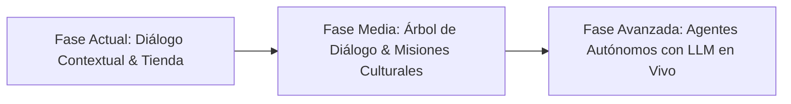

# GAMEFORGE 2D — Integración de NVIDIA Nemotron-Personas-El-Salvador

Este documento detalla el uso, la arquitectura de implementación, la atribución legal y la hoja de ruta aspiracional para la integración del dataset oficial de personas sintéticas **`nvidia/Nemotron-Personas-El-Salvador`** dentro del videojuego **GAMEFORGE 2D**.

---

## 1. Ficha Técnica y Atribución Legal

* **Dataset Oficial**: [`nvidia/Nemotron-Personas-El-Salvador`](https://huggingface.co/datasets/nvidia/Nemotron-Personas-El-Salvador)
* **Plataforma**: Hugging Face Datasets
* **Organización**: NVIDIA Corporation (en colaboración con la iniciativa global Sovereign AI y socios locales)
* **Licencia**: **Creative Commons Attribution 4.0 International (CC BY 4.0)**
* **Fundamento Estadístico**: Datos demográficos, geográficos, laborales y culturales representativos de la población de la República de El Salvador.

---

## 2. ¿Por qué es importante esta integración?

En la mayoría de videojuegos RPG tradicionales, los personajes no jugadores (NPCs) sufren de dos problemas comunes:
1. **Arquetipos planos o genéricos**: Comerciantes o ancianos sin identidad propia, historia ni personalidad consistente.
2. **Desconexión cultural**: Diálogos homogéneos basados en convenciones de fantasía medieval europea estándar.

Al fundamentar los personajes de GAMEFORGE 2D en perfiles sintéticos rigurosos basados en datos reales de El Salvador:
* **Autenticidad de trasfondo**: Cada personaje tiene edad, departamento, municipio, trayectoria laboral real de décadas, patrones familiares, preferencias gastronómicas y sesgos conductuales bien definidos.
* **Mecánicas derivadas de su oficio real**: En lugar de inventar roles arbitrarios, las habilidades del NPC en el juego se desprenden orgánicamente de su experiencia laboral en el mundo real.
* **Preparación para IA Agéntica/LLMs**: Estos perfiles proporcionan un *system prompt* rico y estructurado, permitiendo que en el futuro los NPCs mantengan conversaciones abiertas con coherencia psicológica total sin alucinar personalidades inconsistentes.

---

## 3. Personajes Implementados en el Hub del Juego

Los datos oficiales se encuentran archivados y procesados en [`game/data/personas_el_salvador.json`](game/data/personas_el_salvador.json) y referenciados en el mapa del pueblo [`game/data/maps/hub_town.json`](game/data/maps/hub_town.json).

### 1. Doña Rosa — Mercader y Abastecedora
* **UUID Oficial**: `108fefeb-c9f6-4429-8ce1-a67eaad444ef`
* **Demografía**: 39 años, La Libertad Centro, La Libertad.
* **Oficio en el Dataset**: Venta al por menor de alimentos, bebidas y tabaco en puestos de mercado (más de 15 años de experiencia, trato cálido, resolución rápida de imprevistos, gestión de caja).
* **Rol en GAMEFORGE**: 
  * Encargada del puesto de víveres del Hub.
  * Venta de *Frascos de Brasa* (pociones curativas) por monedas recolectadas en la mazmorra.
  * Tono conversacional: Práctico, hospitalario y enérgico.

### 2. Maestro José — Constructor y Forjador de Estructuras
* **UUID Oficial**: `2e2bca1d-f265-4214-beb3-858d676f2907`
* **Demografía**: 51 años, Santa Ana Oeste, Santa Ana.
* **Oficio en el Dataset**: Construcción de edificios (más de 30 años de experiencia, lectura de planos estructurales, armado de hormigón y perfiles de acero, trabajo manual firme).
* **Rol en GAMEFORGE**:
  * Asesor técnico de la Fragua y herrero.
  * Evalúa el temple de las armas y la resistencia del equipo ante el calor de la lava.
  * Tono conversacional: Sobrio, minucioso y enfocado en la resistencia estructural.

### 3. Don Antonio (Toño) — Sabio Archivista y Guía
* **UUID Oficial**: `0b125a4d-c467-4cc5-8789-968ae1ba7f01`
* **Demografía**: 88 años, Santa Ana Centro, Santa Ana.
* **Oficio en el Dataset**: Gestión y archivo de historias clínicas, recepción y control riguroso de insumos médicos en el Hospital Regional de Santa Ana durante más de 70 años. Puntual, metódico y temeroso de errores en registros.
* **Rol en GAMEFORGE**:
  * Guardián del Altar y custodio de la memoria de la Fragua.
  * Supervisa con precisión milimétrica el conteo de Fragmentos Solares obtenidos.
  * Tono conversacional: Formal, sobrio, estricto con los números, pero paternal con la salud de los aventureros.

---

## 4. Estado Actual de la Implementación (En Código)

* **Extracción limpia**: Script offline en `tools/extract_hub_personas.py` que consulta la API de Hugging Face y formatea los metadatos sin dependencias externas en tiempo de ejecución.
* **Módulo de simulación pura**: [`game/sim/dialog.py`](game/sim/dialog.py) desacoplado de Pygame, compatible con tests automatizados.
* **Detección espacial**: [`game/sim/interaction.py`](game/sim/interaction.py) reconoce la presencia de los NPCs a menos de 56 px del jugador y proyecta en el HUD la opción de interacción (`[E] Hablar con...`).
* **Comercio funcional**: `buy_potion(inventory, cost=15)` ejecuta intercambios atómicos verificando monedas y capacidad de inventario.
* **Batería de pruebas**: `tests/test_npc_dialog.py` verifica la preservación de los UUIDs, atribución del dataset y lógica de diálogos contextuales.

---

## 5. Aspiraciones y Visión Futura (Roadmap)

La meta de GAMEFORGE 2D no es dejar a estos personajes como texto estático, sino evolucionarlos en 3 horizontes:

### 1. Corto Plazo: Ventana de Diálogo Estilo RPG Clásico
* Implementar una interfaz gráfica de diálogo (caja de texto con retrato y opciones múltiples `[1]`, `[2]`, `[3]`).
* Menú interactivo de compra/venta para Doña Rosa.
* Módulo de reparación y mejora de armas con Maestro José.
* Consulta de registro de enemigos (Bestiario) con Don Antonio.

### 2. Mediano Plazo: Sistema de Misiones de Identidad
* Crear misiones secundarias basadas en los perfiles:
  * **Don Antonio**: Encontrar registros perdidos de expediciones pasadas en el Piso 2 (Cavernas).
  * **Doña Rosa**: Conseguir ingredientes raros de wisps o plantas subterráneas.
  * **Maestro José**: Extraer muestras minerales de basalto para aleaciones térmicas.

### 3. Largo Plazo: Integración de IA Generativa Local / API
* **Inyección de Perfil Nemotron**: Usar los campos `professional_persona`, `cultural_background` y `skills` como *System Prompt* de un modelo de lenguaje (como modelos Nemotron de NVIDIA, Gemini o modelos locales ONNX).
* **Conversación libre en lenguaje natural**: El jugador podrá escribir directamente preguntas a Don Antonio o Doña Rosa y ellos responderán manteniendo su identidad, léxico, restricciones de edad y trasfondo regional de forma dinámica y no determinista.
