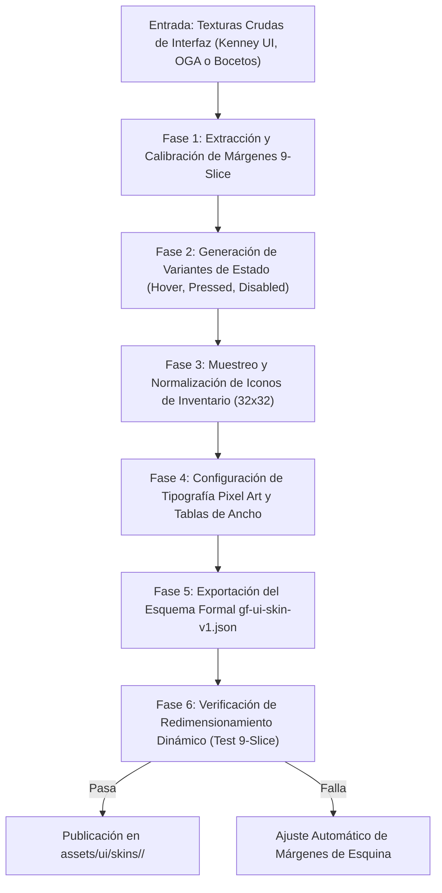

# UI_ASSET_PIPELINE.md — GAMEFORGE 2D
## Pipeline de Componentes de Interfaz, Escalado 9-Slice, Tipografía Retro y Generación Procedural de HUD

**Estado:** ESPECIFICACIÓN TÉCNICA NORMATIVA  
**Misión:** MISIÓN 003 — Asset Ecosystem & GameForge Asset Hub  
**Fecha:** 2026-11-07  
**Autor:** Director / Arquitecto de Sistemas & Especialista en Pipeline de Arte  
**Compatibilidad:** `game.render.canvas.VirtualCanvas` (1280x720)  

---

## 1. Resumen y Principios del Sistema UI

El **UI Asset Pipeline** gestiona el ciclo de vida completo de los elementos visuales de la interfaz de usuario en **GameForge 2D**: menús principales, pantallas de inventario, cajas de diálogo narrativo, barras de estado de vida y maná, y ventanas modales de fabricación (*crafting*).

### Principios Normativos
1. **Escalado Vectorial o 9-Slice Estricto:** Ningún panel, ventana o botón debe deformar sus bordes artísticos al redimensionarse.
2. **Compatibilidad con el Lienzo Virtual (1280x720):** La interfaz se proyecta sobre la resolución lógica fija de GameForge 2D y se escala de manera íntegra preservando la nitidez de píxel (*nearest neighbor* o escalado entero).
3. **Máquina de Estados Visual:** Todo control interactivo debe proveer retroalimentación visual clara para los 5 estados canónicos (`normal`, `hover`, `pressed`, `focused`, `disabled`).
4. **Fallback Procedural Garantizado:** Si falta una textura de interfaz o se ejecutan pruebas automatizadas en entornos sin dependencias gráficas externas, el sistema debe sintetizar paneles y botones geométricos limpios mediante primitivas de Pygame CE.

---

## 2. Diagrama de Flujo del Pipeline UI



---

## 3. El Motor de Escalado 9-Slice (9-Patch)

### 3.1. Fundamento Matemático
Una imagen fuente de dimensiones $W_s \times H_s$ se divide en 9 zonas rectangulares mediante 4 márgenes: $M_{\text{top}}$, $M_{\text{right}}$, $M_{\text{bottom}}$, $M_{\text{left}}$.

```
   0          M_left              W_s - M_right        W_s
0  +------------+-----------------------+------------+
   | (1) NO     | (2) Borde Norte       | (3) NE     | M_top
   | Esquina fija| Se estira en X        | Esquina fija|
   +------------+-----------------------+------------+
   | (4) Borde O| (5) Centro Interior   | (6) Borde E|
   | Se estira Y| Se estira en X e Y    | Se estira Y|
   +------------+-----------------------+------------+
   | (7) SO     | (8) Borde Sur         | (9) SE     | H_s - M_bottom
   | Esquina fija| Se estira en X        | Esquina fija|
H_s+------------+-----------------------+------------+
```

Cuando el componente se solicita a un tamaño de destino arbitrario $W_d \times H_d$ (donde $W_d \ge M_{\text{left}} + M_{\text{right}}$ y $H_d \ge M_{\text{top}} + M_{\text{bottom}}$):
- Las **4 esquinas** se copian a escala $1:1$ sin transformación alguna, garantizando que los biseles de oro, tachuelas o sombras no se distorsionen.
- Los **4 bordes** se escalan en una sola dimensión mediante `pygame.transform.scale`:
  - Bordes Norte y Sur: escala de ancho a $W_d - (M_{\text{left}} + M_{\text{right}})$, alto fijo.
  - Bordes Este y Oeste: escala de alto a $H_d - (M_{\text{top}} + M_{\text{bottom}})$, ancho fijo.
- El **centro interior** se escala a $(W_d - M_{\text{left}} - M_{\text{right}}, H_d - M_{\text{top}} - M_{\text{bottom}})$.

### 3.2. Implementación de Alto Rendimiento en Pygame CE
Para evitar llamadas costosas a `pygame.transform.scale` en cada fotograma:
- El resultado del renderizado 9-slice para un tamaño específico $(W_d, H_d)$ se almacena en una caché LRU en memoria indexada por `(skin_id, element_name, state, W_d, H_d)`.
- Si el tamaño de la ventana o panel no cambia, el coste por frame es un simple blit $O(1)$.

---

## 4. Máquina de Estados para Controles Interactivos

Los elementos interactivos (botones de menú, casillas de inventario, pestañas) presentan 5 estados visuales obligatorios:

| Estado | Significado | Tratamiento Visual por Defecto |
| :--- | :--- | :--- |
| `normal` | Estado en reposo, disponible para pulsar | Textura base con borde estándar |
| `hover` | Cursor sobre el elemento o foco con mando | Aumento de brillo (+15% luminancia), borde iluminado |
| `pressed` | Botón presionado por ratón o tecla `Enter` | Desplazamiento del contenido 1 píxel hacia abajo y derecha; sombra atenuada |
| `focused` | Seleccionado por navegación de teclado/gamepad | Borde parpadeante o cursor indicador en forma de daga |
| `disabled` | Acción no disponible (ej. falta de maná o materiales) | Conversión a escala de grises al 50% de opacidad |

#### Generación de Variantes sin Shaders
Si el activo original solo incluye el estado `normal`, el pipeline sintetiza los demás estados algorítmicamente mediante operaciones en el array de píxeles:
```python
def generate_hover_surface(surface: pygame.Surface) -> pygame.Surface:
    """Incrementa la luminancia para generar el estado hover."""
    hover_surf = surface.copy()
    hover_surf.fill((30, 30, 30), special_flags=pygame.BLEND_RGB_ADD)
    return hover_surf

def generate_disabled_surface(surface: pygame.Surface) -> pygame.Surface:
    """Aplica escala de grises y reduce alfa para el estado disabled."""
    disabled_surf = surface.copy()
    # Conversión a escala de grises usando pesos luminosos estándar (Rec. 601)
    arr = pygame.surfarray.pixels3d(disabled_surf)
    gray = (arr[:, :, 0] * 0.299 + arr[:, :, 1] * 0.587 + arr[:, :, 2] * 0.114).astype('uint8')
    arr[:, :, 0] = gray
    arr[:, :, 1] = gray
    arr[:, :, 2] = gray
    del arr # Libera el bloqueo de la superficie
    disabled_surf.set_alpha(140)
    return disabled_surf
```

---

## 5. Tipografía Retro y Renderizado de Textos

### 5.1. Fuentes TrueType Pixel Art (`.ttf`)
- **Regla de oro de rasterizado:** Al renderizar texto de píxel en Pygame CE, el parámetro de antialiasing debe ser estrictamente `False`:
  `font.render(text, False, text_color)`
  Esto evita los bordes borrosos y garantiza que cada glifo conserve sus aristas nítidas de 1 bit.
- **Tamaños Enteros:** Las fuentes tipográficas de píxel solo deben renderizarse en múltiplos exactos de su altura base de diseño (típicamente 8px, 16px, 24px o 32px).

### 5.2. Fuentes Bitmap (Texture Font Atlases)
Para diálogos estilizados con bordes dorados, sombras integradas o glifos con paleta multicolor:
- El pipeline soporta hojas de fuentes donde cada carácter se mapea mediante una tabla de anchos de paso (*character advance table*).
- Cero dependencia de librerías de fuentes externas del sistema operativo; todo el texto se compone directamente mediante blits directos de texturas en memoria.

---

## 6. Iconografía y Ranuras de Inventario

1. **Resolución Unificada:** Todos los iconos de objetos (armas, consumibles, materiales de crafteo) se normalizan a un marco de $32\times 32$ píxeles.
   - Si un icono original mide $16\times 16$, se escala con filtro *nearest neighbor* a $32\times 32$.
   - Si no es cuadrado, se centra añadiendo márgenes transparentes uniformes.
2. **Marcos de Rareza Dinámicos:**
   El pipeline compone dinámicamente un borde exterior coloreado según la calidad del ítem:
   - *Común:* Borde de hierro gris (`#8a8a8a`).
   - *Poco Común:* Borde de jade verde (`#2ecc71`).
   - *Raro:* Borde de zafiro azul (`#3498db`).
   - *Épico:* Borde de amatista púrpura (`#9b59b6`).
   - *Legendario:* Borde de oro resplandeciente (`#f1c40f`).

---

## 7. Motor de Fallback Procedural (Sin Dependencias Externas)

Para cumplir con la directiva de robustez absoluta de GameForge 2D (el juego y los tests deben funcionar incluso si la carpeta de assets externos está vacía):

```python
class ProceduralSkinFallback:
    """Generador procedural de componentes de interfaz sin archivos externos."""
    
    @staticmethod
    def create_panel(width: int, height: int, bg_color=(24, 20, 36), border_color=(190, 150, 90)) -> pygame.Surface:
        surf = pygame.Surface((width, height), pygame.SRCALPHA)
        # Fondo oscuro semitransparente
        surf.fill((*bg_color, 230))
        # Borde exterior doble estilo pergamino medieval
        pygame.draw.rect(surf, border_color, (0, 0, width, height), width=2)
        pygame.draw.rect(surf, (border_color[0]//2, border_color[1]//2, border_color[2]//2), (2, 2, width-4, height-4), width=1)
        # Remaches en las 4 esquinas
        for cx, cy in [(4, 4), (width-5, 4), (4, height-5), (width-5, height-5)]:
            pygame.draw.circle(surf, (230, 200, 110), (cx, cy), 2)
        return surf

    @staticmethod
    def create_health_bar(width: int, height: int, fill_pct: float) -> pygame.Surface:
        surf = pygame.Surface((width, height), pygame.SRCALPHA)
        # Fondo vacío
        surf.fill((40, 10, 10))
        # Relleno de vida
        fill_w = int(max(0.0, min(1.0, fill_pct)) * (width - 4))
        if fill_w > 0:
            pygame.draw.rect(surf, (220, 40, 40), (2, 2, fill_w, height - 4))
            # Brillo superior
            pygame.draw.line(surf, (255, 120, 120), (2, 2), (2 + fill_w - 1, 2))
        # Borde metálico
        pygame.draw.rect(surf, (160, 160, 160), (0, 0, width, height), width=1)
        return surf
```

---

## 8. Formato de Salida `gf-ui-skin-v1.json`

```json
{
  "version": "gf-ui-skin-v1",
  "metadata": {
    "skin_id": "fantasy_parchment",
    "display_name": "Pergamino Medieval con Bisel Dorado",
    "author": "Kenney / GameForge UI Team"
  },
  "texture_atlas": "fantasy_parchment_atlas.png",
  "components": {
    "dialog_box": {
      "type": "9_slice",
      "source_rect": [0, 0, 96, 96],
      "margins": [24, 24, 24, 24],
      "min_dimensions": [128, 80]
    },
    "button_primary": {
      "type": "9_slice",
      "states": {
        "normal": { "source_rect": [96, 0, 48, 48], "margins": [12, 12, 12, 12] },
        "hover": { "source_rect": [144, 0, 48, 48], "margins": [12, 12, 12, 12] },
        "pressed": { "source_rect": [192, 0, 48, 48], "margins": [12, 12, 12, 12] },
        "disabled": { "source_rect": [240, 0, 48, 48], "margins": [12, 12, 12, 12] }
      }
    },
    "inventory_slot": {
      "type": "fixed",
      "source_rect": [0, 96, 36, 36],
      "inner_content_rect": [2, 2, 32, 32]
    }
  }
}
```
